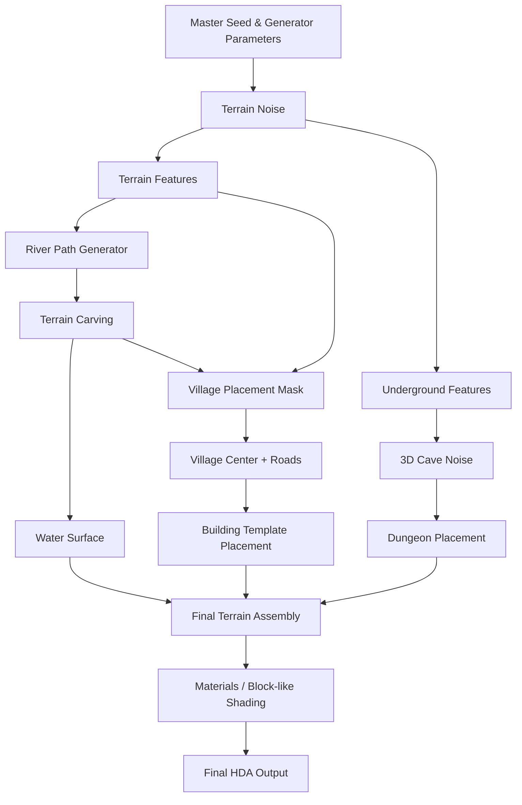

  

# Final Project Design Document — Procedural Minecraft-Like Terrain Chunk

  

  

> A “chunk” referes generally to one square-based area of some height, not Minecraft’s exact 16×16-block chunk size. The tile will be large enough to contain a village, dungeon, some body of water, and a cave.

>

> This project will not necessarily duplicate the blocky visual of Minecraft

  

  

## Introduction

  

  

This project is motivated by the way *Minecraft* builds a large, coherent world from relatively simple procedural rules. Terrain shape, caves, rivers, structures, and biome-like regions are generated from a seed instead of being modeled by hand. The goal of this project is to reproduce that idea on a much smaller scale in Unity.

  

  

The project will generate one complete terrain tile that visibly demonstrates several layers of procedural generation working together. Rather than attempting to reproduce Minecraft exactly, the project will focus on the recognizable design language of its world generation, such as seeded noise, modular structures, rule-based placement, and underground volumetric carving.

  

  

## Goal

  

  

The goal is to create a Unity project/C# generator that generates a single Minecraft-inspired terrain tile from a seed.

  

  

Each generated tile should contain:

  

  

- An overworld terrain surface.

  

- One body of water (river or lake) at the surface of the terrain.

  

- One small procedurally assembled village.

	- For the scope of this project, the design of the buildings in the village will not be procedual, only the placement of them.

  

- One underground dungeon.

  

- A cave (random carvings in a solid region) below the surface

  

- Basic material/biome variation such as grass, dirt, stone, and water.

  

- Exposed generator controls for important parameters such as seed, terrain scale, village size, etc.

  

  

The final result should be deterministic: using the same seed and parameters should regenerate the same terrain.

  

  

## Inspiration/reference

  

  

The primary visual and technical inspiration is *Minecraft* world generation. Minecraft builds terrain in multiple procedural passes, beginning with seeded noise and adding biome and feature information afterward.

  

  

### Minecraft world generation

  

  

Microsoft’s Minecraft Creator documentation gives a high-level description of the world-generation pipeline. It explains that terrain begins from seeded gradient noise, followed by additional passes for biome and feature placement.

  

  

- [Minecraft World Generation Overview — Microsoft Learn](https://learn.microsoft.com/en-us/minecraft/creator/documents/world-generation?view=minecraft-bedrock-stable)

  

  

Reference image — village, terrain, and river:

  

  

  

  

### Minecraft villages and modular structures

  

  

Minecraft villages are assembled from pools of structure pieces rather than being one fixed model. The Java Edition jigsaw system randomly selects compatible structure templates and connects them while checking whether pieces can be placed.

  

  

- [Jigsaw Structure — Minecraft Wiki](https://minecraft.wiki/w/Jigsaw_structure)

  

- [Village — Minecraft Wiki](https://minecraft.wiki/w/Village)

  

  

This project will use a simplified version of the same idea. a small library of house, farm, path, and decoration modules will be selected and placed according to procedural rules.

  

  

### Minecraft cave generation

  

  

Modern Minecraft uses 3D noise as part of cave generation. Noise parameters control cave frequency, hollowness, and thickness, producing large chambers as well as thin winding tunnels.

  

  

- [Noise Settings — Minecraft Wiki](https://minecraft.wiki/w/Noise_settings)

  

- [Cave Generation — Minecraft Wiki](https://minecraft.wiki/w/Cavern)

  

  

  

  

## Specification

  

  

### 1. Base terrain

  

  

The system will create one square terrain tile.

  

  

The terrain will combine one or multiple scales of noise. This depends on how much the blocky visual preserves the detailed noises.

  
  

The overall dimensions and height range will be parameterized.

  

  

### 2. Body of water

  

  

A body of water, likely a river, will be included.

  

  

The river system will:

  

  

- Generate an area over the terrain.

  

- Lower terrain inside the area to form the riverbed.

  

- Add a water surface at a controlled water level.

  

- Prevent village buildings from spawning directly inside the river.

  

  

The river will not necessarily be animated

  

  

### 3. Village

  

  

One village will be generated on a relatively flat area near the surface.

  

  

The village will contain approximately:

  

  

- 3–5 small building modules.

  

- One or more farms.

  

- Zero or one well

  

- Paths connecting buildings.

  

  

The village generator will:

  

  

1. Find terrain that is sufficiently flat and above water level.

  

2. Choose a village center.

  

3. Generate candidate building positions around the center.

  

4. Reject positions that overlap the river, steep terrain, or other buildings.

  

5. Randomly select building modules from a template pool.

  

6. Orient buildings toward nearby paths or the village center.

  

7. Project buildings to the terrain height.

  

  

### 4. Dungeon

  

  

One underground dungeon will be generated in the underground layer (about layer 60 to 80).

  

  

The dungeon will contain serveral rooms. Each room will have further details in time permits.

  

  

A seeded random walk or simple room graph will select and connect modules. Collision checks will prevent rooms from overlapping incorrectly.

  

  

### 5. Cave system

  

  

The lower terrain will contain procedural caves (around layer 0 to 60) generated with 3D noise and/or volumetric geometry.

  

### 7. Seed and controls

  

  

The final generator should expose at least:

  

  

-  `Seed`

  

-  `Terrain Size`

  

-  `Water Level`

  

-  `Dungeon Height`

  

-  `Cave Height`

  

  

Changing the seed should produce a visibly different but structurally valid tile.

  

  

## Techniques

  

  

### Seeded noise

  

  

Seeded noise will provide large-scale randomness without the discontinuities of independent random values. Multiple octaves/scales will be layered to produce both large terrain forms and smaller detail. Different applications of the noises could also produce different features over the terrain

  

### Bounding boxes and collision tests

  

  

Building and dungeon modules will use bounding boxes to test whether new pieces overlap previously placed pieces or forbidden terrain regions.

  

  

### Volumetric cave carving

  

  

Caves require overhangs and enclosed spaces, so a heightfield alone is not sufficient. The cave section will therefore use true 3D geometry/volumes.

  

  

A 3D noise field can be thresholded into cave-shaped regions and subtracted from a solid terrain volume.

  
  

## Design

  
  

  

  

  

## Timeline

  

  

### Week 1 — Terrain and river foundation

  

  

- Build the generator and expose the first seed/terrain parameters.

  

- Generate the base terrain shapes.

  

- Generate slope, elevation, and water areas.

  

- Build the first procedural river curve.

  

- Carve the river into the HeightField.

  

- Add the water surface.

  

- Confirm that changing the seed produces stable, repeatable terrain.

  

  

**Milestone 1:** A complete surface terrain tile with a procedural river.

  

  

### Week 2 — Village generation

  
  

  

- Model a small reusable library of village modules.

  

- Create building footprints/bounding boxes.

  

- Detect flat terrain suitable for village placement.

  

- Select a village center.

  

- Generate candidate building locations.

  

- Reject buildings that collide with the river, steep slopes, or other buildings.

  

- Randomly select and orient building modules.

  

- Generate simple village paths.

  

  

**Goal of the Week:** One procedural village that successfully adapts to different terrain seeds.

  

  

### Week 3 — Caves and dungeon

  

  

- Convert/build the underground terrain representation needed for volumetric carving.

  

- Implement 3D noise caves.

  

- Tune cave density and scale.

  

- Create the modular dungeon room library.

  

- Implement seeded dungeon room/path placement.

  

- Prevent major dungeon self-intersections.

  

- Create the depth-based Nether region.

  

- Add lava pools/channels and basic Nether-style materials.

  

  

**Milestone 2:** One procedural village that successfully adapts to different terrain seeds, and an underground cave network, one dungeon, and a distinct Nether-like lower layer.

  

  

### Week 4 — Integration, polish, and presentation

  
  

  

- Combine all systems into the final generator.

  

- Fix dependencies between river, village, dungeon, and cave generation.

  

- Clean up exposed parameters.

  

- Test several seeds and identify failure cases.

  

- Add final materials and lighting.

  

- Add optional props if time remains.

  

- Optimize expensive operations.

  

- Create final screenshots and/or turntable.

  

- Prepare the final presentation showing how the same asset changes under multiple seeds.

  

  

**Milestone 3:** A stable final Unity asset package that can generate multiple visually distinct terrain tiles from different seeds.

## Milestone 1

Changed the project target from Houdini HDA to a Unity project (Sections above changed accordingly)

Implemented the terrain, body of water, and cave generations
 - The finer details produced by multi-octave noises are not very visible with the blocky visual. Thus, the overall terrain shape uses one single noise. However, other features such as water and caves, uses their respective noises. 
 - It turned out the cave generation is similar to the river generation. Thus, it is implemented this week. Week 3, while originally planned for the cave subsystem, will now be dedicated to underground structures.

### Note on Submission

I forgot to create a pull request for the design doc, but as the commit history shows, it was uploaded by the deadline. 