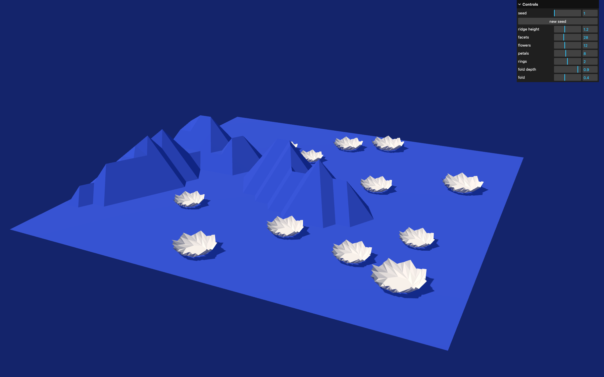
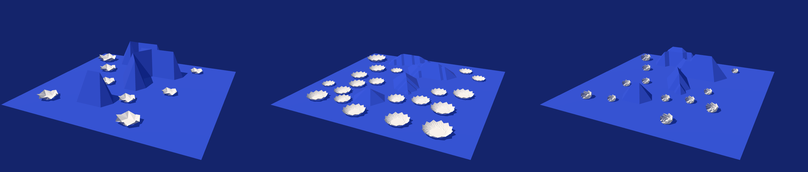

# Paperworld: A Procedural Origami Landscape

**CIS 5660 Final Project Design Doc**  
**Ximing Luo**

## Introduction

I want to explore a landscape that appears to fold itself out of paper as the viewer moves through it. The focus is generating the geometry and folding motion procedurally rather than relying on premade models.

## Goal

Build an interactive 3D paper world with faceted terrain and origami flowers that unfold as the camera approaches. Different seeds and parameters should produce visibly different scenes.

## Inspiration and Reference

**Bloom patterns by Zhongyuan Wang, Robert J. Lang, and Larry L. Howell.** A family of origami patterns that open like blooming flowers. This is kind of the look and motion I want for the flowers. [BYU article](https://news.byu.edu/intellect/the-next-chapter-in-byus-origami-engineering-student-discovered-patterns-unfold-like-blooming-flowers-have-major-applications)


*Image: BYU Photo.*

Papers:

* [Bloom Patterns](https://doi.org/10.1098/rspa.2025.0299) (Wang, Lang, Howell 2025): flower crease patterns
* [Origami Simulator](https://erikdemaine.org/papers/OrigamiSimulator_Origami7/) (Ghassaei, Demaine, Gershenfeld 2018): interactive folding
* [Freeform Variations of Origami](https://tsg.ne.jp/TT/cg/TachiFreeformOrigami2010.pdf) (Tachi 2010): faceted paper surfaces
* [Real Time Approximations to Subsurface Scattering](https://developer.nvidia.com/gpugems/gpugems/part-iii-materials/chapter-16-real-time-approximations-subsurface-scattering) (GPU Gems 2004): light through thin paper

## Specification

1. Generate a small landscape with seeded ridges and flat paper facets.
2. Procedurally generate one origami flower family with adjustable petal count and fold depth.
3. Animate flowers opening when the camera approaches, with a manual fold slider.
4. Render paper with custom crease shading, subtle texture, and light passing through thin surfaces.

The core project uses a bounded scene and one object family. Trees, towers, and arbitrary 3D model conversion are stretch goals.

## Techniques

1. **Procedural geometry:** Build terrain and flower meshes from vertices, faces, random seeds, and simple crease patterns.
2. **Folding animation:** Transform connected faces around defined fold lines. I will use a restricted pattern instead of a general folding solver.
3. **Rendering:** Use Three.js and custom GLSL shaders for faceted lighting, crease darkening, and approximate paper translucency.

## Design

```text
Seed and controls
       ↓
Terrain and flower generators
       ↓
Meshes and folding animation
       ↓
Paper shader and camera
       ↓
Interactive landscape
```

## Timeline

**Nov 4:** Finalize the proposal and get scope approval.  
**Nov 5 to 11:** Implement procedural terrain, flower geometry, and basic folding.  
**Nov 12 to 23:** Add exploration interaction, controls, paper shading, and finish core features.  
**Nov 24 to 30:** Polish lighting, animation, final visuals, and presentation.

## Milestone #1

Terrain, flower geometry, and basic folding all work. Shading is a placeholder for now.

* The terrain is a sheet of triangles. A few seeded ridges follow the grid lines, so every slope is a flat facet.
* Each flower is a Yoshimura bloom pattern, a center polygon with a pinwheel of split rhombi around it. Petal count and ring count are sliders.
* The pattern would not fold by rotating faces one at a time, so folding uses the bar and hinge solver from Origami Simulator. It runs once per flower type, and the fold slider blends between the saved poses.
* The seed also scatters the flowers on flat ground.

Run it with `npm install` and then `npm run dev`.

Next up are flowers that open when the camera gets close and the paper shader.

Stretch goals: a camera that walks through the landscape, ridges that fold up as it gets close, a day and night cycle where the flowers close at night, a paper sky with a sun and clouds, more flower variety and trees, and a tilt shift blur.

### Output



Example seeds.


Fold slider from 0 to 1.


Different petal and ring counts.


Same seed, different parameters.


