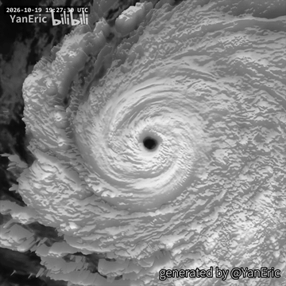
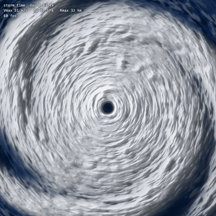
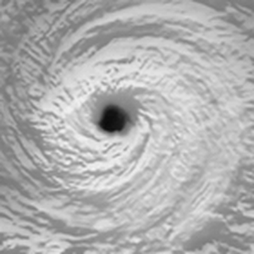
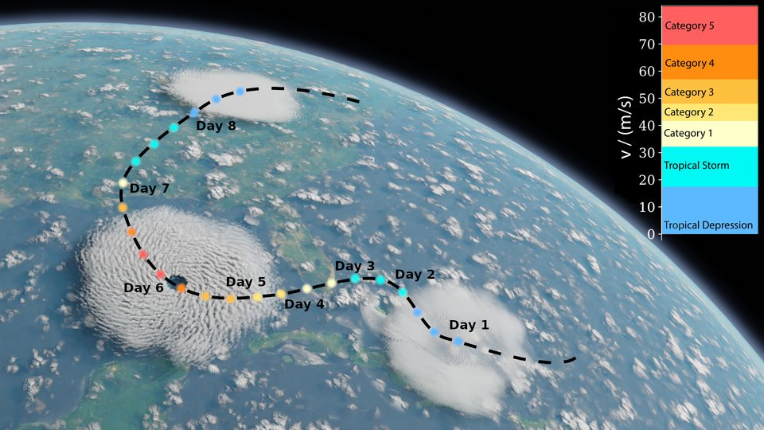
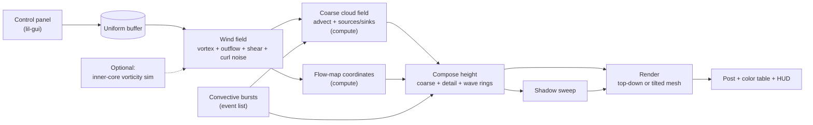

# TyphoonMaster: Procedural Typhoon in WebGPU

A real-time, procedurally generated typhoon seen from above, the way a weather satellite sees it, rendered in the browser with WebGPU. A control panel controls both the storm's structure and how it looks. Live demo link [here](https://typhoon.tonyxtian.com).

Visual target: a 3D-shaded Himawari infrared loop by YanEric (<a href="https://www.bilibili.com/video/BV1934K6VEfo/">bilibili BV1934K6VEfo</a>).

---

## Milestone 1

Milestone 1 result, captured from the running page: about 7 storm hours in 6 seconds.

The whole pipeline runs end to end in real time (120 fps at 2048² on M5 Max):

- **Wind field.** Holland wind profile with outflow that turns anticyclonic far from the center, plus radial outflow at cloud-top level. A debug view shows speed as color and direction as arrows.
- **Coarse cloud simulation.** A 512² cloud-top height field, moved by the wind with semi-Lagrangian advection on a fixed 60 s tick. Cloud is added at the eyewall and along logarithmic-spiral rainbands, and removed by eye clearing and gradual decay.
- **Fine detail.** Streaked, terraced noise in log-polar coordinates, carried by a two-phase flow map whose reset period shortens where the shear is strong.
- **Rendering.** Infrared brightness from height, low-sun relief lighting with shadows, over a blue ocean.
- **Control panel.** Storm, structure, detail, lighting/view, and simulation folders.

---

## Design Doc

### Introduction

Satellite loops of a mature typhoon are among the most striking images in nature: a clear eye, a smooth spinning cloud mass, spiral rainbands, and storm tops boiling up through the cirrus. Most of that structure comes from a few rules:

- a characteristic wind profile;
- outflow that spreads at the top of the storm;
- spiral rainbands;
- bursts of deep convection.

That makes a typhoon a good subject for procedural generation. The reference animation adds a second motivation. It shows that infrared satellite data, rendered as lit 3D relief, already looks like a landscape of clouds. This project aims to generate that look from scratch in real time, with no real weather data.

### Goal

Build a web page that:

- renders an animated, satellite-style typhoon that is recognizably like the reference, entirely procedurally;
- exposes the storm's physical parameters (intensity, eye size, rainbands, outflow, shear) and its look (lighting, relief, color tables) in a control panel;
- runs in real time on a laptop GPU. WebGPU compute shaders handle the simulation, but the per-frame compute stays light. There are no volumetric clouds and no 3D fluid grids.

### Inspiration/reference

**Visual references**

| Reference | Credit |
|---|---|
|  | Close-up of the reference GIF's eye: sloped eyewall, short arcs sheared along the flow, ripples in the cirrus |
|  | Amador Herrera et al., [*Cyclogenesis: Simulating Hurricanes and Tornadoes*](https://storage.googleapis.com/pirk.io/papers/Amador-Herrera.etal-2024-Cyclogenesis.pdf), SIGGRAPH 2024, Fig. 1 (CC BY 4.0). The closest graphics work, a full 3D physical simulation. |

Real Himawari infrared loops for comparison: [RAMMB SLIDER](https://slider.cira.colostate.edu/).

**Typhoon structure and wind**
- Huang et al. 2021, [*Typhoon wind hazard estimation by full-track simulation*](https://doi.org/10.1016/j.jweia.2021.104792): Holland pressure/wind profile and empirical fits for eye radius and profile shape.
- Holland 1980, [*An analytic model of the wind and pressure profiles in hurricanes*](https://doi.org/10.1175/1520-0493%281980%29108%3C1212:AAMOTW%3E2.0.CO;2).
- Willoughby, Darling & Rahn 2006, [*Parametric representation of the primary hurricane vortex, Part II*](https://faculty.fiu.edu/~willough/PUBS/HEWetal_PROFILES_06.pdf): alternative wind profile.
- Houze 2010, [*Clouds in Tropical Cyclones*](https://www.atmos.washington.edu/MG/PDFs/MWR10_Houze_CloudsTropCyc.pdf): eye, eyewall, rainband types, outflow, shear asymmetry.
- Dvorak 1984, [*Tropical cyclone intensity analysis using satellite data*](https://repository.library.noaa.gov/view/noaa/19322): how forecasters read cloud patterns in satellite images.
- Kossin & Schubert 2001, [*Mesovortices, polygonal flow patterns…*](https://ams.confex.com/ams/pdfpapers/21059.pdf): small vortices in the eye and polygon-shaped eyewalls.
- Algodon et al. 2025, [*3D reconstruction of typhoon Trami eye and eyewall clouds*](https://www.nature.com/articles/s41598-025-07510-8): linear mapping from infrared brightness temperature to cloud-top height.
- Nyassor et al. 2022, [*Concentric gravity waves from a moving MCS*](https://acp.copernicus.org/articles/22/15153/2022/): wavelength and speed of the ring waves from storm tops.

**Graphics techniques**
- Bridson et al. 2007, [*Curl-noise for procedural fluid flow*](https://www.cs.ubc.ca/~rbridson/docs/bridson-siggraph2007-curlnoise.pdf).
- Vlachos 2010, [*Water Flow in Portal 2*](https://www.advances.realtimerendering.com/s2010/Vlachos-Waterflow%28SIGGRAPH%202010%20Advanced%20RealTime%20Rendering%20Course%29.pdf): two-phase flow maps.
- Neyret 2003, [*Advected Textures*](https://diglib.eg.org/items/c4bf80cc-23f0-4107-958d-e03c0b9c8ac4/full).
- Harris 2004, [*Fast Fluid Dynamics Simulation on the GPU*](https://developer.nvidia.com/gpugems/GPUGems/gpugems_ch38.html) (GPU Gems ch. 38), and Harris et al. 2003, [*Simulation of Cloud Dynamics on Graphics Hardware*](https://diglib.eg.org/handle/10.2312/EGGH.EGGH03.092-101), which spreads simulation cost over several frames.
- Vimont et al. 2020, [*Interactive Meso-scale Simulation of Skyscapes*](https://people.cs.uct.ac.za/~Jgain/wp-content/papercite-data/pdf/vimont2020.pdf): coarse simulation, then procedural upsampling.
- Quilez, [*Domain Warping*](https://iquilezles.org/articles/warp/).

### Specification

- **Wind field:**
  - Holland or Willoughby wind profile.
  - Upper-level outflow that turns anticyclonic far from the center.
  - Storm motion, vertical shear asymmetry, curl-noise turbulence.
- **Cloud simulation:** a 2D cloud-top height field on the GPU, moved by the wind each frame.
  - Clouds are added in the eyewall, spiral rainbands (principal, secondary, distant), and short bursts of overshooting convection.
  - Clouds are removed by eye clearing and gradual decay.
- **Fine detail that moves with the flow:**
  - convective "cauliflower" cells;
  - arcs sheared by the rotation;
  - transverse cirrus ripples;
  - expanding gravity-wave rings from each burst.
- **Satellite-style rendering:**
  - infrared brightness from height;
  - low-sun relief lighting with shadows and ambient occlusion;
  - top-down view and a tilted 3D relief view;
  - infrared color tables.
- **Control panel:** storm, structure, convection, detail, lighting/view, and simulation folders, plus presets ("reference-like super typhoon", "sheared storm", …).
- **Performance:** quality tiers, and a simulation tick decoupled from the frame rate.
- **Stretch goals:**
  - eyewall replacement cycle;
  - simulated small vortices inside the eye (polygonal eye);
  - a single Dvorak intensity slider driving many parameters;
  - storm track across a map.

### Techniques

- **Clouds as a height field.** Infrared brightness temperature maps roughly linearly to cloud-top height (Algodon et al.). The storm is therefore one evolving height field, H(x, y, t), rendered as lit relief instead of a volume. This is the main decision that keeps the compute light.
- **Wind from formulas.**
  - Tangential wind comes from Holland's gradient-wind profile, with Huang et al.'s fits for eye radius and profile shape (or Willoughby's profile).
  - The outflow carries angular momentum outward, so its rotation reverses (anticyclonic) far from the center (Houze).
  - The swirl and turbulence are combined as stream functions with curl noise (Bridson).
- **GPU semi-Lagrangian advection** (Harris, GPU Gems) of a coarse 512² cloud field in a WebGPU compute shader.
  - Sources are placed on logarithmic spirals (Dvorak) and follow Houze's rainband types.
  - The simulation runs at a fixed tick, independent of the frame rate (Harris et al. 2003).
- **Moving the fine detail.**
  - Two-phase flow maps with noise-offset phases (Vlachos), reset more often where shear is strong (Neyret).
  - The detail itself is fBm, Worley noise, and domain warping (Quilez), with gravity-wave rings parameterized from Nyassor et al.
- **Rendering.**
  - Normals from the height field and low-angle Lambert lighting.
  - Shadows from a single sweep along the sun direction, plus cavity ambient occlusion.
  - A displaced grid mesh for the tilted 3D view; infrared brightness from height.
- **Optional inner-core simulation:** a 2D vorticity model (Kossin & Schubert) with a Jacobi Poisson solve, for small vortices and polygonal eyewalls.

### Design

How the pieces fit:

- **Wind field.** Computed from formulas each frame. It drives two compute passes:
  - the coarse cloud field;
  - the flow-map coordinates that carry the fine detail.
- **Compose pass.** Combines the coarse field, the procedural detail, and the burst wave rings into one height texture.
- **Render.** The height texture is shaded (infrared brightness, sun lighting, shadows) and drawn top-down or as a tilted mesh.
- **Panel.** Every control writes to a single uniform buffer.

**Stack:** TypeScript, Vite, WebGPU/WGSL, lil-gui.

### Timeline

Solo project: all tasks are owned by me.

| Week | Milestone | Tasks |
|---|---|---|
| 11/4 – 11/11 | **Milestone 1:** whole pipeline, crude visuals | WebGPU + Vite scaffold and control panel; wind field with debug view; coarse cloud advection with eyewall, one spiral band, and eye clearing; infrared grayscale + basic relief lighting |
| 11/11 – 11/23 | **Milestone 2:** feature complete | Outflow turning, shear, turbulence; all rainband types + low-cloud layer; flow-map detail (cells, arcs, transverse bands); convective bursts + gravity-wave rings; shadows; tilted relief view; presets |
| 11/23 – 11/30 | **Final:** polish | Tune against the reference (side-by-side compare); color tables, post, HUD; quality tiers and performance pass; stretch goals as time allows; results, live demo, post mortem |
