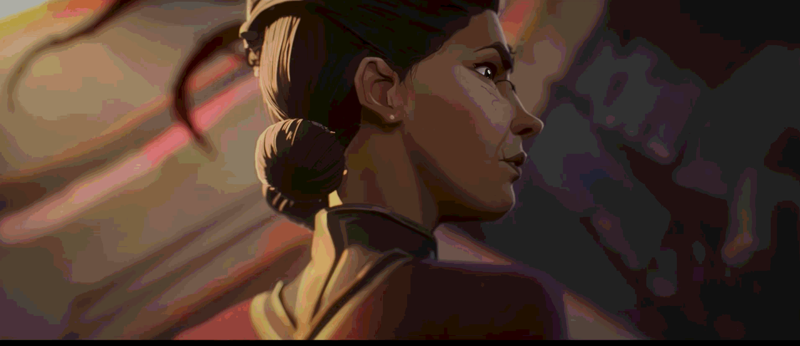
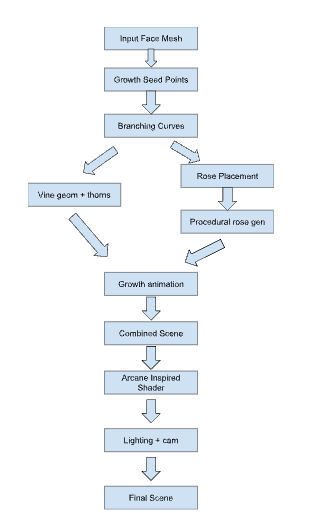
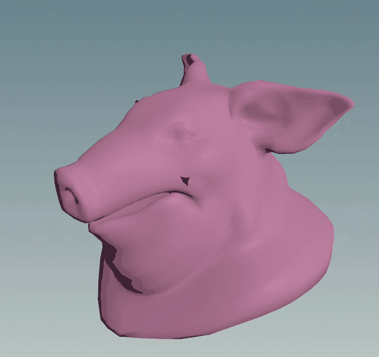

# Final Project!

This is it! The culmination of your procedural graphics experience this semester. For your final project, we'd like to give you the time and space to explore a topic of your choosing. You may choose any topic you please, so long as you vet the topic and scope with an instructor or TA. We've provided some suggestions below. The scope of your project should be roughly 1.5 homework assignments. To help structure your time, we're breaking down the project into 4 milestones:

## Project planning: Design Doc (due 11/4)

Before submitting your first milestone, _you must get your project idea and scope approved by Rachel, Adam or a TA._

### Design Doc

Start off by forking this repository. In your README, write a design doc to outline your project goals and implementation plan. It must include the following sections:

#### Introduction

One of my favorite shows is Arcane, and a big reason why was because I really like the animations.

#### Goal

I would like to try to replicate this scene in Houdini, where I would like to recreate their artstyle through stylized shaders. In addition to this, I would like to create a specific scene where there are black roses that grow out of a face. This means being able to procedurally place the roses, animate their growth and blooming, and be able to generate thorn covered vines across arbitrary 3d surfaces.

#### Inspiration/reference:

I just looked up a few forums online about how to recreate the shader, and I found many talking about something called "FilaToon" shaders.

In addition to this I would most likely create the model for the face myself, referencing the gif above. If this is too difficult I might just take a preexisting model of a face. I found a few that fortiche made on [sketchfab](https://sketchfab.com/tags/fortiche)

I also found a Houdini tutorial on procedural flower modeling and animation: [Houdini Tutorial — Blooming Flowers](https://www.youtube.com/watch?v=aUajIqvl6H4) (might not follow this though and might follow a tutorial on creating a rose by parametric equations).

#### Specification:

I would like to create a stylized shader, and have procedural vine and rose generation.

#### Techniques:

For the shading, I plan to use a combination of toon shading, lighting-based color ramps, and procedural texture variation. I also plan to experiment with noise based modulation of the lighting or colors. This is a [stylized Shader Tutorial](https://www.youtube.com/watch?v=hXgflY8NAOo) that I found I might follow.

For the vines, I plan to generate branching curves that follow the contours of a target 3D mesh. 

When it comes to animating, for the vines, I plan to animate their growth by progressively revealing sections of the generated curves. 

For the roses, I plan to procedurally generate them using parametric equations, following an [Instagram tutorial](https://www.instagram.com/reel/DcHBBGuxtFI/) I found that demonstrates how mathematical functions can be used to construct the shape of a rose (not sure how to link it here).

#### Design:

#### Timeline:

**Milestone 1:**

- Begin implementing the Arcane-inspired shader with basic stylized lighting and color ramps.
- Experiment with procedural noise and texture variation.
- Implement an initial vine generator capable of creating branching curves.
- Test projecting or constraining vines onto a simple 3D surface.
- Create the basic geometry for a procedural rose.

**Milestone 2:**

- Refine the stylized shader and apply it to the face model.
- Complete the procedural vine generation system, including branching, thickness, and thorns.
- Implement vine growth animation.
- Complete the procedural rose generator and blooming animation.
- Implement procedural rose placement along the vines.
- Integrate the geometry and shading systems into a single animated scene.

**Milestone 3:**

- Refine the shader's color palette, shadow shapes, and texture variation to more closely resemble the reference.
- Adjust vine branching, thorn distribution, and rose placement for visual appeal.
- Improve animation timing and transitions between vine growth and blooming.
- Add final lighting, camera movement, and composition.
- Render the final animation.

## Milestone 1: Implementation part 1 (due 11/11)
Begin implementing your engine! Don't worry too much about polish or parameter tuning -- this week is about getting together the bulk of your generator implemented. By the end of the week, even if your visuals are crude, the majority of your generator's functionality should be done.

Put all your code in your forked repository.

### Milestone #1 Progress

This milestone I had to dial things back a bit from what I expected to do. After getting more into it, I realized I hadn't really figured out how I wanted to approach the Arcane style shading in Houdini. I found a lot of resources for getting started in Blender, but it also didn't make a ton of sense to move all the procedural work there. After a while, I decided to split it up where I do the procedural rose and vine generation in Houdini then bring the geometry into Blender for the stylized shading and final render. After scrapping a few ideas, I focused on getting the Houdini part working for this milestone.

I have vines growing across a test head and roses emerging and blooming at editable locations. The node-based setup uses space colonization for branching [1] and parametric equations for the roses [2], inspired by the Instagram reference [3].

Getting the vines to look right took more tuning than I expected. The current version is much close to what I want, but there is still some cleanup and tuning of params.

Because of the time spent figuring out the workflow and fixing the geometry, I haven't started the stylized shader yet. For now, the demo shows the procedural generation and animation with simple viewport colors. Next, I want to polish this setup and start bringing it into Blender for the shading and final look.

#### Current result

[Video](video/milestone1.mp4)

#### References

1. Runions, A., Lane, B., and Prusinkiewicz, P. (2007). [Modeling Trees with a Space Colonization Algorithm](https://www.algorithmicbotany.org/papers/colonization.egwnp2007.html) — vine branching.
2. Nylander, P. (2006). [Rose-Shaped Parametric Surface](https://nylander.wordpress.com/2006/06/21/rose-shaped-parametric-surface/) — rose equations.
3. mathswithmuza. [3D rose surface Instagram reel](https://www.instagram.com/reel/DcHBBGuxtFI/) — visual reference.
4. SideFX documentation: [Attribute VOP](https://www.sidefx.com/docs/houdini/nodes/sop/attribvop.html), [feedback loops](https://www.sidefx.com/docs/houdini/nodes/sop/block_end.html), [Point Cloud Open](https://www.sidefx.com/docs/houdini/nodes/vop/pcopen.html), [Point Cloud Filter](https://www.sidefx.com/docs/houdini/nodes/vop/pcfilter.html), [Clip](https://www.sidefx.com/docs/houdini/nodes/sop/clip), [Sweep](https://www.sidefx.com/docs/houdini/nodes/sop/sweep), and [Copy to Points](https://www.sidefx.com/docs/houdini/nodes/sop/copytopoints.html).

Submission: Add a new section to your README titled: Milestone #1, which should include
- written description of progress on your project goals. If you haven't hit all your goals, what's giving you trouble?
- Examples of your generators output so far
We'll check your repository for updates. No need to create a new pull request.

## Milestone 2: Implementation part 2 (due 11/23)
We're over halfway there! This week should be about fixing bugs and extending the core of your generator. Make sure by the end of this week _your generator works and is feature complete._ Any core engine features that don't make it in this week should be cut! Don't worry if you haven't managed to exactly hit your goals. We're more interested in seeing proof of your development effort than knowing your planned everything perfectly. 

Put all your code in your forked repository.

Submission: Add a new section to your README titled: Milestone #3, which should include
- written description of progress on your project goals. If you haven't hit all your goals, what did you have to cut and why? 
- Detailed output from your generator, images, video, etc.
We'll check your repository for updates. No need to create a new pull request.

Come to class on the due date with a WORKING COPY of your project. We'll be spending time in class critiquing and reviewing your work so far.

## Final submission (due 11/30)
Time to polish! Spen this last week of your project using your generator to produce beautiful output. Add textures, tune parameters, play with colors, play with camera animation. Take the feedback from class critques and use it to take your project to the next level.

Submission:
- Push all your code / files to your repository
- Come to class ready to present your finished project
- Update your README with two sections 
  - final results with images and a live demo if possible
  - post mortem: how did your project go overall? Did you accomplish your goals? Did you have to pivot?

## Topic Suggestions

### Create a generator in Houdini

### A CLASSIC 4K DEMO
- In the spirit of the demo scene, create an animation that fits into a 4k executable that runs in real-time. Feel free to take inspiration from the many existing demos. Focus on efficiency and elegance in your implementation.
- Example: 
  - [cdak by Quite & orange](https://www.youtube.com/watch?v=RCh3Q08HMfs&list=PLA5E2FF8E143DA58C)

### A RE-IMPLEMENTATION
- Take an academic paper or other pre-existing project and implement it, or a portion of it.
- Examples:
  - [2D Wavefunction Collapse Pokémon Town](https://gurtd.github.io/566-final-project/)
  - [3D Wavefunction Collapse Dungeon Generator](https://github.com/whaoran0718/3dDungeonGeneration)
  - [Reaction Diffusion](https://github.com/charlesliwang/Reaction-Diffusion)
  - [WebGL Erosion](https://github.com/LanLou123/Webgl-Erosion)
  - [Particle Waterfall](https://github.com/chloele33/particle-waterfall)
  - [Voxelized Bread](https://github.com/ChiantiYZY/566-final)

### A FORGERY
Taking inspiration from a particular natural phenomenon or distinctive set of visuals, implement a detailed, procedural recreation of that aesthetic. This includes modeling, texturing and object placement within your scene. Does not need to be real-time. Focus on detail and visual accuracy in your implementation.
- Examples:
  - [The Shrines](https://github.com/byumjin/The-Shrines)
  - [Watercolor Shader](https://github.com/gracelgilbert/watercolor-stylization)
  - [Sunset Beach](https://github.com/HanmingZhang/homework-final)
  - [Sky Whales](https://github.com/WanruZhao/CIS566FinalProject)
  - [Snail](https://www.shadertoy.com/view/ld3Gz2)
  - [Journey](https://www.shadertoy.com/view/ldlcRf)
  - [Big Hero 6 Wormhole](https://2.bp.blogspot.com/-R-6AN2cWjwg/VTyIzIQSQfI/AAAAAAAABLA/GC0yzzz4wHw/s1600/big-hero-6-disneyscreencaps.com-10092.jpg)

### A GAME LEVEL
- Like generations of game makers before us, create a game which generates an navigable environment (eg. a roguelike dungeon, platforms) and some sort of goal or conflict (eg. enemy agents to avoid or items to collect). Aim to create an experience that will challenge players and vary noticeably in different playthroughs, whether that means procedural dungeon generation, careful resource management or an interesting AI model. Focus on designing a system that is capable of generating complex challenges and goals.
- Examples:
  - [Rhythm-based Mario Platformer](https://github.com/sgalban/platformer-gen-2D)
  - [Pokémon Ice Puzzle Generator](https://github.com/jwang5675/Ice-Puzzle-Generator)
  - [Abstract Exploratory Game](https://github.com/MauKMu/procedural-final-project)
  - [Tiny Wings](https://github.com/irovira/TinyWings)
  - Spore
  - Dwarf Fortress
  - Minecraft
  - Rogue

### AN ANIMATED ENVIRONMENT / MUSIC VISUALIZER
- Create an environment full of interactive procedural animation. The goal of this project is to create an environment that feels responsive and alive. Whether or not animations are musically-driven, sound should be an important component. Focus on user interactions, motion design and experimental interfaces.
- Examples:
  - [The Darkside](https://github.com/morganherrmann/thedarkside)
  - [Music Visualizer](https://yuruwang.github.io/MusicVisualizer/)
  - [Abstract Mesh Animation](https://github.com/mgriley/cis566_finalproj)
  - [Panoramical](https://www.youtube.com/watch?v=gBTTMNFXHTk)
  - [Bound](https://www.youtube.com/watch?v=aE37l6RvF-c)

### YOUR OWN PROPOSAL
- You are of course welcome to propose your own topic . Regardless of what you choose, you and your team must research your topic and relevant techniques and come up with a detailed plan of execution. You will meet with some subset of the procedural staff before starting implementation for approval.
