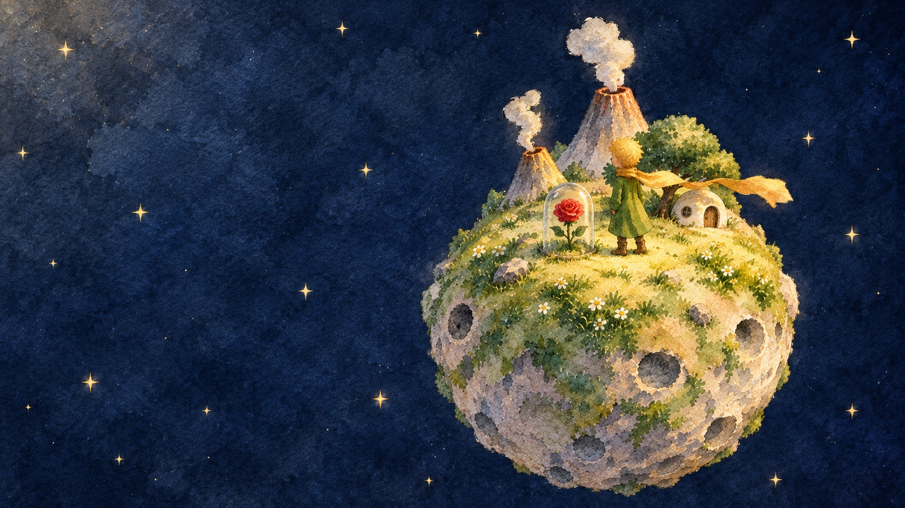
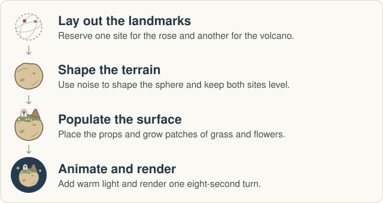
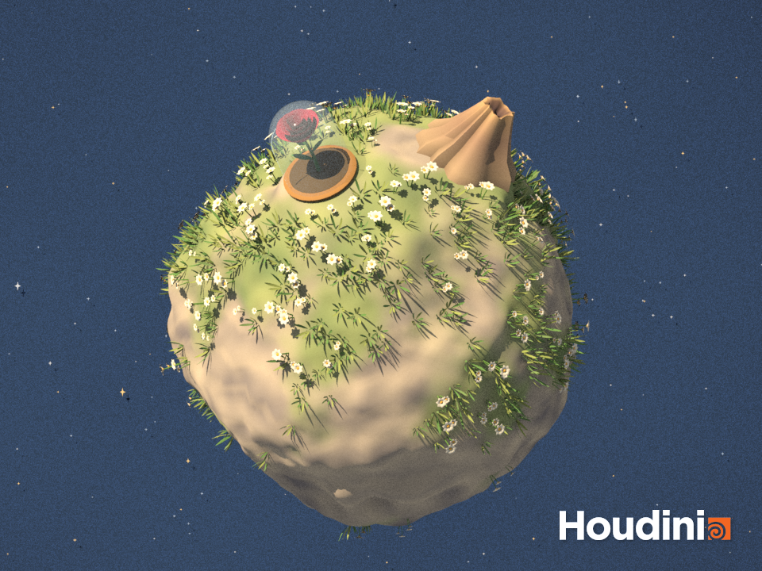
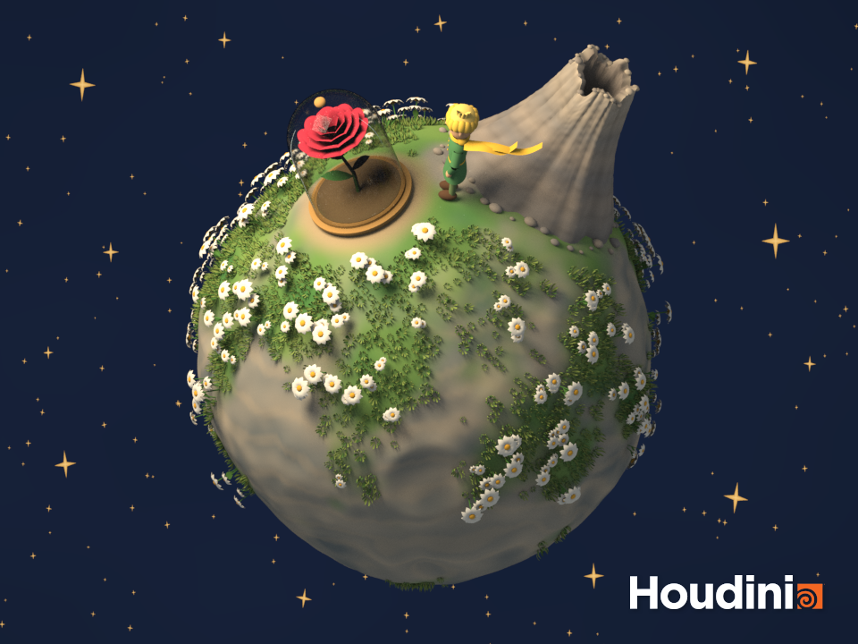
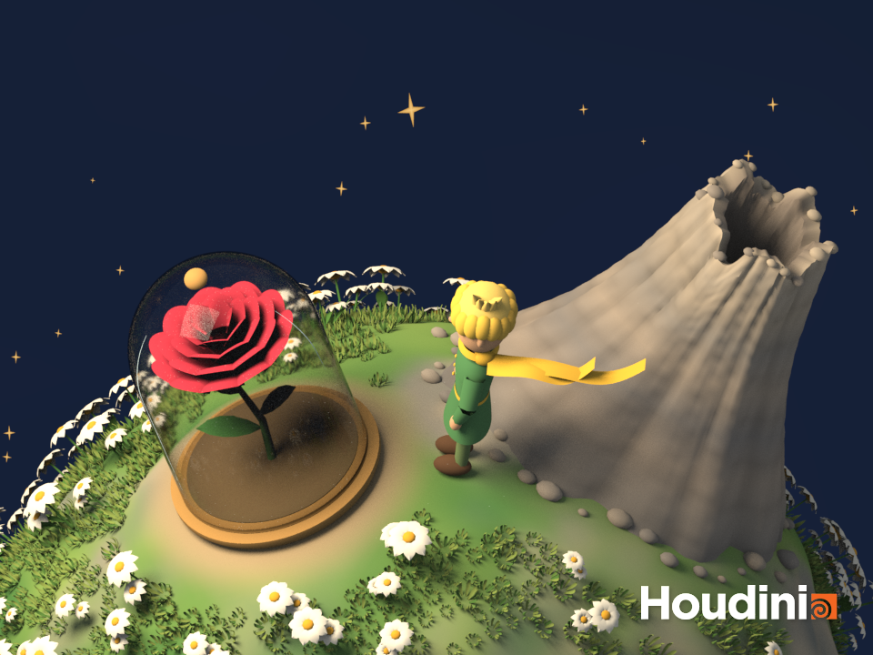

# A Rose on B-612

*A Procedural Storybook Planet in Houdini*

**Yao tang**

CIS 5660 · Final Project Design Doc · November 4, 2026

## Introduction

What caught my eye in *The Little Prince: Across the Stars* was the scale of the planet. From far enough away to see the whole world, I could still pick out a single rose. I want to keep that sense of scale as the planet turns and a different part of its surface comes into view. The challenge is deciding what can change with a random seed and what needs to stay fixed for the composition to work.

## Goal

I will make a small Houdini planet with a red rose under a clear dome, one volcano, and patches of grass and white flowers. The final shot will be an eight-second turntable against a deep blue sky. Two stills from the same camera will show how changing the seed changes the terrain and planting.

## Inspiration / Reference

*Visual reference: title artwork from [Sac’s Little Prince project](https://littleprince.dev/) ([original image](https://littleprince.dev/keyart.031aa305131370a0e08c9cb92d1b1aaa.jpg)).*

Three details in the reference will guide my version: the volcanoes interrupt the round outline; the white flowers form patches with bare ground between them; and the rose has the strongest red in the scene. I will model the props in Houdini and use these relationships to guide their placement.

## Specification

The generator will expose three controls: **seed**, **terrain relief**, and **plant density**. The rose and volcano will have fixed locations so I can compose the opening shot once. The rose will sit in a small clearing, and patches of bare rock will show between clumps of plants.

## Techniques

I will use 3D noise to move points outward or inward on a subdivided sphere. A smooth falloff around the rose and volcano will keep the ground under each prop level. The noise will use the sphere’s rest position so the pattern stays attached during rotation. [Perlin, *An Image Synthesizer* (1985)](https://doi.org/10.1145/325334.325247) · [SideFX, Attribute Noise](https://www.sidefx.com/docs/houdini/nodes/sop/attribnoise.html)

I will model one grass tuft and one white flower. A noise mask will group them into patches, and an exclusion mask will keep the clearings open. Each copy will align with the local surface so plants point away from the planet on every side. [SideFX, Scatter and Align](https://www.sidefx.com/docs/houdini/nodes/sop/scatteralign.html) · [SideFX, Copy to Points](https://www.sidefx.com/docs/houdini/copy/copytopoints.html)

For the shot I will light the rose from the side and rotate the assembled planet at a constant speed in front of a fixed camera.

## Design

## Timeline

I will handle the modeling, generator, lighting, animation, and documentation.

| Dates | My work | Deliverable |
| --- | --- | --- |
| Nov 4 | Set the scope and review it with course staff. | Design doc |
| Nov 5–11 | Build the terrain, reserve two landmark sites, and scatter placeholder plants. Compare two seeds. | Milestone 1 preview images and progress update |
| Nov 12–18 | Model the rose, dome, volcano, grass tuft, and flower. Set the camera and light. | First color still |
| Nov 19–23 | Set up the rotation and check both seeds for floating props or plants inside the dome. | Working scene, preview loop, and Milestone 2 update |
| Nov 24–30 | Apply critique feedback and render the final shot. | Houdini scene, eight-second loop, two seed stills, presentation, and postmortem |

[Original course assignment and submission instructions](docs/course-brief.md)

## Milestone #1

The core generator is working. It builds an uneven sphere, reserves clearings for the rose and volcano, and scatters grass and white flowers in patches. Plants follow the displaced surface, with variation in their size and orientation. The **Seed**, **Terrain Relief**, and **Plant Density** controls change the layout, surface shape, and amount of ground cover. Reusing a seed reproduces the same planet.

I have also added initial models of the rose, glass dome, and volcano, plus a camera, lighting, and an eight-second turntable. This covers the terrain and planting goals in my first-week plan. The image below shows the current scene.

The still was rendered with Mantra. [Watch the eight-second Houdini viewport preview](media/B612-turntable.mp4).

The glass dome initially obscured the rose. I corrected its material binding and isolated its opacity from the terrain and plants. The render still has visible noise, and the glass looks different in the viewport and Mantra. My next step is to refine the lighting and dome shading so the rose reads more clearly, then check the composition throughout the rotation.

To try the generator, open [B612.hipnc](B612.hipnc) in Houdini and select `/obj/B612_PLANET`. Under **Planet Controls**, switch **Seed** between 12 and 47, adjust **Terrain Relief**, or set **Plant Density** to zero to inspect the bare terrain. Choose `storybook_camera` in the viewport and play frames 1–192 at 24 fps to see one full turn. The scene contains the generator code, and the editable source is included in [scripts](scripts/).

## Milestone #2

Milestone 1 already included the initial prop models, camera, lighting, and eight-second rotation. For this stage, I refined those models, added the Little Prince and a more visible star field, and checked the generator across seeds and parameter ranges. The core features in the proposal are implemented.

| Planned work | Progress for this milestone |
| --- | --- |
| Rose and dome | Rebuilt the rose with five layers of curled petals, a bent stem, and wider leaves. Enlarged the glass cover and added a detailed brass base and small handle. Corrected the shell normals and transparent shadows so the rose receives light through the glass. |
| Volcano | Enlarged the cone and broadened its base. Deepened the crater, broke up the rim with chipped rock, and added erosion grooves, ash-colored layers, and scree around the foot. Expanded the planting exclusion area to fit the larger mountain. |
| Grass and flowers | Rebuilt the grass with shorter, finer curved blades and denser masked planting. The daisies have nine curved petals and rounded yellow centers. Expanded the landmark clearings to fit the larger models and added slope-based placement. |
| Scene details | Added a static Little Prince with blond hair, a long green coat, boots, and a curved gold scarf. Reduced the default terrain relief for a rounder silhouette, added shallow craters to the exposed rock, and made warm four-point stars against a deeper blue sky. |
| Camera and lighting | Kept the original wide camera for comparison, added a close-up camera, softened the key light, and increased Mantra sampling to reduce noise. |
| Rotation and checks | Re-rendered the eight-second turn with the updated assets. Checked seed reproducibility, density and relief limits, landmark clearings, glass orientation, and the loop boundary. |

The close-up shows the prince, curled rose petals, glass cover, decorated base, and crater rim.

[Watch the updated eight-second viewport turntable](media/milestone2-turntable.mp4).

The most difficult part was the glass. Its surface orientation and shadows initially made the rose appear dark. I corrected the inner and outer walls and enabled transparent shadows. The still uses Mantra refraction, while the video uses a lightweight viewport preview.

I reopened the saved scene and checked seeds 0, 12, 47, and 255, the minimum and maximum density and relief values, and frames 1, 97, and 193. The checks can be repeated with `hython scripts/verify_scene.py`.

For the class demonstration, open [B612.hipnc](B612.hipnc), select `/obj/B612_PLANET`, and use **Planet Controls**. Change **Seed** from 12 to 47, adjust **Terrain Relief**, and set **Plant Density** to zero to inspect the terrain. Select `storybook_camera` and play frames 1–192 at 24 fps for one turn, or choose `rose_detail_camera` for the close-up. For a new still, render frame 1 with `/out/STORYBOOK_RENDER`.

Before the final submission on November 30, I will focus on the following.

- Reduce the glass highlights that cover the rose petals, and refine the lighting, rock colors, and distribution of grass and flowers.
- Apply feedback from the November 23 class critique and make targeted visual adjustments.
- Select the final wide and close-up stills and prepare the eight-second video. I will test the render time of a few Mantra frames before deciding whether to upgrade the viewport video to a fully rendered animation.
- Add Final Results and Post Mortem sections to the README, and prepare a short presentation showing how the seed, terrain relief, and plant density affect the scene.
