# Procedural Zhuozhengyuan

Zhuoyang Pan

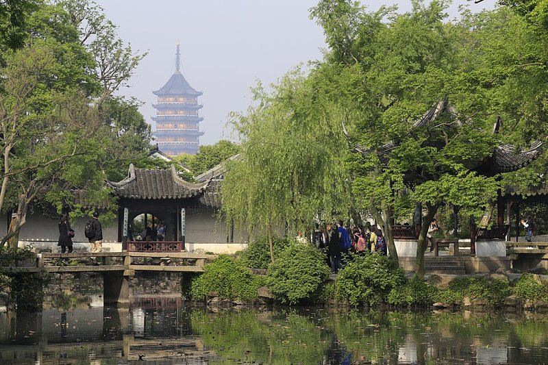

*The target: looking west from Wuzhu Youju across the central pond of Zhuozhengyuan (Humble Administrator's Garden), with the Beisi Pagoda behind the garden wall. Photo: Zhangzhugang, [Commons](https://commons.wikimedia.org/wiki/File:Suzhou_Zhuozheng_Yuan_2015.04.23_08-13-49.jpg), CC BY-SA 4.0*

# Milestone #1

Everything is in `zhuozhengyuan.hipnc` (Houdini 22, Apprentice, hence the watermark). The three tools so far are HDAs embedded in the hip: `lattice_window`, `taihu_rock`, `pavilion`. Renders are Karma.

## Matched camera + blockout

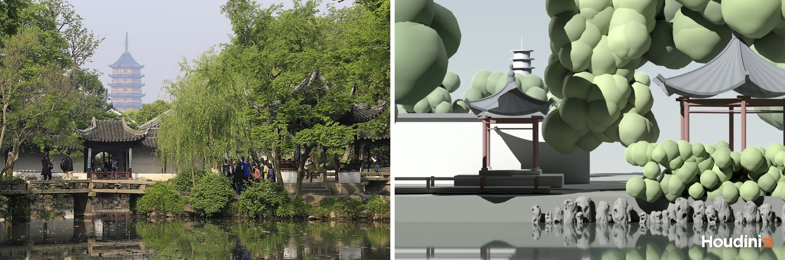
*left: photo, right: my blockout from the matched camera*

- camera at Wuzhu Youju, 3 m above the water, 155 mm lens (~15° FOV); distances eyeballed from the photo (pagoda ~1 km away, 76 m tall)
- both pavilions are the real HDA, shore rocks are 4 `taihu_rock` variants copied along the bank
- trees, wall, bridge and pagoda are placeholders; haze is baked into the color by distance for now

## lattice_window

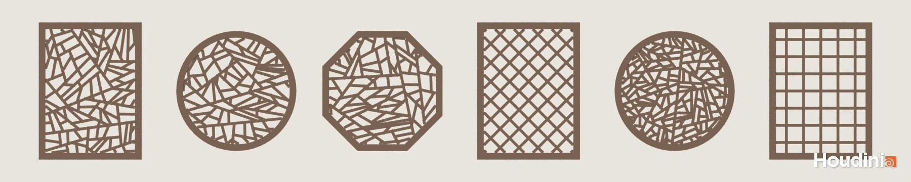

- ice-ray grammar in one detail wrangle: start with the window rectangle, keep splitting the biggest piece with one straight bar between two of its edges
- a split is only allowed if both new pieces are triangles, quads or pentagons (Stiny's rule) and no corner is sharper than 24°
- out of the allowed splits it picks short, balanced cuts, plus some noise
- every edge becomes a bar (box on a point), clipped to the inside of the frame
- params: pattern (ice-ray / grid / diamond), frame (rectangle / circle / octagon), size, border, bar width, depth, piece size, randomness, seed

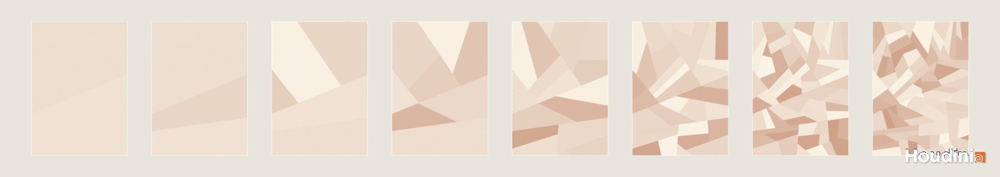
*the grammar after 1, 2, 4, 8, 16, 32, 64 cuts and when it stops*

## taihu_rock

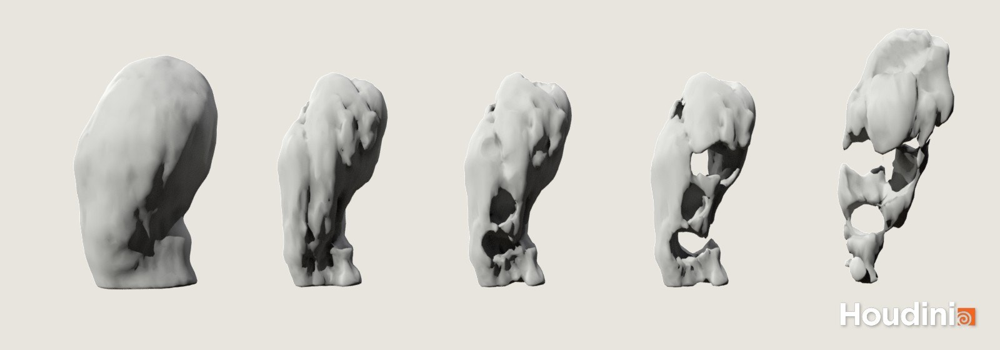
*left to right: turning the four qualities on one at a time*

- one volume wrangle writes an SDF, then Convert Volume and Poly Reduce
- thin: smooth union of capsules along a bent spine, the slider sets radius vs height
- wrinkled: ridged noise stretched vertically so the grooves run up and down
- perforated: cellular (Worley) pits carved out
- see-through: bent tunnels across the body, subtracted
- darker in holes and grooves by sampling the SDF just outside the surface

## pavilion

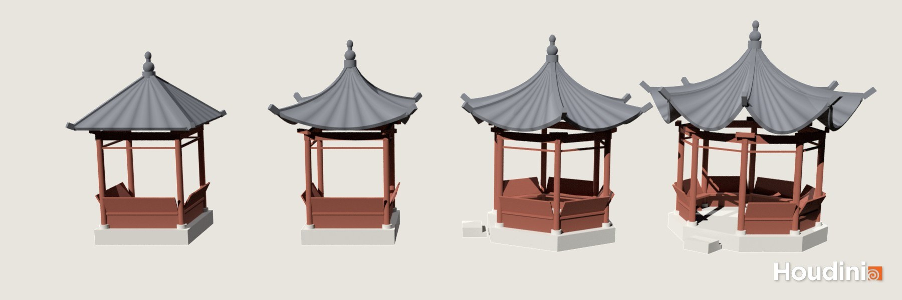
*square with a straight roof, square, hexagon, octagon with more corner lift*

- columns, beams, brackets, benches with the leaning backrest, steps: one point per part with kit shapes copied on (same trick as hw04)
- roof: a grid per face, height from the juzhe rule (drops of 1/10, 1/20, 1/40 ...), corners lift and flare out toward the eave
- hip ridges follow the same curve and end in a turned-up tip; tile rows are only color for now

## Progress

- everything planned for this week works, and the juzhe roof + corner lift from next week's list are already in
- still to do: round openings for Wuzhu Youju, the real pagoda, willows, the wall with lattice windows, materials
- trouble: my first lattice cut the holes with a Boolean and it randomly dropped some, so I switched to bars. Also `npoints(0)` in a detail wrangle counts the input, not the points you just added, which broke the first roof

# Design Doc

## Introduction

Zhuozhengyuan is the most famous of the Suzhou gardens, and this is one of its best-known views. Standing at Wuzhu Youju at the east end of the pond, you look across water, lotus, rocks and pavilions, and the Beisi Pagoda (outside the garden, 9 storeys) shows up in the middle of the frame like it belongs there. Garden designers call this a "borrowed view".

A lot of what makes the view work is rule based, which is why I want to build it procedurally:
- lattice windows follow a few construction conventions (Stiny wrote a shape grammar for the "ice-ray" ones)
- garden rocks are judged on four named qualities: thin, wrinkled, perforated, see-through
- roof curves come from a 12th-century building manual (the *Yingzao Fashi*)

A procedural Chinese garden was done last year ([Yuanlin](https://github.com/SirEnri2001/Houdini-Yuanlin)), as a whole-garden layout seen from above. Mine is the opposite: one real view, from eye level, with the detail going into the pieces (lattice, rocks, roofs) instead of the overall layout.

## Goal

Recreate the west view from Wuzhu Youju in Houdini with procedural tools, and render it in Karma next to the reference photo.
- each element is its own HDA: lattice window, Taihu rock, pavilion, pagoda
- the scene around them (pond, shore, lotus, bridges, willows) is driven by curves and a seed
- final output: the hero shot matched to the photo, a "framed view" shot through one of Wuzhu Youju's round openings, and a short camera move

## Inspiration/reference

| Same view in autumn | Wuzhu Youju (camera position) |
|:--:|:--:|
| 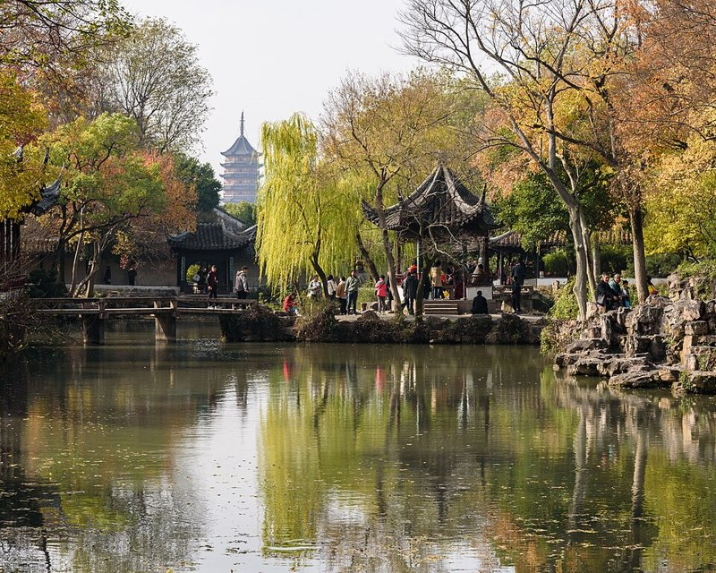 | 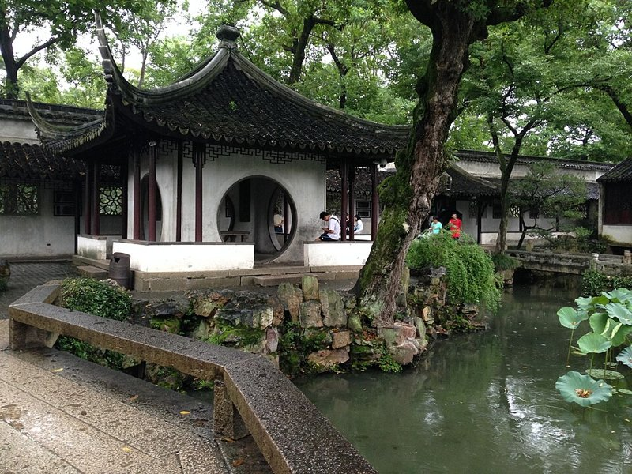 |
| Photo: King of Hearts, [Commons](https://commons.wikimedia.org/wiki/File:Humble_Administrator%27s_Garden_Suzhou_November_2017_006.jpg), CC BY-SA 4.0 | Photo: Soramimi, [Commons](https://commons.wikimedia.org/wiki/File:Wuzhuyouju_of_Zhuozhengyuan_Garden.JPG), CC BY-SA 4.0 |

| Lotus pond | Moon gate | Pavilion roof |
|:--:|:--:|:--:|
| 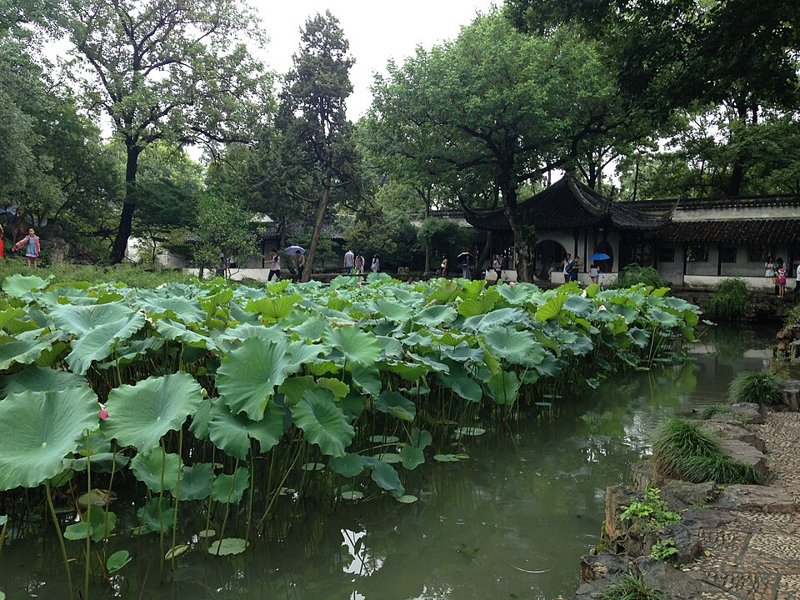 | 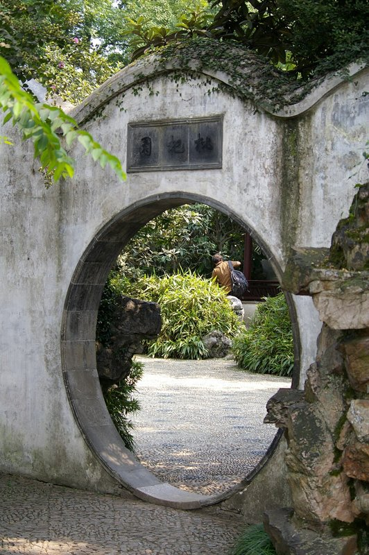 | 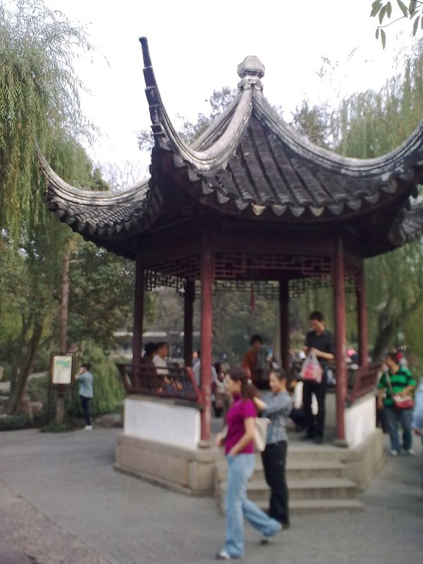 |
| Photo: Soramimi, [Commons](https://commons.wikimedia.org/wiki/File:Wuzhuyouju_and_Lotus_of_Zhuozhengyuan_Garden.JPG), CC BY-SA 4.0 | Photo: Jakub Hałun, [Commons](https://commons.wikimedia.org/wiki/File:20090905_Suzhou_Humble_Administrator%27s_Garden_4605.jpg), CC BY-SA 3.0 | Photo: Lamassu Design Gurdjieff, [Commons](https://commons.wikimedia.org/wiki/File:Humble_garden_pavilion_in_lotus_breeze.jpg), CC BY-SA 3.0 |

| Taihu rock (Guanyun Peak, Lingering Garden) | Lattice window |
|:--:|:--:|
| 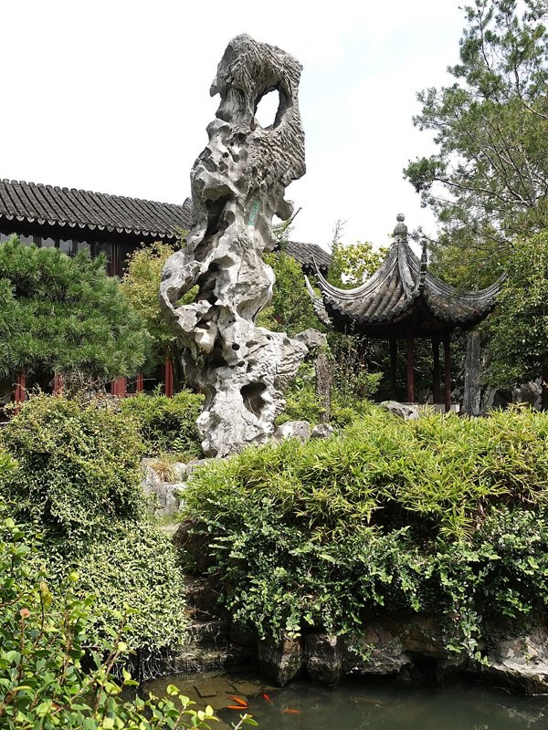 | 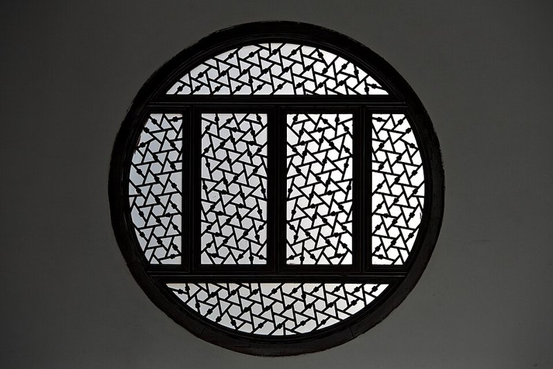 |
| Photo: 颐园居, [Commons](https://commons.wikimedia.org/wiki/File:Lingering_Garden_-_%E6%B9%96%E7%9F%B3%E5%86%A0%E4%BA%91%E5%B3%B0_20220904.jpg), CC BY-SA 4.0 | Photo: kevinmcgill, [Commons](https://commons.wikimedia.org/wiki/File:Round_Window_(6399130989).jpg), CC BY-SA 2.0 |

Reading:
- G. Stiny, [Ice-Ray: A Note on the Generation of Chinese Lattice Designs](https://doi.org/10.1068/b040089), *Environment and Planning B* 4(1), 1977
- D. S. Dye, *A Grammar of Chinese Lattice* (Dover reprint: *Chinese Lattice Designs*), where Stiny's examples come from
- Y. Shen, E. Zhang, Y. Feng, S. Liu, J. Wang, [Parameterizing the Curvilinear Roofs of Traditional Chinese Architecture](https://doi.org/10.1007/s00004-020-00512-1), *Nexus Network Journal* 23(2), 2021
- [Scholar's rocks](https://pages.stolaf.edu/chinese-scholars-studio/scholar-rocks/) (St. Olaf), on the four qualities: *shou* (thin), *zhou* (wrinkled), *lou* (perforated), *tou* (see-through)
- [Humble Administrator's Garden](https://en.wikipedia.org/wiki/Humble_Administrator%27s_Garden) (Wikipedia) and [The Garden of the Inept Administrator](https://hiddenarchitecture.net/the-garden-of-the-inept-administrator/) (Hidden Architecture) for the layout and the borrowed view

## Specification

Everything in Houdini 22 (Apprentice), one hip file, Karma for the renders.

Core:
1. **`lattice_window` HDA**: ice-ray pattern from a shape grammar plus one regular pattern; frame shape (rectangle, circle, octagon); bar width/depth; seed
2. **`taihu_rock` HDA**: sliders for the four qualities (thin, wrinkled, perforated, see-through), size and seed
3. **`pavilion` HDA**: 4/6/8-sided plan, columns, bench rail, walls with round openings (for Wuzhu Youju), curved roof with upturned corners and a finial
4. **`pagoda` HDA**: octagonal storeys stacked and tapered, each one reusing the pavilion's eave and roof code, spire on top
5. **Scene**: pond from a curve, rocks along the shore, lotus on the water, flat stone bridges, willows, garden wall with lattice windows, pagoda placed far behind the wall
6. **Look**: whitewash, grey tile, dark wood, limestone and water materials; hazy daylight so the pagoda fades with distance; camera matched to the reference photo

Stretch (only if core is done by Milestone 2):
- willow branches moving in wind (vellum hair, same setup as my hw03 tentacles)
- season switch: each side of Wuzhu Youju is said to look out on a different season, so a spring/autumn preset for foliage colour and lotus
- ripples on the water, a few koi

## Techniques

**Ice-ray lattice** (Stiny 1977)
- start with the window rectangle as one polygon
- each step picks the biggest piece and splits it with one straight bar between two of its edges; the rules only let a triangle, quad or pentagon split into two smaller ones of those kinds, which is what gives the cracked-ice look
- stop when every piece is under a minimum area
- for-each loop with feedback (same setup as hw04), the split itself in a wrangle
- edges -> bars (`polyexpand2d` + extrude), then clip by the frame shape

**Taihu rock** (VDB)
- *thin*: 3-5 noisy spheres along a bent vertical spine, smooth union; height/width ratio slider
- *see-through*: a few tunnel curves between random points on opposite sides, bent with curl noise, turned into VDB tubes and subtracted
- *perforated*: Worley noise pits ([Worley 1996](https://doi.org/10.1145/237170.237267)) subtracted from the SDF
- *wrinkled*: ridged FBM with domain warping ([Quilez](https://iquilezles.org/articles/warp/)), stretched along the spine so grooves run mostly vertical
- convert to polygons, reduce, occlusion/curvature attribute to darken the holes

**Roofs** (Shen et al. 2021, *juzhe* from the *Yingzao Fashi*)
- roof section: draw a straight line from ridge to eave, drop the first purlin under the ridge by 1/10 of the rise, redraw the line from there to the eave and drop the next one by 1/20, then 1/40, halving each time; that gives the concave curve
- corners lift and push outward (*qiqiao*), blended along the eave
- roof surface lofted from those section curves, tiles copied along its rows, same "kit shapes on points" trick as hw04 for columns and rails

**Pagoda**
- one storey = octagonal pavilion body + eave, from the pavilion HDA
- storey radius and height shrink with a taper curve, 9 storeys, spire on top
- it's far away in the shot, so silhouette and proportions matter more than detail

**Scene**
- pond: closed curve + noise, water surface and a sunken bed
- shore: rocks scattered in a band around the pond, relaxed so they don't overlap, bigger near the water
- lotus: scatter on the water with a noise mask so they clump
- willows: trunk and branches from an L-system (lab05), hanging strands as curves with gravity droop, leaves copied on
- camera: match the reference photo's focal length and horizon ([fSpy](https://fspy.io/)), then place the big pieces to line up with it

## Design

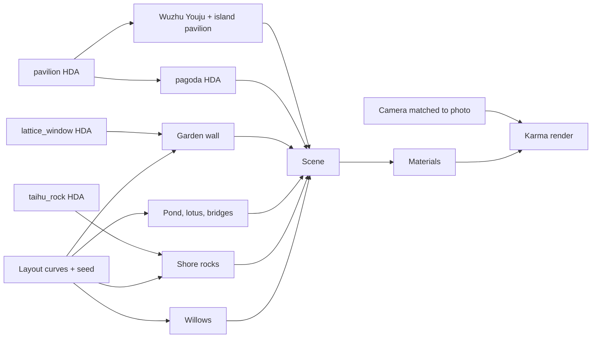

## Timeline

| Week | Work | Due |
|:--|:--|:--|
| **11/4 - 11/11** (Milestone 1) | - camera matched to the reference photo, blockout with boxes - `lattice_window`: ice-ray grammar working, frame shapes - `taihu_rock` v1: base shape + tunnels + noise - `pavilion` v1: plan, columns, rails, straight roof | 11/11 |
| **11/12 - 11/18** | - *juzhe* roof curve + corner lift - `pagoda` from stacked storeys - Wuzhu Youju with round openings - rock sliders for the four qualities | |
| **11/19 - 11/23** (Milestone 2) | - pond, shore rocks, lotus, bridges, willows, wall with lattice windows - first materials and Karma renders of the hero shot - feature complete, cut what's left | 11/23 |
| **11/24 - 11/30** (Final) | - lighting, haze, side by side with the photo - framed-view shot through a round opening, camera move - stretch goals if there's time - README results + post mortem | 11/30 |

Backup plans:
- if the *juzhe* roof eats too much time, fall back to a straight hip roof with just the corner lift
- if VDB booleans get slow, cache each rock variant once and copy them around as packed prims
- willows can be simple static curves if the L-system + droop doesn't look right in time
