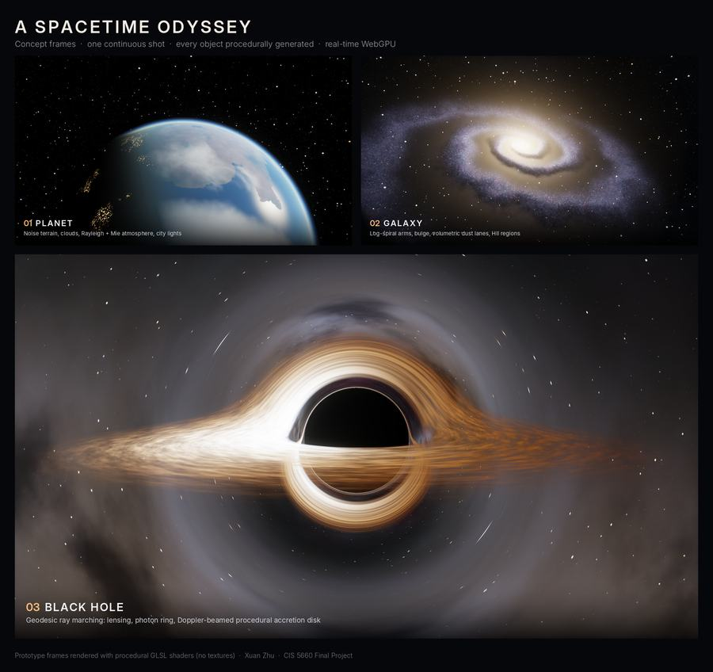
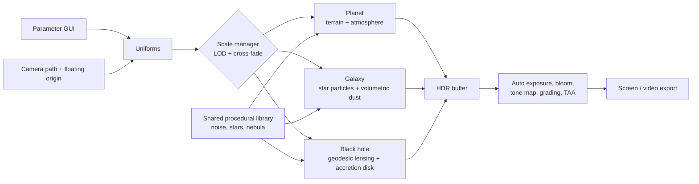

# A Spacetime Odyssey: A Multi-Scale Procedural Universe in WebGPU

CIS 5660 Fall 2026 Final Project — Xuan Zhu

## Design Doc

### Introduction
Documentaries like *Cosmos: A Spacetime Odyssey* and the Eames' short film *Powers of Ten* (1977) share one powerful visual idea: a **single, unbroken camera move** that travels across enormous changes in scale, from a planet, to its galaxy, to the extreme physics at the galaxy's center. That journey is a natural fit for procedural graphics: nothing at these scales can be modeled by hand, but all of it can be grown from noise, simple physical rules and parameters.

I want to build a real-time version of that journey in the browser, where **every object along the way is procedurally generated** and the transitions between scales are seamless.

### Goal
- A **continuous real-time fly-through** in WebGPU across three scales: **planet → galaxy → black hole**.
- Every visible element is **procedurally generated**: planet terrain and atmosphere, galaxy arms and dust, star field, nebulae, accretion disk. No textures or skyboxes loaded from disk.
- **Seamless scale transitions**: no cuts, no visible pops between levels of detail.
- **Cinematic quality**: HDR rendering, bloom, careful color grading, and an offline high-quality mode for recording the final video.
- An artist-facing **parameter panel** so the same generator produces many different universes.

**Concept frames** (quick procedural GLSL prototype of the three stages):

### Inspiration / Reference
- *Cosmos: A Spacetime Odyssey* (2014): overall tone and camera language (inspiration only; no imagery from the show is reproduced).
- Charles & Ray Eames, *Powers of Ten* (1977): the continuous zoom across scales.
- **SpaceEngine** (V. Romanyuk), https://spaceengine.org: the visual target for seamless planet-to-galaxy travel, star rendering and auto exposure.
- O. James, E. von Tunzelmann, P. Franklin, K. Thorne, *Gravitational Lensing by Spinning Black Holes in Astrophysics, and in the Movie Interstellar* (2015), https://arxiv.org/abs/1502.03808
- NASA SVS black hole accretion disk visualization (J. Schnittman), https://svs.gsfc.nasa.gov/13326
- R. Antonelli, *Starless* black hole raytracer, https://rantonels.github.io/starless/
- S. Hillaire, *A Scalable and Production Ready Sky and Atmosphere Rendering Technique* (EGSR 2020)
- M. Heckel, *Real-time dreamy Cloudscapes with Volumetric Raymarching*, https://blog.maximeheckel.com/posts/real-time-cloudscapes-with-volumetric-raymarching/

### Specification

**Stage 1: Planet**
- Cube-sphere planet with procedural terrain (fBm + ridged noise), chunked LOD.
- Atmospheric scattering (Rayleigh + Mie) visible as the blue limb glow from orbit.
- Procedural surface coloring by height, slope and latitude (oceans, land, ice caps).

**Stage 2: Galaxy**
- Procedural spiral galaxy: arms from a logarithmic-spiral density field, central bulge, dust lanes.
- Rendered as GPU star particles + ray-marched volumetric dust/emission.
- Star colors and brightness follow a realistic distribution (many faint red stars, few bright blue ones).
- Procedural emission nebulae inside the arms.

**Stage 3: Black hole at the galactic center**
- Per-pixel null-geodesic ray marching around a Schwarzschild black hole (shadow, photon ring, lensed background).
- Procedural accretion disk: domain-warped fBm in rotating polar coordinates, Keplerian (differential) rotation, blackbody temperature ramp.
- Doppler beaming and gravitational redshift.
- The galaxy itself is the lensed background.

**Journey & transitions**
- Scripted camera path with eased motion through all three stages; free-camera mode for exploration.
- Seamless level-of-detail transitions: point → glowing impostor → full procedural model, cross-faded by screen size.
- Floating origin + logarithmic depth to stay precise across ~20 orders of magnitude.
- Auto exposure (eye adaptation) when moving between dark space and bright objects.

**Look**
- HDR pipeline, multi-level bloom, AgX/ACES tone mapping, color grading per stage.
- Stars drawn as Gaussian point-spread functions (bright ones with diffraction spikes).
- Blue-noise jitter + temporal accumulation to remove ray-marching noise.
- Offline mode: accumulate many samples per frame for the recorded video.

**Stretch goals:** pull back further to a procedural cosmic web (galaxy filaments); spinning (Kerr) black hole; landing on the planet surface.

### Planning

**Short list (ideas considered)**
1. **Multi-scale procedural universe fly-through (chosen).** Planet → galaxy → black hole in one continuous shot. Needs a geodesic ray marcher, procedural disk/galaxy/planet generators, and a scale manager for seamless LOD transitions.
2. **Procedural Gaussian Splatting.** Procedurally growing L-system trees and grass as Gaussians inside a scanned 3DGS scene, reusing my WebGPU splat viewer. Novel, but the visual payoff depends on matching the scan's lighting.
3. **Real-time procedural planet** (orbit-to-ground). Quadtree terrain, atmosphere and volumetric clouds. Strong visuals, but a narrower use of procedural techniques.

**Decision:** #1. It has the strongest visuals, combines many procedural techniques (noise, spiral density fields, volumetrics, physically based shading), has solid paper references, and builds on my existing WebGPU code. #3 is folded in as the planet stage.

**1. Features, by priority (≈ 1.5 assignments of work)**
- **Must have (core):** black hole lensing + procedural accretion disk; procedural star field; procedural spiral galaxy; scripted camera path; parameter GUI.
- **Should have:** procedural planet + atmosphere; seamless scale transitions; Doppler/redshift; bloom, tone mapping, auto exposure.
- **Nice to have:** offline high-quality render mode; cosmic web; Kerr black hole; planet landing.

Each stage alone is roughly half to one homework of work; the black hole and galaxy together form the 1.5-assignment core, and the planet stage plus polish is the extension.

**2. Presentation / final product**
- A **live web demo** (GitHub Pages) with a free camera and parameter panel.
- A **1–2 minute fly-through video**: one continuous shot planet → galaxy → black hole, rendered in the offline high-quality mode.
- A set of **still renders** and a short **turntable of presets** showing how parameters change each stage.

**3. Visual assets**
None are imported. Every visual is generated in shaders at runtime: terrain, clouds, atmosphere, galaxy, nebulae, stars, accretion disk and the blackbody color ramp. The only external dependencies are code libraries (lil-gui for the UI). This keeps the project fully procedural and avoids asset licensing issues.

**4. Weekly targets:** see **Timeline** below.

**5. Resources:** see **Inspiration / Reference** above and **Techniques** below.

### Techniques
- **Noise:** gradient/simplex noise, fBm, ridged multifractal, domain warping (I. Quilez).
- **Planet:** cube-to-sphere mapping, quadtree chunk LOD; precomputed atmosphere lookup tables (Hillaire 2020).
- **Galaxy:** density-wave / logarithmic spiral arms; GPU particle rendering with additive blending; ray-marched volumetric density for dust and gas.
- **Black hole:** Schwarzschild null geodesics, integrated with RK4 in a WGSL compute shader (Starless; James et al. 2015). Each camera ray obeys

  $$\frac{d^2\mathbf{x}}{d\lambda^2} = -\frac{3}{2}\,h^2\,\frac{\mathbf{x}}{\lvert\mathbf{x}\rvert^{5}}, \qquad h = \lvert \mathbf{x}\times\mathbf{v} \rvert$$

  where $h$ is the conserved angular momentum of the ray (units with Schwarzschild radius $r_s=1$). The accretion disk is shaded with

  $$T \propto r^{-3/4}, \qquad \Omega \propto r^{-3/2}, \qquad g = \frac{1}{\gamma\,(1-\beta\cos\theta)}, \qquad I \propto g^{4}$$

  (temperature $T$, angular velocity $\Omega$, Doppler factor $g$, observed intensity $I$).
- **Scale handling:** floating origin (camera-relative coordinates in double precision on the CPU), logarithmic depth buffer, screen-size-based LOD blending.
- **Rendering:** HDR float targets, mip-chain bloom, AgX tone mapping, blue-noise sampling, temporal accumulation, exposure from average log luminance.

### Design

Stack: TypeScript + WebGPU + WGSL, Vite, lil-gui. Live demo hosted on GitHub Pages.

### Timeline
Solo project; all tasks by Xuan Zhu.

| Week | Dates | Milestone | Tasks |
|---|---|---|---|
| 1 | 11/4 – 11/11 | **Milestone 1** | WebGPU framework, HDR pipeline, camera with floating origin. Procedural star field. Black hole: geodesic lensing + procedural accretion disk (first working stage). |
| 2 | 11/12 – 11/17 | | Procedural galaxy (arms, bulge, dust, nebulae); black hole placed at its center and lensing the galaxy. |
| 3 | 11/18 – 11/23 | **Milestone 2** (feature complete) | Procedural planet + atmosphere; scale manager with seamless LOD transitions; scripted camera path through all three stages. |
| 4 | 11/24 – 11/30 | **Final** | Polish only: bloom, tone mapping, color grading, auto exposure, TAA, camera timing; offline render mode; final video + README. Stretch goals if time allows. |

**Risk plan:** the black hole is built first and is the core deliverable. If time runs short, the planet stage is cut first, giving a two-stage galaxy → black hole journey.

---

## Milestone 1
_TBD_

## Milestone 2
_TBD_

## Final Submission
_TBD_
