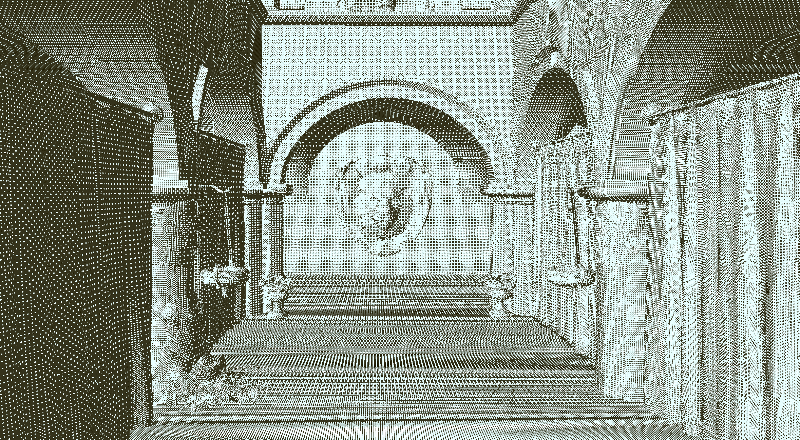

# Final Project!

## Design Doc
### Introduction / Goal
I've been looking more into screen-space shaders and effects to make a scene look more stylized. I started research dithering as I really enjoyed the pixelated look that it gave an image. But instead of making a screen-space dithering shader, I thought it might be interesting to make the dithering effect in object space, similar to what the game Return of the Obra Dinn does. In addition, I wanted to learn more about volumetric raymarching, so I'd like to combine the two techniques into one project. The goal of this project is to create a 3D scene consisting of volumetric raymarched clouds that are dithered in object space.

### Inspiration / Reference
I'm taking heavy inspiration from the game Return of the Obra Dinn. This is a very stylized game that takes advantage of dithering to create cool visuals.

### Specification / Techniques
I will complete this project in WebGL. The main feature of this project will be a 3D scene consisting of volumetric raymarched clouds that are dithered in object space. In addition, if time permits, I can include other dithered objects in the scene, as well as more post-process effects to make the look more similar to Return of the Obra Dinn. I intend to have parameters where the user can edit the look of the clouds, as well as the strength/look of the dithering effect. They will be able to move the 3D scene around to view it at different angles and see how the shading changes.

The main technique for the dithering will be from [this video by runevision](https://www.youtube.com/watch?v=HPqGaIMVuLs) to create the object-space shader. 

To shade the clouds, I will get the 3D representation of the clouds by volumetric raymarching. I will reference [this implementation by Xor](https://mini.gmshaders.com/p/volumetric) to help with my logic for the raymarching. I will attempt to use a density-weighted position as the object-space position for the dithering shader to use.

### Design

### Timeline
**Milestone 1:** Write the dithering object-space shader and have it working on simple models like a sphere or cube.

**Milestone 2:** Create the volumetric raymarching algorithm and test it with simple cloud shapes.

**Milestone 3:** Create the final scene and add tunable parameters that the user can use to change the dithering effect and the cloud shapes.

---
## Milestone #1

I successfully implemented the object-space dithering shader on a 3D object. I originally wrote the shader in WebGL, and then used the base code from a [previous project](https://github.com/anya0402/Project4-WebGPU-Forward-Plus-and-Clustered-Deferred) and ported the shader and texture generation files to WebGPU. I followed the video fairly closely in terms of the dithering techniques. This involved writing a dithering shader in GLSL/WGSL and a texture maker in Typescript to create the Bayer matrix textures that the shader can sample from. Moving around in the scene keeps the ditherng effect tied to the object, and zooming in and out adds/removes dots to keep the overall look stable. There are moiré patterns that appear especially when I have the dot scale be small, so for Milestone 2 I may try addressing that.

---
