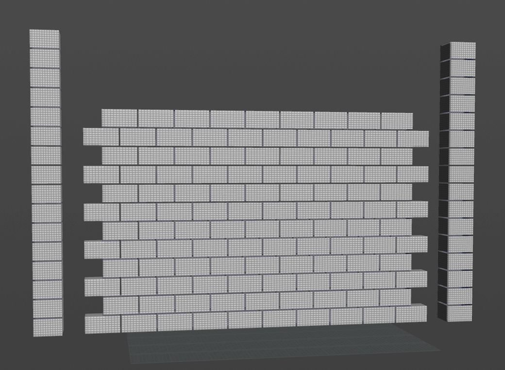
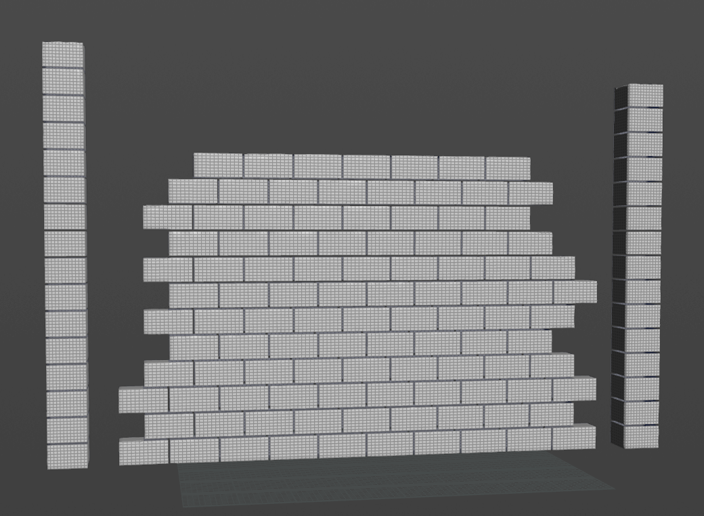
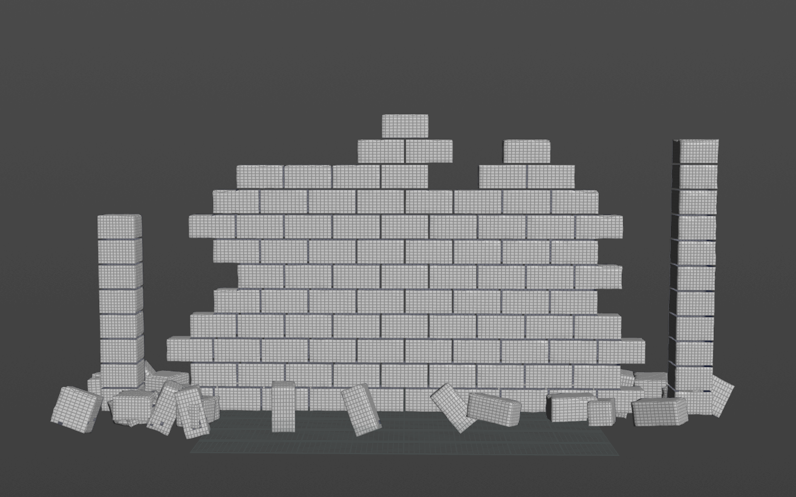
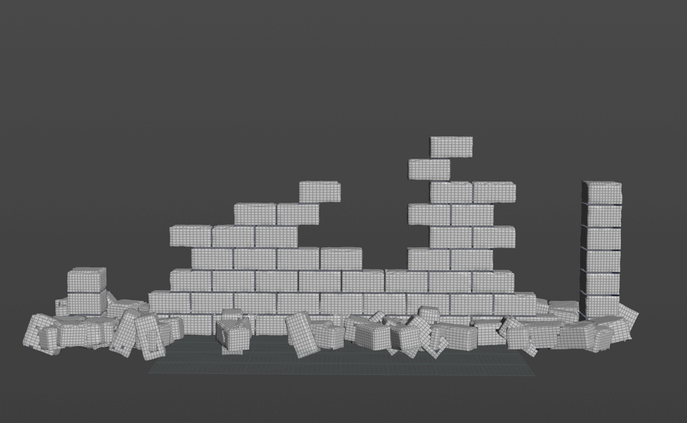
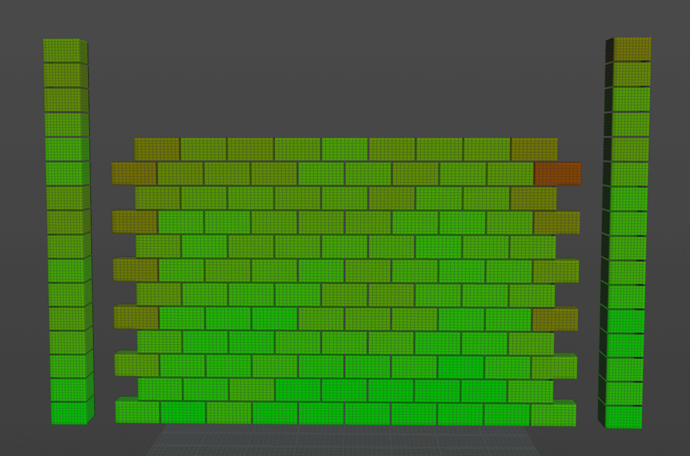
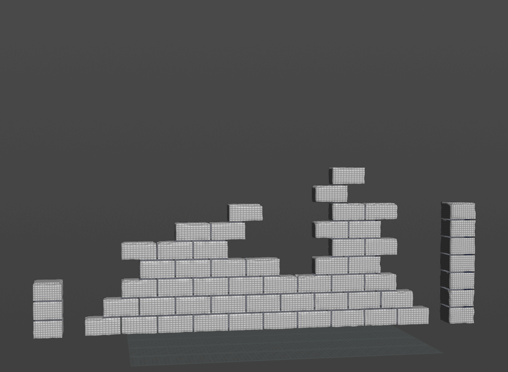
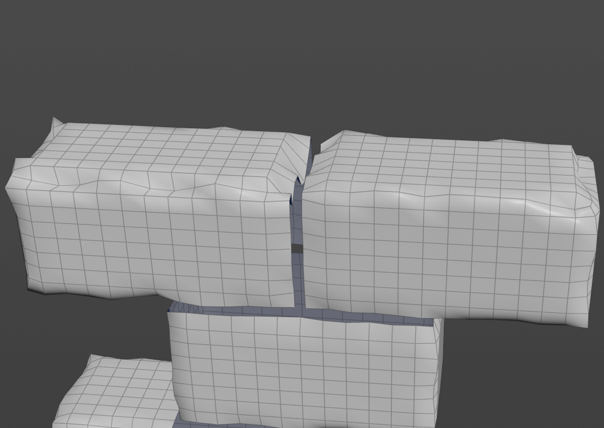
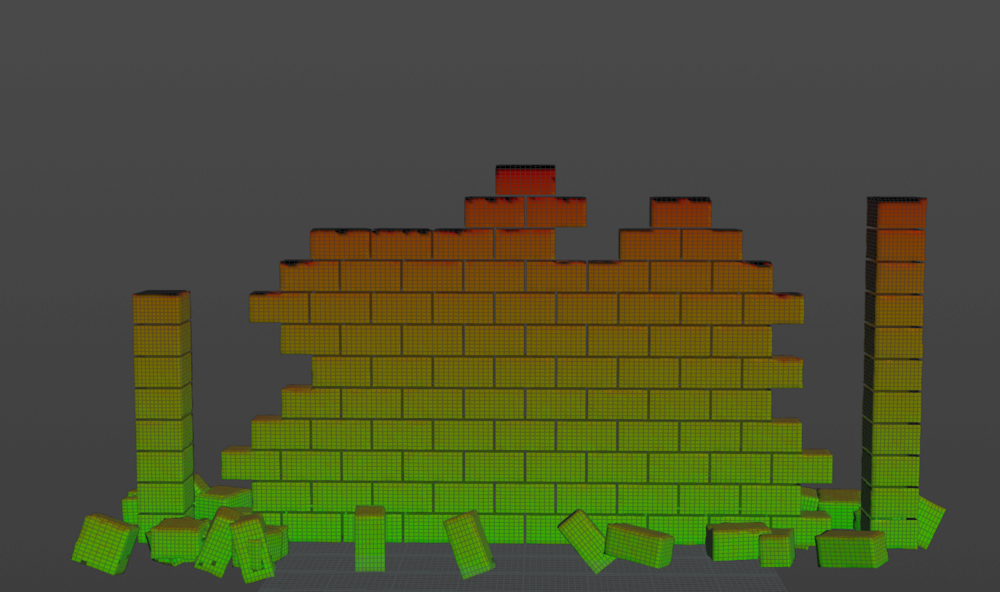

# Ruin Reclamation

A procedural environment-aging tool: given a clean stone ruin and an `age` slider, edges weather, blocks fall, and vines grow into the gaps. Built as a Houdini Digital Asset, driven from Unreal Engine through Houdini Engine.

- Design doc: [design-doc.md](design-doc.md)
- Course instructions: [instructions.md](instructions.md)

## Milestone #1

### Anna (structure)

#### Progress

- **Week-1 goals: all done.** Blockified test asset, per-block `height` / `support`, stability score, edge weathering.
- **Ahead of plan:**
  - `age`-driven block removal with a cascade pass (blocks whose supporters are gone fall too), noisy skyline, separate normalization for the columns.
  - Rubble: fallen blocks move to the wall base with random offset and rotation (`rubble = 1`) and receive the growth field.
  - Growth field exported for P2: `ao`, `crevice`, `moisture` in [0, 1] plus `piece`, at three ages (`houdini/export/`).
  - Packaged as an HDA (`houdini/hda/ruin_structure.hdanc`) exposing `age`, erosion depth / band, collapse range and seed, so P2 can work from it independently.
- **Blocked:** UE round-trip, pending a Houdini Engine license.
- **Plan change:** because of the above, the P1 column for weeks 2-3 is revised; see the [Timeline](design-doc.md#timeline).

#### Output

All images are Houdini viewport captures of the `ruin_structure` HDA (`houdini/hda/ruin_structure.hdanc`) on the built-in test wall. Unless noted, parameters are at their defaults: erosion depth 0.18, erosion bandwidth 0.08, collapse min / max 0.3 / 0.8, seed 0.

**1. Collapse over `age`**

The two ends of the wall go first. By 0.6 the upper courses have fallen, leaving a ragged skyline, and fallen blocks pile up at the base. By 1.0 most of the wall is gone and the top edges are visibly eroded.

| `age` = 0 | `age` = 0.3 |
| --- | --- |
|  |  |
| **`age` = 0.6** | **`age` = 1.0** |
|  |  |

*`age` = 0 / 0.3 / 0.6 / 1.0, same camera for all four.*

**2. Why those bricks fall: stability score**

Each block's score combines its height above ground, the number of blocks supporting it, its end-of-wall position and a spatial noise, so the skyline collapses in patches. A block falls when its score drops below a threshold that rises with `age` (from collapse min to collapse max); a cascade pass then drops any block left with no support, so nothing floats.

*`age` = 0, viewport colored by the `stability` attribute (green = stable, red = likely to fall).*

**3. Rubble: before and after**

In the first version a fallen block simply disappeared. Now it lands at the wall base with a random offset and tilt, so the ruin reads as collapsed rather than unbuilt, and the rubble becomes surface for the vines.

| Fallen blocks deleted | Fallen blocks kept as rubble |
| --- | --- |
|  |  |

*`age` = 1.0 for both; left captured before the rubble step was added.*

**4. Edge weathering close-up**

Noise displacement is weighted toward edges and upward faces, so the exposed top bricks are worn more than the one below.

*`age` = 1.0, camera zoomed in on the top courses, wireframe on to show the displaced surface.*

**5. Handoff to vegetation: growth field**

`moisture` is derived from height, ray-cast ambient occlusion and facing, so the wall base, inside corners and rubble pile are wettest. P2 weights vine attractors by this field, so vines favor the rubble and lower courses, as in the Ta Prohm reference.

*`age` = 0.6, viewport colored by the `moisture` attribute (green = wet, red = dry).*

### Jacky (vegetation)

_TBD_
