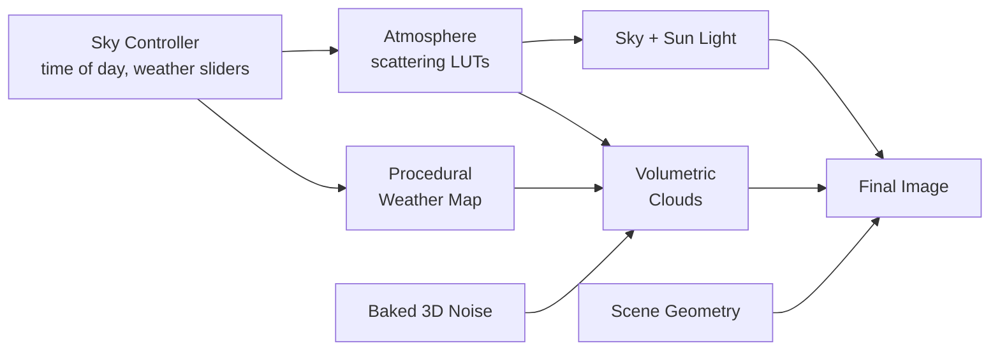
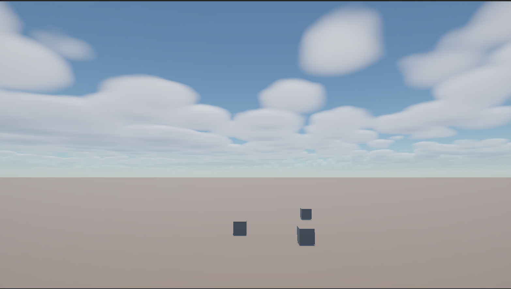
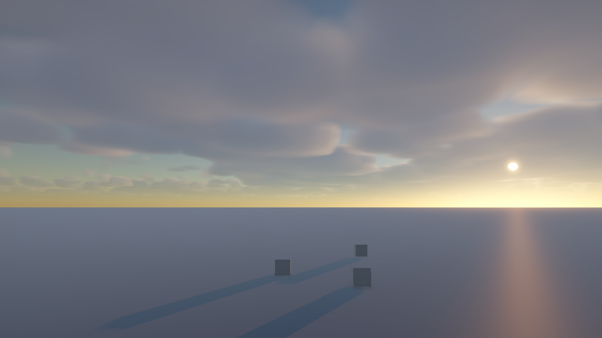
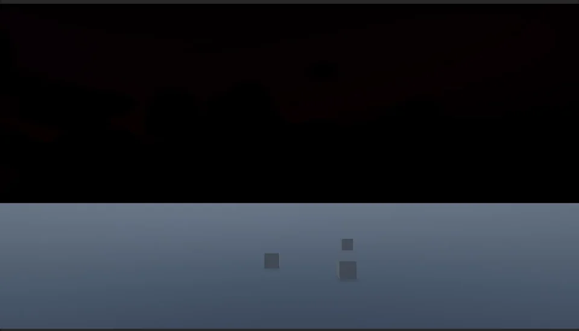
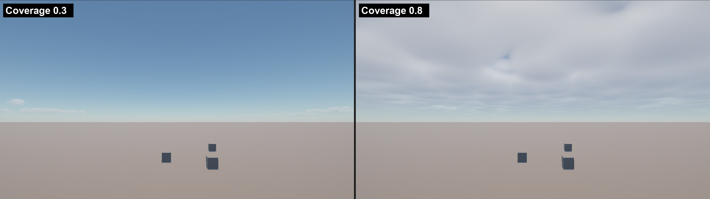
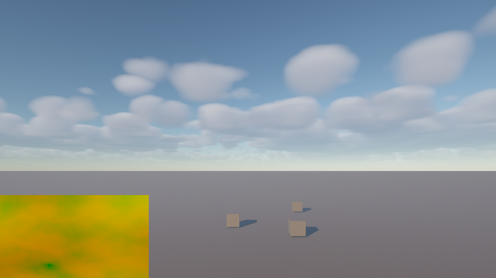

# Skyward — A Procedural Sky, Cloud & Weather System for Unity URP

> CIS 5660 Final Project — Design Doc
> Author: Yikai Li

---

## Introduction

In open-world games the sky is not just a backdrop. It drives the lighting of the whole scene: the sun's color at dusk, the bluish haze that tells you a mountain is far away, cloud shadows sweeping across a field, and the way the mood shifts from a clear morning to a storm. Modern open-world titles (and especially stylized, live-service open-world games) treat the sky as a **time-of-day + weather subsystem** that must be physically plausible, art-directable, and cheap enough to run in real time across a wide range of hardware.

I want to build that subsystem myself, as an engine-level feature inside Unity's Universal Render Pipeline (URP), so that I deeply understand the techniques that production engines (Unreal, Frostbite, Decima) use, and the trade-offs between physical accuracy, artistic control, and performance.

## Goal

Build a real-time, procedural **sky + volumetric cloud system** in Unity URP, consisting of:

1. **Physically based atmospheric scattering** (Rayleigh, Mie, ozone) using the LUT-based method of Hillaire 2020.
2. A **time-of-day controller** that moves the sun and drives the sky and the scene's sun light.
3. A **procedurally generated, evolving weather map**: noise-based cloud coverage and type fields that drift and change over time.
4. **Raymarched volumetric clouds** shaped by the weather map and procedural 3D noise, lit with a physically motivated model, and rendered at a real-time budget.

Beyond this core, the stretch goals add temporal reprojection, aerial perspective, weather presets, and a stylized (anime-style) cloud lighting mode.

The final deliverable is an interactive Unity demo scene (simple terrain plus a few props) where the user can scrub the time of day, tweak weather parameters, and see per-pass GPU timings.

## Inspiration / Reference

| Reference | What I take from it |
|---|---|
| **Hillaire, S. 2020.** *A Scalable and Production Ready Sky and Atmosphere Rendering Technique.* EGSR 2020 / Computer Graphics Forum 39(4). [Paper](https://sebh.github.io/publications/egsr2020.pdf) · [Code](https://github.com/sebh/UnrealEngineSkyAtmosphere) | The core atmosphere model: transmittance, multi-scattering, sky-view, and aerial-perspective LUTs. This is the technique behind Unreal Engine's SkyAtmosphere component. |
| **Bruneton, E. & Neyret, F. 2008.** *Precomputed Atmospheric Scattering.* EGSR 2008. [Project page](https://ebruneton.github.io/precomputed_atmospheric_scattering/) | Background on precomputed scattering and LUT parameterization. |
| **Schneider, A. & Vos, N. 2015.** *The Real-time Volumetric Cloudscapes of Horizon Zero Dawn.* SIGGRAPH 2015, Advances in Real-Time Rendering. [Course page](https://advances.realtimerendering.com/s2015/index.html) | Cloud modeling (weather map, Perlin-Worley base + Worley detail noise, height gradients), the lighting model (Beer's law, powder effect, HG phase), and temporal reprojection. |
| **Schneider, A. 2017.** *Nubis: Authoring Real-Time Volumetric Cloudscapes with the Decima Engine.* SIGGRAPH 2017, Advances in Real-Time Rendering. [Course page](https://advances.realtimerendering.com/s2017/index.html) | How cloud systems are made art-directable in a shipped open-world engine. |
| **Hillaire, S. 2016.** *Physically Based Sky, Atmosphere and Cloud Rendering in Frostbite.* SIGGRAPH 2016, Physically Based Shading course. [Course page](https://blog.selfshadow.com/publications/s2016-shading-course/) | Energy-conserving scattering integration and how sky and clouds feed scene lighting. |
| **Wrenninge, M., Kulla, C. & Lundqvist, V. 2013.** *Oz: The Great and Volumetric.* SIGGRAPH 2013 Talks. | Multiple-scattering approximation using attenuated "octaves". |
| **Högfeldt, R. 2016.** *Convincing Cloud Rendering.* Master's thesis, Chalmers University of Technology. | A detailed, implementation-level walkthrough of a Frostbite-style cloud renderer. |
| **Bridson, R., Hourihan, J. & Nordenstam, M. 2007.** *Curl-Noise for Procedural Fluid Flow.* SIGGRAPH 2007. | Divergence-free noise used to advect and distort the weather map so it evolves naturally. |

**Physically based atmosphere — Hillaire 2020**


*Image: S. Hillaire, [publications page](https://sebh.github.io/publications/).*

**Volumetric cloudscapes — Horizon Zero Dawn (Schneider & Vos 2015)**


*Image: Guerrilla Games, [The Real-time Volumetric Cloudscapes of Horizon Zero Dawn](https://www.guerrilla-games.com/read/the-real-time-volumetric-cloudscapes-of-horizon-zero-dawn).*

## Specification

### Core features (must ship)

**Atmosphere**
- Transmittance and multiple-scattering LUTs, recomputed only when the atmosphere parameters change.
- A per-frame sky-view LUT, used to render the sky dome and sun disk.

**Time of day**
- The sun direction is computed from the time of day.
- The sun light's color and intensity are derived from the transmittance LUT, so the scene is lit warm at sunset and the sky stays consistent with the lighting.

**Procedural weather map**
- A 2D weather map is generated on the GPU from layered noise:
  - Coverage: fBm of Perlin-Worley noise.
  - Cloud type: low-frequency noise.
  - Density.
- It scrolls with the wind and is distorted by curl noise, so cloud formations grow, drift, and dissolve over time.
- Global sliders (coverage, cloud type bias, wind) let the user steer the generated weather.

**Volumetric clouds**
- A cloud layer between two altitudes on a spherical planet shell.
- Tileable 3D noise (128³ Perlin-Worley base, 32³ Worley detail), baked by an editor tool.
- Raymarched lighting: Beer–Lambert extinction, dual-lobe Henyey–Greenstein phase, powder term, multiple-scattering octaves, and a short light march toward the sun.
- Performance: clouds are rendered at 1/4 resolution with blue-noise ray offsets, then composited with a depth-aware upsample so terrain occludes them correctly.

**Tooling**
- Runtime debug UI: time slider, weather sliders, and LUT and weather-map visualizers.
- Per-pass GPU timings.

### Stretch goals (in priority order)
Given the four-week schedule, I expect to reach one or two of these at most.

1. **Temporal reprojection:** re-march only 1/16 of the pixels each frame for a large speed-up, with history rejection to avoid ghosting.
2. **Aerial perspective:** a froxel volume that applies atmospheric haze to distant scene geometry.
3. **Weather presets:** Clear / Cloudy / Overcast / Storm, with smooth transitions between them.
4. **Cloud shadows** on the terrain, and **sky-driven ambient lighting** (SH computed from the sky-view LUT).
5. **Stylized mode:** the same cloud density field shaded with a toon ramp, hard light/shadow edges, and rim light.
6. **Night sky:** moon and procedural stars.

## Techniques

### 1. LUT-based atmosphere (Hillaire 2020)
The atmosphere is a participating medium with three constituents. Each one has its own altitude density profile, and the profiles are summed:
- **Rayleigh** (air molecules): wavelength-dependent scattering that makes the sky blue and sunsets red.
- **Mie** (aerosols): forward scattering that produces haze and the sun halo.
- **Ozone**: absorption only, which adds the twilight tint.

The cost is split across lookup tables, each built by a compute shader:

| LUT | Size | Content | Update |
|---|---|---|---|
| Transmittance | 256×64 | Optical depth from (altitude, sun zenith) to the top of the atmosphere | On parameter change |
| Multi-scattering | 32×32 | Isotropic infinite-order scattering, using the paper's closed-form geometric series | On parameter change |
| Sky-View | 192×108 | Sky radiance around the camera, with a non-linear latitude mapping that keeps the horizon detailed | Every frame |

I will port the reference implementation from Hillaire's open-source code (HLSL) to Unity compute shaders.

### 2. Procedural weather map
A compute shader writes an RGBA weather texture each frame (or every few frames):
- **R — coverage:** fBm of Perlin-Worley noise, remapped by the global coverage slider.
- **G — cloud type:** low-frequency value noise, ranging from stratus (0) to cumulonimbus (1).
- **B — density:** a secondary noise layer.

The sample position is `p + wind * t + curl(p, t) * strength`. The curl-noise term (Bridson 2007) makes the formations swirl and evolve instead of just sliding across the sky.

### 3. Cloud density model (Schneider 2015)
```
base     = remap(PerlinWorley(p), WorleyFBM(p) - 1, 1, 0, 1)
shape    = remap(base * heightGradient(h, cloudType), 1 - coverage, 1, 0, 1) * coverage
density  = remap(shape, detailErosion(p, h), 1, 0, 1)
```
- `heightGradient` defines the vertical profile of each cloud type.
- Detail noise erodes the edges more strongly near the cloud base, producing wispy bottoms and billowy tops.

### 4. Cloud lighting
For each primary sample, the integrator accumulates energy-conserving in-scattered light (Hillaire 2016):
- **Sun term:** `L_sun · T_light · phase_HG2(θ) · powder`, where `T_light` comes from a short march toward the sun and `L_sun` comes from the transmittance LUT.
- **Multiple scattering:** a sum over a few octaves with attenuated extinction, eccentricity, and contribution (Wrenninge 2013).
- **Ambient:** a height-based gradient tinted by the sky color.
- **Optimizations:** adaptive step size and early exit when transmittance is low.

### 5. Unity URP integration
- Target **Unity 6 (6000.0 LTS)** with URP. The sky and clouds are implemented as `ScriptableRendererFeature`s.
- I will start with the Render Graph API. If it becomes a blocker, URP's *Compatibility Mode* allows the older `Execute`-based passes, which have more learning resources.
- `AsyncGPUReadback` reads back the sun's transmittance so the directional light's color can be set without stalling the GPU.

## Design

<!-- Optional: replace the Mermaid block below with a hand-drawn diagram, e.g.  -->


- **Sky Controller:** holds the time and weather state and sends parameters to the rendering passes.
- **Atmosphere:** builds the LUTs, renders the sky, and provides the sun light color to both the scene and the clouds.
- **Procedural Weather Map:** generates where clouds are and what type they are, and evolves that over time.
- **Volumetric Clouds:** raymarch the 3D noise inside the weather map's footprint, lit by the atmosphere's sun color.
- **Final Image:** composites the sky, clouds, and scene, with depth-aware occlusion.

## Timeline

Solo project: all tasks are done by Yikai Li.

| Week | Dates | Tasks | Milestone |
|---|---|---|---|
| 1 | 11/5 – 11/11 | Set up the Unity URP project and renderer feature skeleton; port the transmittance, multi-scattering, and sky-view LUTs and render the sky; time-of-day controller with sun direction and sun light color; noise baker tool; procedural weather map; first raymarched clouds with Beer–Lambert lighting only. Visuals may be crude. | **Milestone 1 (11/11):** the bulk of the generator works end to end |
| 2 | 11/12 – 11/18 | Full cloud lighting (HG phase, powder, multi-scattering, light march); curl-noise evolution of the weather map; 1/4-resolution rendering, blue noise, and depth-aware upsample. | |
| 3 | 11/19 – 11/23 | Debug UI and GPU timing measurements; bug fixing; any core feature not done by now is cut. If ahead of schedule: temporal reprojection. | **Milestone 2 (11/23):** feature complete, working copy for in-class critique |
| 4 | 11/24 – 11/30 | Polish based on the critique: tune parameters and colors, add camera animation, build the demo scene; record the demo video; write the final results and post-mortem sections. If time allows: aerial perspective or weather presets. | **Final (11/30)** |

**Performance target:** the full sky and clouds run at ≤ 3 ms of GPU time at 1080p on my development GPU.

**Risks & mitigations**
- *URP plumbing (render graph, render textures, compute dispatch) takes longer than expected:* build the feature skeleton in week 1 before any heavy shader work, and fall back to Compatibility Mode if needed.
- *Clouds look flat or dark:* compare against the HZD and Frostbite reference images early, and keep the multi-scattering approximation in the core.
- *Schedule slip:* all stretch goals are independent and optional; the core features alone form a complete, demonstrable system.

---

## Milestone #1

### Progress

The full pipeline works: the sky, the sun's movement, the clouds, and the "weather map" that decides where clouds appear are all running together in Unity 6.2 (URP). The Unity project is in [`Skyward/`](Skyward/).

| Noon | Sunset |
|---|---|
|  |  |

**Time of day:** dragging one slider moves the sun. The sky, the clouds and the scene lighting all change with it.



**What I built**
- **Sky.** The sky color is computed physically. For every pixel, the shader steps along the view ray through the atmosphere and adds up how much sunlight air and haze scatter toward the camera. This is why the sky is blue overhead, whiter near the horizon, and warm at sunset. The physical constants come from Hillaire 2020.
- **Sun and time of day.** A script ([`SkyController.cs`](Skyward/Assets/Skyward/Scripts/SkyController.cs)) turns a 0–24 h slider into a sun direction. It also computes how much sunlight survives the trip through the atmosphere, and uses that to color the scene's directional light. At sunset the light on the ground turns warm, and it matches the sky.
- **Weather map.** A 2D noise texture covering the sky, seen from above. It answers two questions for every location: *is there a cloud here*, and *what kind of cloud*. It drifts with the wind and slowly changes over time, so clouds form and dissolve. One **Coverage** slider controls how cloudy the sky is overall.
- **Volumetric clouds.** The clouds are real 3D volumes between 1.5 km and 4 km altitude, not flat pictures. The shader marches through this layer and asks at each step how thick the cloud is there. The cloud shapes come from 3D noise: a large, puffy noise for the overall shape, and a finer noise that eats away the edges (the approach from *Horizon Zero Dawn*, Schneider 2015). For lighting, it checks how much cloud lies between each point and the sun. That makes the side facing the sun bright, the bottoms darker, and the edges glow when you look toward the sun.
- **How it is plugged into Unity.** Everything above is one shader ([`SkyAndClouds.shader`](Skyward/Assets/Skyward/Shaders/SkyAndClouds.shader)) that runs over the whole screen after the scene is drawn. It only paints pixels where there is no object, so buildings and terrain correctly block the sky. A menu item, **Skyward → Setup Scene**, sets everything up in one click.

**Coverage slider**



Left: coverage 0.3 gives a few separate clouds. Right: coverage 0.8 gives a mostly cloudy sky that still has gaps and shape.

**Weather map debug view**



The bottom-left corner shows the weather map around the camera (60 km × 60 km). The more red, the more cloud; the more green, the taller the cloud type.

**Performance:** about 73 FPS at 1568×882 in Play mode. This number includes the Unity editor's own overhead, so it does not yet show exactly how much time the sky and clouds take on the GPU.

### What I simplified compared to the plan
To get everything working by this milestone, I chose the quickest version of each part:
- **The sky is computed from scratch for every pixel, every frame.** The plan is to precompute it into small lookup textures, which is much faster. Light that bounces more than once in the air is also not included yet.
- **The cloud noise is generated live in the shader.** The plan is to generate it once ahead of time and store it in 3D textures.
- **The clouds are drawn at full resolution.** The plan is to draw them at a quarter of the resolution and scale them up, which is a common trick in games.

### What's giving me trouble
- **Making the Coverage slider look natural.** My first attempts gave either no clouds at all or a flat grey sheet. A later version gave tiny round puffs. What fixed it was splitting the job in two: the weather map decides *where* clouds are, and the cloud shape decides *how thick* they are.
- **Speed.** Generating 3D noise live is expensive, and the lighting check toward the sun repeats that work several times per step. Pre-generating the noise and drawing at lower resolution should fix most of this.
- **The sky is a bit too dark.** Because multiple light bounces are missing, the sky near the horizon is slightly darker and duller than in the reference images.
- **Far-away clouds look blurry.** Near the horizon a ray crosses up to 40 km of cloud layer with the same number of steps as an overhead ray, so distant clouds lose detail and show faint stripes.

### Plan for Milestone 2
1. Pre-generate the cloud noise into 3D textures.
2. Draw the clouds at a quarter of the resolution, then upscale them. If time allows, reuse results from the previous frame to make them even cheaper (temporal reprojection).
3. Switch the sky to precomputed lookup textures, and add multiple light bounces.
4. Add an on-screen control panel and accurate GPU timings.

---

<details>
<summary>Original assignment instructions</summary>

# Final Project!

This is it! The culmination of your procedural graphics experience this semester. For your final project, we'd like to give you the time and space to explore a topic of your choosing. You may choose any topic you please, so long as you vet the topic and scope with an instructor or TA. We've provided some suggestions below. The scope of your project should be roughly 1.5 homework assignments). To help structure your time, we're breaking down the project into 4 milestones:

## Project planning: Design Doc (due 11/4)
Before submitting your first milestone, _you must get your project idea and scope approved by Rachel, Adam or a TA._

### Design Doc
Start off by forking this repository. In your README, write a design doc to outline your project goals and implementation plan. It must include the following sections:

#### Introduction
- What motivates your project?

#### Goal
- What do you intend to achieve with this project?

#### Inspiration/reference:
- You must have some form of reference material for your final project. Your reference may be a research paper, a blog post, some artwork, a video, another class at Penn, etc.  
- Include in your design doc links to and images of your reference material.

#### Specification:
- Outline the main features of your project.

#### Techniques:
- What are the main technical/algorithmic tools you’ll be using? Give an overview, citing specific papers/articles.

#### Design:
- How will your program fit together? Make a simple free-body diagram illustrating the pieces.

#### Timeline:
- Create a week-by-week set of milestones for each person in your group. Make sure you explicitly outline what each group member's duties will be.

Submit your Design doc as usual via pull request against this repository.
## Milestone 1: Implementation part 1 (due 11/11)
Begin implementing your engine! Don't worry too much about polish or parameter tuning -- this week is about getting together the bulk of your generator implemented. By the end of the week, even if your visuals are crude, the majority of your generator's functionality should be done.

Put all your code in your forked repository.

Submission: Add a new section to your README titled: Milestone #1, which should include
- written description of progress on your project goals. If you haven't hit all your goals, what's giving you trouble?
- Examples of your generators output so far
We'll check your repository for updates. No need to create a new pull request.
## Milestone 2: Implementation part 2 (due 11/23)
We're over halfway there! This week should be about fixing bugs and extending the core of your generator. Make sure by the end of this week _your generator works and is feature complete._ Any core engine features that don't make it in this week should be cut! Don't worry if you haven't managed to exactly hit your goals. We're more interested in seeing proof of your development effort than knowing your planned everything perfectly. 

Put all your code in your forked repository.

Submission: Add a new section to your README titled: Milestone #3, which should include
- written description of progress on your project goals. If you haven't hit all your goals, what did you have to cut and why? 
- Detailed output from your generator, images, video, etc.
We'll check your repository for updates. No need to create a new pull request.

Come to class on the due date with a WORKING COPY of your project. We'll be spending time in class critiquing and reviewing your work so far.

## Final submission (due 11/30)
Time to polish! Spen this last week of your project using your generator to produce beautiful output. Add textures, tune parameters, play with colors, play with camera animation. Take the feedback from class critques and use it to take your project to the next level.

Submission:
- Push all your code / files to your repository
- Come to class ready to present your finished project
- Update your README with two sections 
  - final results with images and a live demo if possible
  - post mortem: how did your project go overall? Did you accomplish your goals? Did you have to pivot?

## Topic Suggestions

### Create a generator in Houdini

### A CLASSIC 4K DEMO
- In the spirit of the demo scene, create an animation that fits into a 4k executable that runs in real-time. Feel free to take inspiration from the many existing demos. Focus on efficiency and elegance in your implementation.
- Example: 
  - [cdak by Quite & orange](https://www.youtube.com/watch?v=RCh3Q08HMfs&list=PLA5E2FF8E143DA58C)

### A RE-IMPLEMENTATION
- Take an academic paper or other pre-existing project and implement it, or a portion of it.
- Examples:
  - [2D Wavefunction Collapse Pokémon Town](https://gurtd.github.io/566-final-project/)
  - [3D Wavefunction Collapse Dungeon Generator](https://github.com/whaoran0718/3dDungeonGeneration)
  - [Reaction Diffusion](https://github.com/charlesliwang/Reaction-Diffusion)
  - [WebGL Erosion](https://github.com/LanLou123/Webgl-Erosion)
  - [Particle Waterfall](https://github.com/chloele33/particle-waterfall)
  - [Voxelized Bread](https://github.com/ChiantiYZY/566-final)

### A FORGERY
Taking inspiration from a particular natural phenomenon or distinctive set of visuals, implement a detailed, procedural recreation of that aesthetic. This includes modeling, texturing and object placement within your scene. Does not need to be real-time. Focus on detail and visual accuracy in your implementation.
- Examples:
  - [The Shrines](https://github.com/byumjin/The-Shrines)
  - [Watercolor Shader](https://github.com/gracelgilbert/watercolor-stylization)
  - [Sunset Beach](https://github.com/HanmingZhang/homework-final)
  - [Sky Whales](https://github.com/WanruZhao/CIS566FinalProject)
  - [Snail](https://www.shadertoy.com/view/ld3Gz2)
  - [Journey](https://www.shadertoy.com/view/ldlcRf)
  - [Big Hero 6 Wormhole](https://2.bp.blogspot.com/-R-6AN2cWjwg/VTyIzIQSQfI/AAAAAAAABLA/GC0yzzz4wHw/s1600/big-hero-6-disneyscreencaps.com-10092.jpg)

### A GAME LEVEL
- Like generations of game makers before us, create a game which generates an navigable environment (eg. a roguelike dungeon, platforms) and some sort of goal or conflict (eg. enemy agents to avoid or items to collect). Aim to create an experience that will challenge players and vary noticeably in different playthroughs, whether that means procedural dungeon generation, careful resource management or an interesting AI model. Focus on designing a system that is capable of generating complex challenges and goals.
- Examples:
  - [Rhythm-based Mario Platformer](https://github.com/sgalban/platformer-gen-2D)
  - [Pokémon Ice Puzzle Generator](https://github.com/jwang5675/Ice-Puzzle-Generator)
  - [Abstract Exploratory Game](https://github.com/MauKMu/procedural-final-project)
  - [Tiny Wings](https://github.com/irovira/TinyWings)
  - Spore
  - Dwarf Fortress
  - Minecraft
  - Rogue

### AN ANIMATED ENVIRONMENT / MUSIC VISUALIZER
- Create an environment full of interactive procedural animation. The goal of this project is to create an environment that feels responsive and alive. Whether or not animations are musically-driven, sound should be an important component. Focus on user interactions, motion design and experimental interfaces.
- Examples:
  - [The Darkside](https://github.com/morganherrmann/thedarkside)
  - [Music Visualizer](https://yuruwang.github.io/MusicVisualizer/)
  - [Abstract Mesh Animation](https://github.com/mgriley/cis566_finalproj)
  - [Panoramical](https://www.youtube.com/watch?v=gBTTMNFXHTk)
  - [Bound](https://www.youtube.com/watch?v=aE37l6RvF-c)

### YOUR OWN PROPOSAL
- You are of course welcome to propose your own topic . Regardless of what you choose, you and your team must research your topic and relevant techniques and come up with a detailed plan of execution. You will meet with some subset of the procedural staff before starting implementation for approval.


</details>
