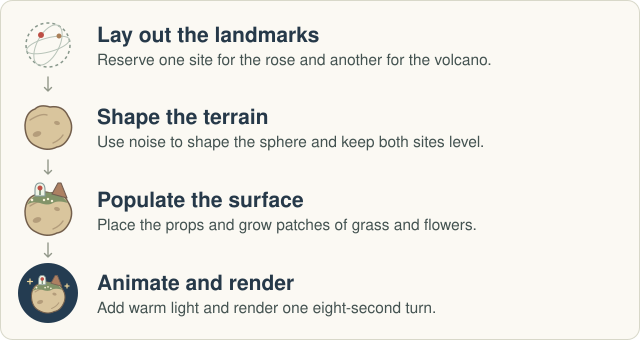

# A Rose on B-612

*A Procedural Storybook Planet in Houdini*

**Yao tang**

CIS 5660 · Final Project Design Doc · November 4, 2026

## Introduction

What caught my eye in *The Little Prince: Across the Stars* was the scale of the planet. From far enough away to see the whole world, I could still pick out a single rose. I want to keep that sense of scale as the planet turns and a different part of its surface comes into view. The challenge is deciding what can change with a random seed and what needs to stay fixed for the composition to work.

## Goal

I will make a small Houdini planet with a red rose under a clear dome, one volcano, and patches of grass and white flowers. The final shot will be an eight-second turntable against a deep blue sky. Two stills from the same camera will show how changing the seed changes the terrain and planting.

## Inspiration / Reference

*Visual reference: title artwork from [Sac’s Little Prince project](https://littleprince.dev/) ([original image](https://littleprince.dev/keyart.031aa305131370a0e08c9cb92d1b1aaa.jpg)).*

Three details in the reference will guide my version: the volcanoes interrupt the round outline; the white flowers form patches with bare ground between them; and the rose has the strongest red in the scene. I will model the props in Houdini and use these relationships to guide their placement.

## Specification

The generator will expose three controls: **seed**, **terrain relief**, and **plant density**. The rose and volcano will have fixed locations so I can compose the opening shot once. The rose will sit in a small clearing, and patches of bare rock will show between clumps of plants.

## Techniques

I will use 3D noise to move points outward or inward on a subdivided sphere. A smooth falloff around the rose and volcano will keep the ground under each prop level. The noise will use the sphere’s rest position so the pattern stays attached during rotation. [Perlin, *An Image Synthesizer* (1985)](https://doi.org/10.1145/325334.325247) · [SideFX, Attribute Noise](https://www.sidefx.com/docs/houdini/nodes/sop/attribnoise.html)

I will model one grass tuft and one white flower. A noise mask will group them into patches, and an exclusion mask will keep the clearings open. Each copy will align with the local surface so plants point away from the planet on every side. [SideFX, Scatter and Align](https://www.sidefx.com/docs/houdini/nodes/sop/scatteralign.html) · [SideFX, Copy to Points](https://www.sidefx.com/docs/houdini/copy/copytopoints.html)

For the shot I will light the rose from the side and rotate the assembled planet at a constant speed in front of a fixed camera.

## Design

## Timeline

I will handle the modeling, generator, lighting, animation, and documentation.

| Dates | My work | Deliverable |
| --- | --- | --- |
| Nov 4 | Set the scope and review it with course staff. | Design doc |
| Nov 5–11 | Build the terrain, reserve two landmark sites, and scatter placeholder plants. Compare two seeds. | Milestone 1 preview images and progress update |
| Nov 12–18 | Model the rose, dome, volcano, grass tuft, and flower. Set the camera and light. | First color still |
| Nov 19–23 | Set up the rotation and check both seeds for floating props or plants inside the dome. | Working scene, preview loop, and Milestone 2 update |
| Nov 24–30 | Apply critique feedback and render the final shot. | Houdini scene, eight-second loop, two seed stills, presentation, and postmortem |

[Original course assignment and submission instructions](docs/course-brief.md)
