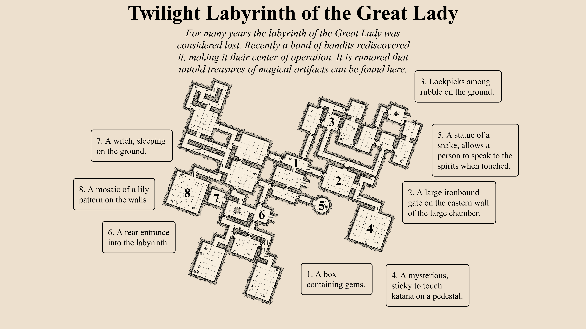
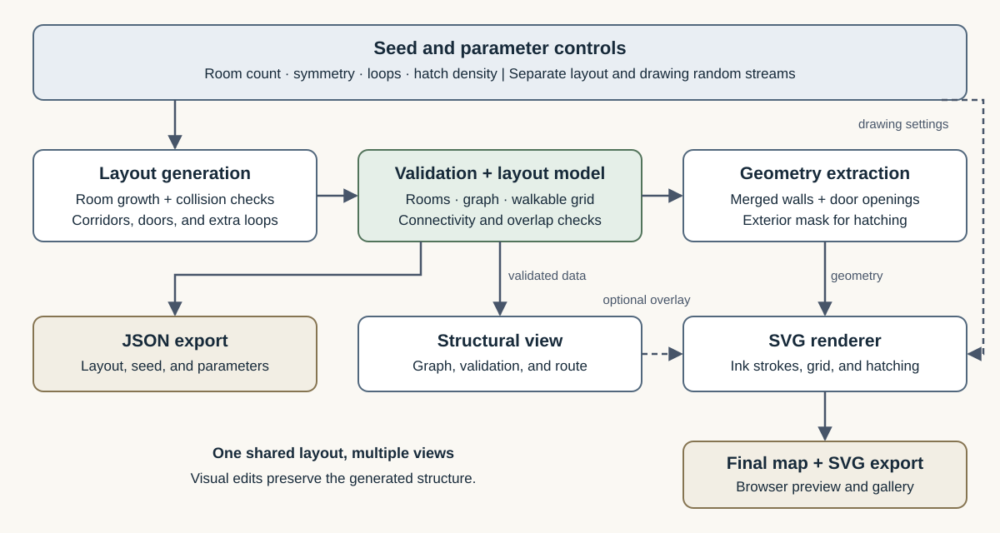

# Procedural Hand-Drawn Dungeon Map Generator

**CIS 5660 Final Project — Design Doc**

**Proposal due:** November 4, 2026

**Project format:** Individual

**Status:** Proposed topic and scope for instructor/TA review.

## Introduction

Hand-drawn dungeon maps combine readable spatial structure with expressive visual detail. I am interested in how a procedural system can produce maps that feel intentionally designed: rooms form recognizable groups, corridors connect them coherently, and imperfect ink strokes give the result a consistent visual identity.

Inspired by Watabou's One Page Dungeon, I will build a browser-based generator that combines partially symmetric layouts with procedural pen-and-paper rendering. The project fits the course's **A RE-IMPLEMENTATION** and **A FORGERY** directions. My implementation will focus on the generation and drawing algorithms.

## Goal

Create a controllable generator for connected, single-floor dungeon maps with a hand-drawn appearance. Different seeds should produce visibly different layouts; reusing a seed and the same parameters should reproduce the same result.

The main technical goals are:

- Generate varied room-and-corridor layouts with adjustable symmetry and additional loops.
- Convert the layout into clean walls, door openings, and floor boundaries.
- Render those boundaries with procedural ink variation and exterior hatching.
- Expose the generation stages so the relationship between parameters, structure, and final appearance is easy to demonstrate.

The intended scale is approximately 1.5 homework assignments. The final deliverable will be an interactive map-generation tool, an example gallery, and documented results.

## Inspiration/reference

### Watabou — One Page Dungeon

- [Live generator](https://watabou.github.io/one-page-dungeon/)
- [Project page and author's explanation of the layout algorithm](https://watabou.itch.io/one-page-dungeon)
- [Video that introduced the reference](https://www.bilibili.com/video/BV1Z6Jf6UEVs/)
- [Reference map with seed 1467063380](https://watabou.github.io/one-page-dungeon/?seed=1467063380)

*Figure 1. Reference output generated with One Page Dungeon by Oleg Dolya / Watabou, seed 1467063380, exported on November 4, 2026. This is reference material, not output from my implementation. The [author's FAQ](https://watabou.github.io/faq.html) permits use of generated map images.*

I will study its room groupings, door placement, wall treatment, and visual hierarchy. A small number of exported maps may serve as reference fixtures while developing the renderer. The final maps will come from my own generator.

### Technical references

1. **Oleg Dolya, One Page Dungeon — author discussion of layout generation.** On the [project page](https://watabou.itch.io/one-page-dungeon), the author describes growing a partly symmetric room tree and then adding connections to create loops. This is the starting point for my layout approach.
2. **Oleg Dolya, [Hatching in 1PDG](https://www.patreon.com/watawatabou/posts/hatching-in-1pdg-31716880), 2019.** Explains how spaced clusters of short strokes approximate hand-drawn dungeon shading.
3. **Robert Bridson, [Fast Poisson Disk Sampling in Arbitrary Dimensions](https://www.cs.ubc.ca/~rbridson/docs/bridson-siggraph07-poissondisk.pdf), SIGGRAPH Sketches, 2007.** Provides the sampling method I will adapt for distributing hatch clusters.

These sources inform an independent implementation. The reference application's compiled JavaScript will not be used as the project's generation engine.

## Specification

### Core features

| Feature | Planned behavior |
| --- | --- |
| Reproducible generation | A seed controls layout and visual variation through separate random streams. Changing drawing settings preserves the layout. |
| Connected layouts | Generate approximately 8–24 rectangular rooms, corridors, and door openings on a bounded grid. |
| Layout controls | Adjust target room count, probability of symmetric growth, and the proportion of eligible extra connections. |
| Hand-drawn rendering | Slightly irregular wall strokes, a floor grid, paper-and-ink colors, and exterior hatch clusters with adjustable density. |
| Structural visualization | Switch between the room graph, plain geometry, and final drawing; highlight an entrance-to-exit route. |
| Export | Save the final drawing as SVG and the generated layout and parameters as JSON. |

The entrance will be associated with the root room; an exit will be selected from a room far from it in graph distance. The route overlay demonstrates connectivity without requiring a gameplay system.

### Scope and success criteria

The core project covers one floor, rectangular room geometry, and one coherent drawing style. Combat, platforming physics, full narrative generation, multi-floor buildings, and world-map generation are outside this scope. If the core is complete early, I may add circular rooms or a second visual preset.

I will evaluate the generator using a fixed set of 100 seeds across supported parameter presets. Checks will cover room-interior overlap, floor connectivity, entrance-to-exit reachability, deterministic output, and bounded termination. If a layout cannot reach the requested room count within its placement budget, the interface will report the actual count.

A small visual gallery will compare seeds and parameter settings, especially low/high symmetry and sparse/dense hatching. I will also record generation and drawing times, aiming for roughly one second or less for a typical 24-room map on my development laptop.

## Techniques

### 1. Seeded, partially symmetric room growth

Following the idea described in reference 1, begin with a root room and grow children relative to each parent's entrance direction. Symmetric proposals place children on opposing sides; asymmetric proposals vary their size or keep only one child. A grid occupancy check rejects room overlaps and invalid corridor placements.

Use a finite placement budget to prevent stalled growth from running indefinitely. Each accepted child is connected to its parent, establishing a connected base layout.

### 2. Loop creation and structural validation

After tree growth, consider spatially nearby room pairs for additional connections. Add a door or a short orthogonal corridor only when the geometry permits it. The loop parameter controls how many eligible connections are attempted.

Maintain both a room adjacency graph and a walkable-cell grid. Breadth-first search checks graph reachability and selects the exit; flood fill checks the actual floor geometry. Keeping both representations helps detect a graph edge whose corridor was drawn incorrectly.

### 3. Boundary extraction and ink rendering

Extract the exterior edges of occupied floor cells, merge collinear edges, and preserve gaps for door openings. This avoids drawing internal walls between adjacent floor cells.

Draw the resulting geometry as SVG paths. Small seeded perturbations of curve control points and stroke widths create an ink effect while preserving the underlying collision-free layout. Geometry and drawing randomness remain independent.

### 4. Procedural hatching

Following references 2 and 3, distribute hatch-cluster centers with a two-dimensional Poisson disk sampler. Draw several short, slightly curved strokes around each center with controlled orientation and size variation.

Restrict the strokes to a narrow exterior band around the floor footprint using an SVG mask. This keeps hatching out of rooms and passages. Minimum sample spacing and a cap on cluster count will control drawing cost.

## Design

**Tools:** TypeScript for the algorithms and data model, SVG for rendering and vector export, HTML/CSS for controls, and Vite for local development and the browser build. The implementation does not require a game engine or external generation service.

*Figure 2. Planned system structure. The same validated layout feeds the renderer, structural views, and JSON export.*

The main modules will be:

- **Parameters and RNG:** store the seed and settings; provide separate layout and drawing random streams.
- **Layout generator:** create rooms, corridors, doors, and the adjacency graph.
- **Validator:** check occupancy and reachability; return validation results and the highlighted route.
- **Geometry builder:** extract floor boundaries, door gaps, and the hatch mask.
- **SVG renderer:** draw walls, floor grid, hatching, symbols, and the optional debug overlay.
- **Controls and export:** regenerate, switch views, and save SVG/JSON.

The shared data model will contain rooms, connections, door positions, a walkable grid, generation parameters, and the seed. Validation failures will be surfaced in the debug view rather than hidden by the final drawing.

The main risks are crowded layouts and excessive SVG path counts. Bounded placement attempts, a modest room limit, merged wall segments, and capped hatch density address those risks. Circular rooms and extra styles will be cut first if time is limited.

## Timeline

This is an individual project. I am responsible for all research, algorithms, rendering, interface work, evaluation, and documentation.

| Dates | My responsibilities | Deliverable |
| --- | --- | --- |
| **Nov. 4 — Proposal** | Finalize references, scope, architecture, and schedule; obtain instructor/TA approval of the topic and scope before submission. | Design doc in README, reference image, and system diagram; submit through a PR to the course repository after approval. |
| **Nov. 5–11 — Milestone 1** | Implement seeded room growth, collision checks, corridors, loop insertion, basic connectivity checks, and plain SVG output. Build an initial hatching prototype. | A working core generator with sample outputs and a README progress report by **Nov. 11**. |
| **Nov. 12–18 — Rendering and interaction** | Finish boundary extraction, door drawing, hand-drawn strokes, exterior hatching, parameter controls, structural views, and export. | Integrated generator and renderer; initial comparisons of seeds and visual settings. |
| **Nov. 19–23 — Milestone 2** | Run the fixed-seed checks, fix geometric failures, measure generation time, tune defaults, and finish all core features. Cut unfinished extensions. | A feature-complete working copy for the **Nov. 23** critique, with documented results. |
| **Nov. 24–30 — Final** | Apply critique feedback, polish line quality and composition, curate the gallery, record a short demonstration, and write the post mortem. | Final code, images, demonstration, and README results by **Nov. 30**; a live browser demo if feasible. |

---

The original course brief is preserved in [docs/assignment.md](docs/assignment.md).
