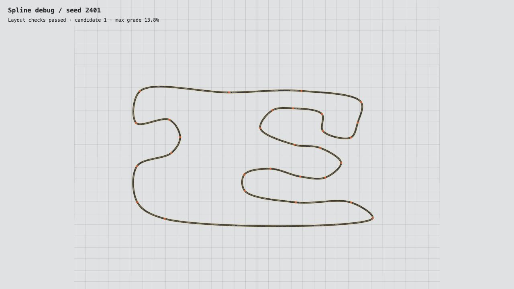
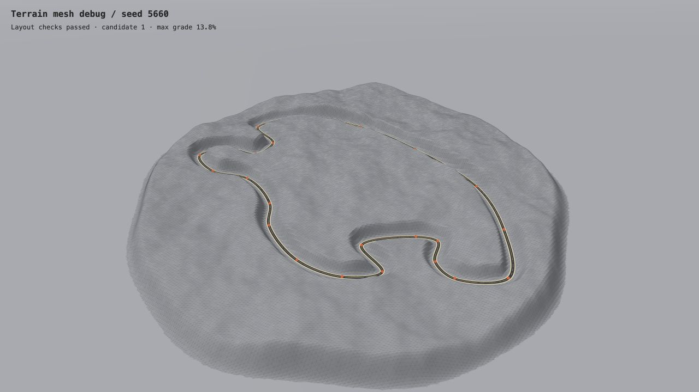

## Milestone #1

The browser demo generates a complete island circuit from a seed and a layout preset. It samples a closed Catmull–Rom spline, checks the sampled layout for crossings, tight turns, and insufficient clearance, and builds the road, curbs, and barriers. Layered gradient noise shapes the terrain and track elevation. The demo includes an overview, a top-down layout, and a camera that follows a lap.

Run from the repository root with Python 3 and open [the local demo](http://127.0.0.1:5660/) in a WebGL-capable browser. Select a preset or enter a seed, then click **Generate circuit**.

```sh
python3 -m http.server 5660 --bind 127.0.0.1 --directory demo
```

The demo uses JavaScript and bundles Three.js. 

**Shanghai-inspired, seed 2401.** The top-down debug view shows the sampled centerline and control points.



**Spa-inspired, seed 5660.** The terrain debug view shows the untextured mesh and the road cut through the hills.


