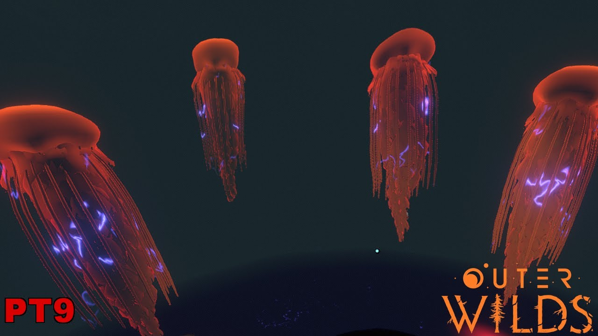
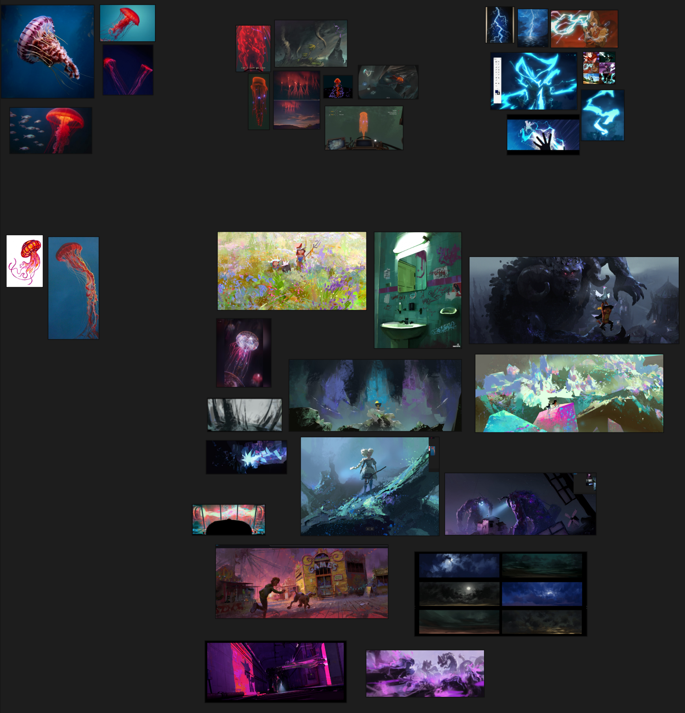
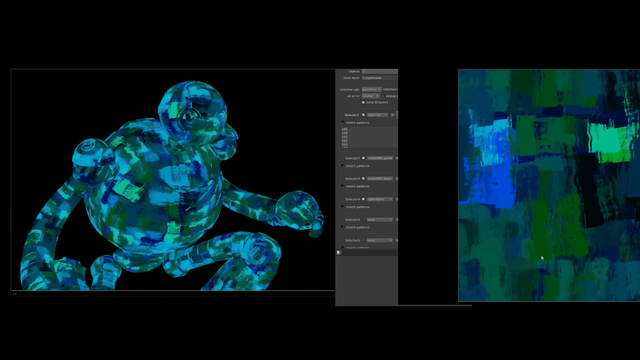
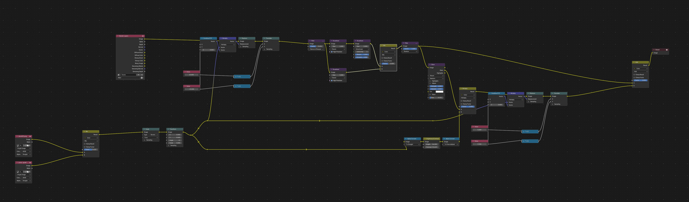

# Final Project!

#### Introduction
- What motivates your project?

I want to explore stylization and rendering in Blender. I originally was going to do this project in Houdini, but after researching about Karma's renderer, I think Blender will be far better suited for the task.

#### Goal
- What do you intend to achieve with this project?

A cinematic render of an underwater environment inspired by Outer Wilds with procedural jellyfish, but stylized as brush strokes in Blender. I want to focus more on the artistic side of things (I had originally wanted to make a brush strokes tool), while keeping most of the scene entirely procedural.

#### Inspiration/reference:

https://www.youtube.com/watch?v=qgpR6k11If4
https://x.com/KoalaOK_/status/1668525179440599040
https://x.com/KoalaOK_/status/1665706668783702016
https://www.instagram.com/p/DFIiJH2Plcs/?utm_source=ig_web_copy_link&img_index=1
https://www.artstation.com/artwork/KeL02r

#### Specification:
- Outline the main features of your project.

1. procedural jellyfish
2. brush stroke / texture 2d stylization
3. stylized lightning animation in the core
4. underwater cinematics
5. fully procedural and done in Houdini

#### Techniques:
brush strokes tool: https://extensions.blender.org/add-ons/brushstroke-tools/

Brush stroke stylized lens flare:
https://www.youtube.com/watch?v=-fHuTSCq2eg
https://www.youtube.com/watch?v=rkkt54UoQiI

Blender dev talk:
https://www.youtube.com/watch?v=ljjUoup2uTw

Simple brush stoke example:
https://www.youtube.com/watch?v=1jWNeLujtV8

https://www.youtube.com/watch?v=mNlL77U0IL8
https://www.youtube.com/watch?v=myvLr5Iii1Q&pp=ygUXYmxlbmRlciAzZCBvaWwgcGFpbnRpbmc%3D
https://www.youtube.com/watch?v=pJ5_cGjrhuU

Displacing glare: https://www.youtube.com/watch?v=abi3FUYLuDU

#### Design:
- How will your program fit together? Make a simple free-body diagram illustrating the pieces.

blender brush stroke tool (both using and modifying for my own purposes) -> procedural jellyfish (with brush strokes for its ribbons) -> electricity bolts -> giant's deep core -> underwater cinematics -> create a final scene

#### Timeline:

## Milestone 1: Blender Geometry Nodes Jellyfish + early brush stroke exploration (due 11/11)

Found this [forum](https://blenderartists.org/t/uniformly-triangulated-mesh-for-cloth-how/1443059/5) super helpful for recreating the houdini remesh node in geometry nodes!

This jellyfish is just a prototype / visdev, modeled after Elyssa's tutorial entirely in Blender geometry nodes. It was a challenge to recreate similar logic using the geometry nodes system which differs from the Houdini sops in many ways.

I used the experimental cloth simulation node in Blender to animate the ruffles.

## Milestone 2: More brush stroke exploration + procedural electricity (due 11/23)
We're over halfway there! This week should be about fixing bugs and extending the core of your generator. Make sure by the end of this week _your generator works and is feature complete._ Any core engine features that don't make it in this week should be cut! Don't worry if you haven't managed to exactly hit your goals. We're more interested in seeing proof of your development effort than knowing your planned everything perfectly. 

Put all your code in your forked repository.

Submission: Add a new section to your README titled: Milestone #3, which should include
- written description of progress on your project goals. If you haven't hit all your goals, what did you have to cut and why? 
- Detailed output from your generator, images, video, etc.
We'll check your repository for updates. No need to create a new pull request.

Come to class on the due date with a WORKING COPY of your project. We'll be spending time in class critiquing and reviewing your work so far.

## Final submission: final composited underwater scene with multiple jellyfish (due 11/30)
Time to polish! Spen this last week of your project using your generator to produce beautiful output. Add textures, tune parameters, play with colors, play with camera animation. Take the feedback from class critques and use it to take your project to the next level.

Submission:
- Push all your code / files to your repository
- Come to class ready to present your finished project
- Update your README with two sections 
  - final results with images and a live demo if possible
  - post mortem: how did your project go overall? Did you accomplish your goals? Did you have to pivot?
