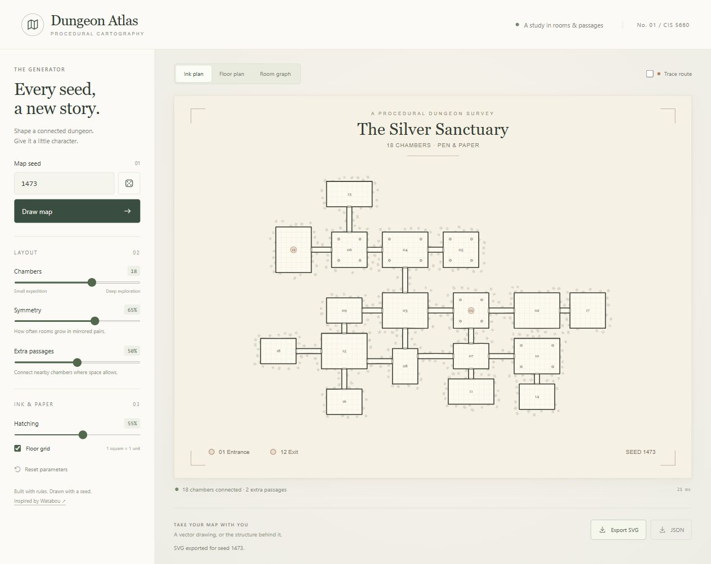
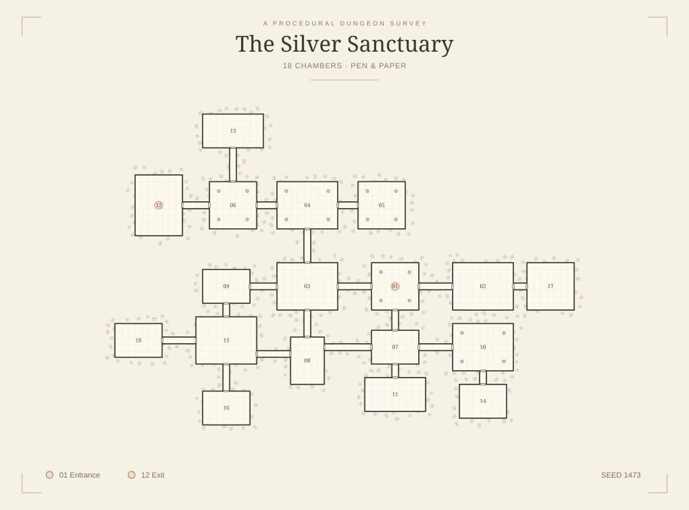
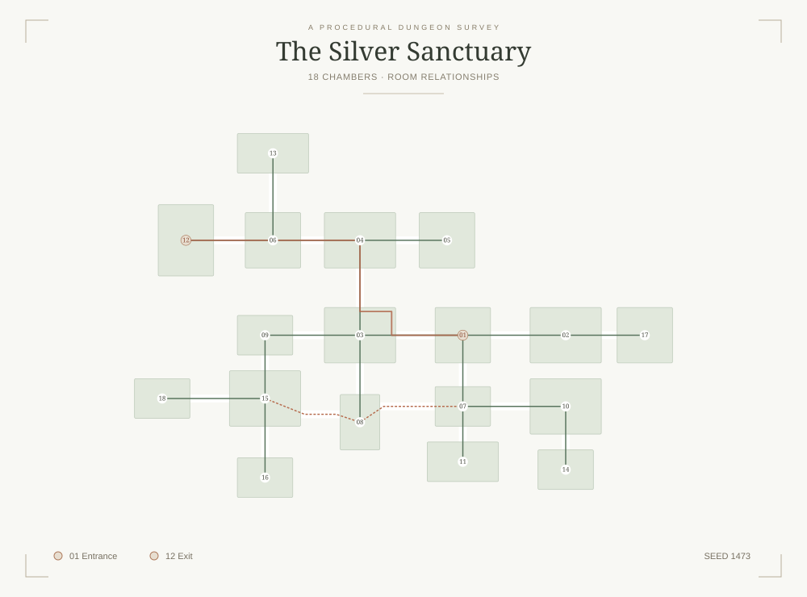
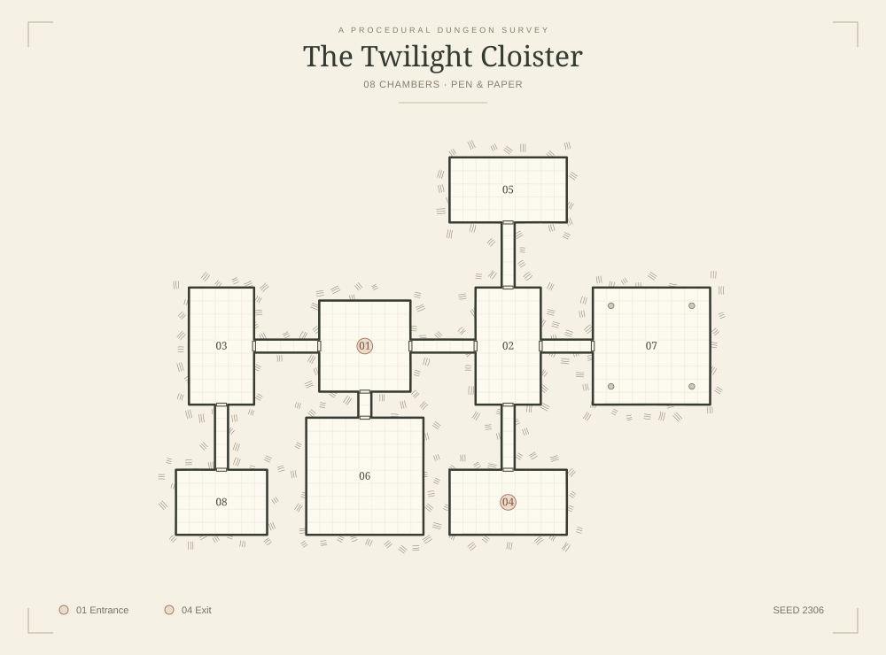
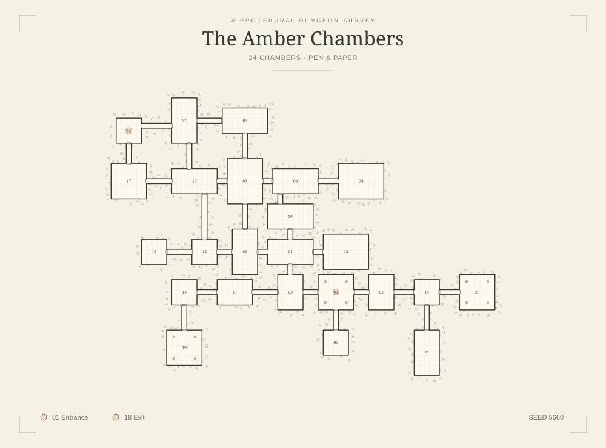

# Procedural Hand-Drawn Dungeon Map Generator

**CIS 5660 Final Project — Dungeon Atlas**

**Proposal due:** November 4, 2026

**Project format:** Individual

**Status:** Milestone 1 implemented. Progress and generated examples are recorded below; the original design proposal is preserved afterward.

## Milestone #1

**Implementation part 1 · due November 11 · progress recorded November 12, 2026**

The core generator now runs in the browser. It grows a connected dungeon from a seed, rejects collisions, adds valid extra passages, and renders the result as an SVG map. The examples in this section are generated by this repository's implementation. Watabou's output appears only in the separately labeled reference section of the proposal.

### Run the project

Use **Node.js 24 or later** and npm. From the repository root:

```sh
npm ci
npm run dev
```

Open the local URL printed by Vite. Enter a seed and select **Draw map**, or use the dice button for a new seed. The sliders adjust room count, mirrored-growth probability, eligible extra passages, and hatch density. **Ink plan**, **Floor plan**, and **Room graph** expose different stages of the same map; **Trace route** shows a walkable entrance-to-exit path. **Export SVG** saves the current view; **JSON** saves the layout and drawing settings.

```sh
npm test          # Determinism, geometry, connectivity, sampling, and SVG checks
npm run build    # Type checking and production bundle in dist/
npm run preview  # Serve the production build locally
npm run examples # Regenerate the gallery and measured validation report
```

### Progress toward the project goals

| Goal | Implemented for Milestone 1 |
| --- | --- |
| Seeded layout generation | A seeded random stream grows 8–24 rectangular rooms. Paired proposals create local symmetry; rejected pairs fall back to individual growth. Symmetry is a probability, not a guarantee that the whole map is mirrored. |
| Collision-free connectivity | Grid occupancy and clearance checks reject overlapping rooms, intersecting corridors, and unintended contact with other floor cells. Each new room has a parent corridor, so the initial room graph is a tree. Growth has a fixed attempt budget and reports any room-count shortfall. |
| Extra passages | A separate random stream selects nearby aligned room pairs. Valid straight corridors add cycles without changing the base room placement. The percentage controls eligible candidates; it does not prescribe a fixed number of loops. |
| Structural checks | A graph traversal checks room reachability and chooses a distant exit. A separate grid flood fill checks the actual walkable geometry. A shortest grid path supports the route overlay. |
| Geometry and SVG | Shared cell edges are removed and collinear exterior edges are merged. Door symbols mark room–corridor boundaries. Plain geometry, graph, and ink views use the same generated model. |
| Initial ink renderer | Seeded line variation, a floor grid, and short hatch clusters are implemented. A Bridson-style Poisson disk sampler spaces clusters, and an exterior mask keeps strokes out of the floor. Drawing settings do not regenerate room geometry. |
| Controls and export | A browser interface exposes the parameters and views, with SVG and JSON downloads. No external generation service or runtime asset downloads are required. |

The implementation is split between [layout generation](src/generator.ts), [validation](src/validation.ts), [boundary extraction](src/geometry.ts), [hatch sampling](src/hatching.ts), [SVG rendering](src/renderer.ts), and [browser controls](src/main.ts). Layout, loop insertion, ink variation, and hatching use independent seeded streams.

### Output examples



*The working browser interface. The following maps are reproducible with `npm run examples`.*



*Seed **1473**: 18 rooms, symmetry 65%, extra-passage probability 50%. The result has 19 connections, including 2 extra passages. [Layout JSON](docs/milestone1/sable-archive.json).*



*The same layout in graph view: green tree connections, dashed terracotta extra connections, and a solid terracotta route through the walkable grid. Room 01 is the entrance; room 12 is the exit.*

| Small map | Larger map |
| --- | --- |
|  |  |
| Seed **2306** · 8 rooms · symmetry 100% · extra passages 25% · 0 accepted loops. [JSON](docs/milestone1/small-sanctuary.json) | Seed **5660** · 24 rooms · symmetry 20% · extra passages 85% · 4 accepted loops. [JSON](docs/milestone1/large-vaults.json) |

### Validation and current results

The [test suite](tests/core.test.ts) passes all **6 tests**. It checks **100 fixed seeds across 3 parameter presets (300 layouts)** for deterministic regeneration, room overlap, bounds, graph and floor connectivity, valid routes, and bounded generation. All 300 layouts pass validation and reach their requested room counts. Additional tests check loop/drawing independence, deliberate invalid layouts, merged boundaries, minimum Poisson sample spacing, parameter limits, and escaped SVG metadata. This is evidence for the tested cases, not a proof for every possible seed.

The [recorded report](docs/milestone1/validation-report.json) contains the presets, sample counts, and timings. On the development machine with Node 24.20.0, the 300-layout run averaged approximately **0.64 ms** for generation, with a **1.53 ms** maximum. The three gallery examples took approximately **12–25 ms** to serialize their ink SVGs. These are Node measurements and exclude browser painting; they are not end-to-end frame-time claims. The production build passes TypeScript checking. Browser checks cover seed changes, slider updates, all three views, the route overlay, exports, reset, and a narrow mobile layout.

### Problems, limitations, and next steps

The main geometric challenge was keeping the room graph consistent with the visible floor: a corridor passing next to unrelated floor can create an unintended connection. The current placement checks reserve clearance around new rooms and reject passages adjacent to unrelated occupied cells. This conservative rule reduces the number of eligible loops, particularly in crowded maps.

- **Geometry:** Rooms are rectangular and extra passages are straight. Bent corridors and circular rooms are not implemented. The core generator does not depend on those extensions.
- **Symmetry:** Mirrored growth is local. Collision checks and fallback growth can break symmetry later, even with the control at 100%.
- **Appearance:** The initial hatching and wall variation work, but still look regular at some scales. Before Milestone 2, I will refine stroke grouping, line weight, and door readability, and compare low/high hatching on the same layout.
- **Evaluation:** The fixed-seed checks are in place early. Further work will add curated visual comparisons and examine browser rendering cost at the densest settings.
- **Scope:** This remains a single-floor map-generation tool. Combat, character movement, and multi-floor gameplay remain outside the proposal's scope.

The bulk of the proposed generator is implemented for this checkpoint. The next stage is visual refinement and parameter tuning, followed by the feature-complete Milestone 2 review on November 23.

---

The following sections preserve the **November 4 design proposal**.

## Introduction

Hand-drawn dungeon maps combine readable spatial structure with expressive visual detail. I am interested in how a procedural system can produce maps that feel intentionally designed: rooms form recognizable groups, corridors connect them coherently, and imperfect ink strokes give the result a consistent visual identity.

Inspired by Watabou's One Page Dungeon, I will build a browser-based generator that combines partially symmetric layouts with procedural pen-and-paper rendering. The project fits the course's **A RE-IMPLEMENTATION** and **A FORGERY** directions. My implementation will focus on the generation and drawing algorithms.

## Goal

Create a controllable generator for connected, single-floor dungeon maps with a hand-drawn appearance. Different seeds should produce visibly different layouts; reusing a seed and the same parameters should reproduce the same result.

The main technical goals are:

- Generate varied room-and-corridor layouts with adjustable symmetry and additional loops.
- Convert the layout into clean walls, door openings, and floor boundaries.
- Render those boundaries with procedural ink variation and exterior hatching.
- Expose the generation stages so the relationship between parameters, structure, and final appearance is easy to demonstrate.

The intended scale is approximately 1.5 homework assignments. The final deliverable will be an interactive map-generation tool, an example gallery, and documented results.

## Inspiration/reference

### Watabou — One Page Dungeon

- [Live generator](https://watabou.github.io/one-page-dungeon/)
- [Project page and author's explanation of the layout algorithm](https://watabou.itch.io/one-page-dungeon)
- [Video that introduced the reference](https://www.bilibili.com/video/BV1Z6Jf6UEVs/)
- [Reference map with seed 1467063380](https://watabou.github.io/one-page-dungeon/?seed=1467063380)


*Figure 1. Reference output generated with One Page Dungeon by Oleg Dolya / Watabou, seed 1467063380, exported on November 4, 2026. This is reference material, not output from my implementation. The [author's FAQ](https://watabou.github.io/faq.html) permits use of generated map images.*

I will study its room groupings, door placement, wall treatment, and visual hierarchy. A small number of exported maps may serve as reference fixtures while developing the renderer. The final maps will come from my own generator.

### Technical references

1. **Oleg Dolya, One Page Dungeon — author discussion of layout generation.** On the [project page](https://watabou.itch.io/one-page-dungeon), the author describes growing a partly symmetric room tree and then adding connections to create loops. This is the starting point for my layout approach.
2. **Oleg Dolya, [Hatching in 1PDG](https://www.patreon.com/watawatabou/posts/hatching-in-1pdg-31716880), 2019.** Explains how spaced clusters of short strokes approximate hand-drawn dungeon shading.
3. **Robert Bridson, [Fast Poisson Disk Sampling in Arbitrary Dimensions](https://www.cs.ubc.ca/~rbridson/docs/bridson-siggraph07-poissondisk.pdf), SIGGRAPH Sketches, 2007.** Provides the sampling method I will adapt for distributing hatch clusters.

These sources inform an independent implementation. The reference application's compiled JavaScript will not be used as the project's generation engine.

## Specification

### Core features

| Feature | Planned behavior |
| --- | --- |
| Reproducible generation | A seed controls layout and visual variation through separate random streams. Changing drawing settings preserves the layout. |
| Connected layouts | Generate approximately 8–24 rectangular rooms, corridors, and door openings on a bounded grid. |
| Layout controls | Adjust target room count, probability of symmetric growth, and the proportion of eligible extra connections. |
| Hand-drawn rendering | Slightly irregular wall strokes, a floor grid, paper-and-ink colors, and exterior hatch clusters with adjustable density. |
| Structural visualization | Switch between the room graph, plain geometry, and final drawing; highlight an entrance-to-exit route. |
| Export | Save the final drawing as SVG and the generated layout and parameters as JSON. |

The entrance will be associated with the root room; an exit will be selected from a room far from it in graph distance. The route overlay demonstrates connectivity without requiring a gameplay system.

### Scope and success criteria

The core project covers one floor, rectangular room geometry, and one coherent drawing style. Combat, platforming physics, full narrative generation, multi-floor buildings, and world-map generation are outside this scope. If the core is complete early, I may add circular rooms or a second visual preset.

I will evaluate the generator using a fixed set of 100 seeds across supported parameter presets. Checks will cover room-interior overlap, floor connectivity, entrance-to-exit reachability, deterministic output, and bounded termination. If a layout cannot reach the requested room count within its placement budget, the interface will report the actual count.

A small visual gallery will compare seeds and parameter settings, especially low/high symmetry and sparse/dense hatching. I will also record generation and drawing times, aiming for roughly one second or less for a typical 24-room map on my development laptop.

## Techniques

### 1. Seeded, partially symmetric room growth

Following the idea described in reference 1, begin with a root room and grow children relative to each parent's entrance direction. Symmetric proposals place children on opposing sides; asymmetric proposals vary their size or keep only one child. A grid occupancy check rejects room overlaps and invalid corridor placements.

Use a finite placement budget to prevent stalled growth from running indefinitely. Each accepted child is connected to its parent, establishing a connected base layout.

### 2. Loop creation and structural validation

After tree growth, consider spatially nearby room pairs for additional connections. Add a door or a short orthogonal corridor only when the geometry permits it. The loop parameter controls how many eligible connections are attempted.

Maintain both a room adjacency graph and a walkable-cell grid. Breadth-first search checks graph reachability and selects the exit; flood fill checks the actual floor geometry. Keeping both representations helps detect a graph edge whose corridor was drawn incorrectly.

### 3. Boundary extraction and ink rendering

Extract the exterior edges of occupied floor cells, merge collinear edges, and preserve gaps for door openings. This avoids drawing internal walls between adjacent floor cells.

Draw the resulting geometry as SVG paths. Small seeded perturbations of curve control points and stroke widths create an ink effect while preserving the underlying collision-free layout. Geometry and drawing randomness remain independent.

### 4. Procedural hatching

Following references 2 and 3, distribute hatch-cluster centers with a two-dimensional Poisson disk sampler. Draw several short, slightly curved strokes around each center with controlled orientation and size variation.

Restrict the strokes to a narrow exterior band around the floor footprint using an SVG mask. This keeps hatching out of rooms and passages. Minimum sample spacing and a cap on cluster count will control drawing cost.

## Design

**Tools:** TypeScript for the algorithms and data model, SVG for rendering and vector export, HTML/CSS for controls, and Vite for local development and the browser build. The implementation does not require a game engine or external generation service.


*Figure 2. Planned system structure. The same validated layout feeds the renderer, structural views, and JSON export.*

The main modules will be:

- **Parameters and RNG:** store the seed and settings; provide separate layout and drawing random streams.
- **Layout generator:** create rooms, corridors, doors, and the adjacency graph.
- **Validator:** check occupancy and reachability; return validation results and the highlighted route.
- **Geometry builder:** extract floor boundaries, door gaps, and the hatch mask.
- **SVG renderer:** draw walls, floor grid, hatching, symbols, and the optional debug overlay.
- **Controls and export:** regenerate, switch views, and save SVG/JSON.

The shared data model will contain rooms, connections, door positions, a walkable grid, generation parameters, and the seed. Validation failures will be surfaced in the debug view rather than hidden by the final drawing.

The main risks are crowded layouts and excessive SVG path counts. Bounded placement attempts, a modest room limit, merged wall segments, and capped hatch density address those risks. Circular rooms and extra styles will be cut first if time is limited.

## Timeline

This is an individual project. I am responsible for all research, algorithms, rendering, interface work, evaluation, and documentation.

| Dates | My responsibilities | Deliverable |
| --- | --- | --- |
| **Nov. 4 — Proposal** | Finalize references, scope, architecture, and schedule; obtain instructor/TA approval of the topic and scope before submission. | Design doc in README, reference image, and system diagram; submit through a PR to the course repository after approval. |
| **Nov. 5–11 — Milestone 1** | Implement seeded room growth, collision checks, corridors, loop insertion, basic connectivity checks, and plain SVG output. Build an initial hatching prototype. | A working core generator with sample outputs and a README progress report by **Nov. 11**. |
| **Nov. 12–18 — Rendering and interaction** | Finish boundary extraction, door drawing, hand-drawn strokes, exterior hatching, parameter controls, structural views, and export. | Integrated generator and renderer; initial comparisons of seeds and visual settings. |
| **Nov. 19–23 — Milestone 2** | Run the fixed-seed checks, fix geometric failures, measure generation time, tune defaults, and finish all core features. Cut unfinished extensions. | A feature-complete working copy for the **Nov. 23** critique, with documented results. |
| **Nov. 24–30 — Final** | Apply critique feedback, polish line quality and composition, curate the gallery, record a short demonstration, and write the post mortem. | Final code, images, demonstration, and README results by **Nov. 30**; a live browser demo if feasible. |

---

The original course brief is preserved in [docs/assignment.md](docs/assignment.md).
