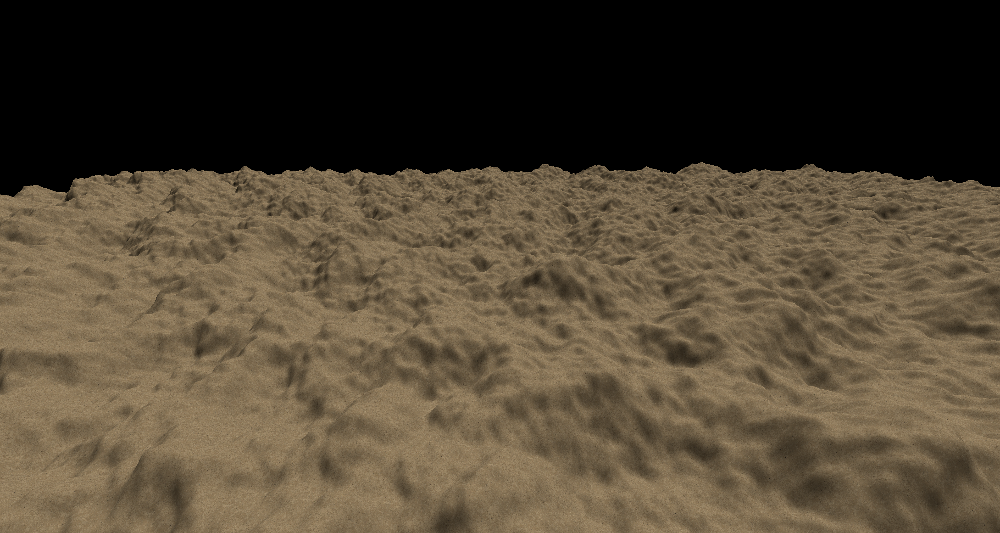
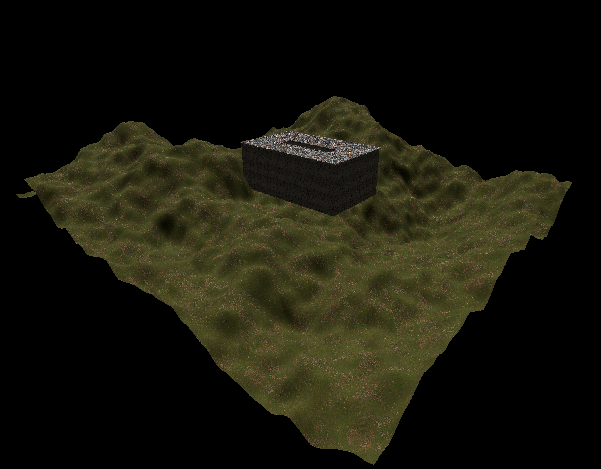
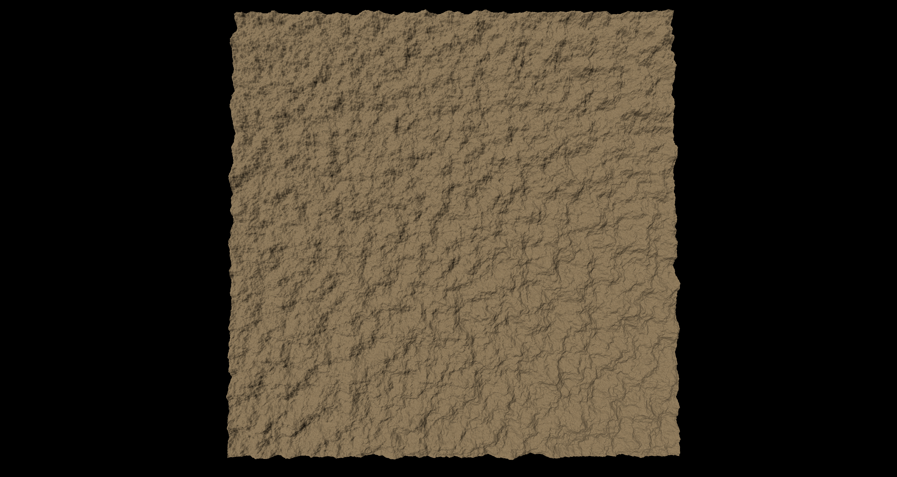

**University of Pennsylvania, CIS 5660: Procedural Graphics,
Final Project**

- Bryce Joseph
- [Website](https://brycejo.com/), [LinkedIn](https://www.linkedin.com/in/brycejoseph/), [GitHub](https://github.com/brycej217)
- Tested on: Windows 11, Intel(R) CORE(TM) Ultra 9 275HX @ 2.70GHz 32.0GB, NVIDIA GeFORCE RTX 5080 Laptop GPU 16384MB

# CIS 5660 Final Project: _Death Stranding Terrain Generation_

# Overview
This project seeks to replicate the terrain generation from the Death Stranding series of games. It will be implemented in my [custom Vulkan engine](https://github.com/brycej217/uncle-engine) and will focus both on visual fidelity as well as performance optimization. All code can be found in the [Uncle Engine repo](https://github.com/brycej217/uncle-engine).

# Milestone 1

In terms of progress this week I have achieved:
- CPU-based Perlin noise terrain generation
- Engine infrastructure changes to allow for terrain generation with the existing resource model

Right now I am using a CPU based Perlin noise terrain generator which effectively creates a vertex grid and offsets each vertex position based on FBM Perlin noise. With my existing engine infrastructure, this can be labeled as a mesh the engine will render during draw time, and different textures can be assigned to it for rendering. What you see in the above image is 4,000,000 vertices of terrain rendering at around 400 fps.

Thus I actually did not end up getting as much done this week as I would have liked. Effectively however, this week helped cement where I want to take this project and the next goals for the project. Firstly, I am realizing that I wish to now focus directly on terrain generation rather than terrain + foliage generation as this helps keep the scope more in line with what I want. On top of this, I need to move the terrain generation to the GPU as soon as possible as while generation is taking longer and longer, given the quite large FPS counts I am seeing while rendering, the strain on my GPU for rendering is not nearing its cap whatsoever. In addition, I am seeing that Perlin noise based generator is not very interesting to look at and so for next week I wish to look into better terrain generation techniques such as erosion. Effectively my goals for the next milestone are to ramp up production in a few key aspects:
- Move terrain generation to the GPU
- Implement a better terrain generation technique (possibly erosion)

Once this is in place, then I can see both visually where I should be going in order to mimic the Decima engine's terrain generation, and hopefully my GPU will be pushed to its limits as well, which will guide me in the direction of optimization. This week was more of a proof of concept that my engine is flexible enough to allow for terrain generation within its resource management model, but next week is where the work really begins.

This project invovled creating a custom procedural building creator tool using Houdini. The tool allows users to specify the number and dimensions of the floors of their building, and these segments will automatically be popoulated with assets and additional procedural geometry. Much of the implementation followed this excellent tutorial by [Simon Houdini](https://youtu.be/uIe97023sDk?si=znT3d5FOex_nmTrb).