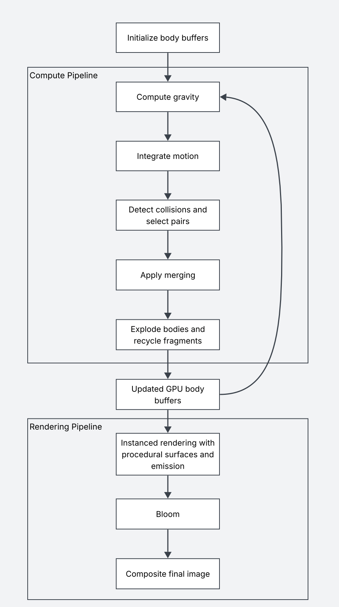

# CosmicChaos

*A tiny universe with a questionable life expectancy.*

[Live Demo](https://jamesliu12.github.io/cosmic-chaos/)

## Introduction

I love the visual chaos of celestial bodies pulling each other in, growing, and blowing apart. I also enjoy GPU programming, so this project is a chance to build a tiny universe while exploring parallel simulation and performance optimization!

## Goal

Build a 3D gravity sandbox in WebGPU where bodies attract each other, collide, merge, and eventually explode into smaller fragments. A tiny universe with plenty of opportunities for chaos!

## Inspiration / Reference

**[Collider — Robert Hodgin](https://roberthodgin.com/project/collider)** is my main visual and behavioral reference. I like its cycle of attraction, growth, ignition, and explosion, especially how glowing bodies stand out among smaller particles.

*Reference image: Robert Hodgin, Collider.*

**[Fast N-Body Simulation with CUDA — GPU Gems 3, Chapter 31](https://developer.nvidia.com/gpugems/gpugems3/part-v-physics-simulation/chapter-31-fast-n-body-simulation-cuda)** by Lars Nyland, Mark Harris, and Jan Prins is my main technical reference. I'll adapt its gravitational softening and tiled shared-memory computation to WGSL.

*Reference diagram: GPU Gems 3, Figure 31-2.*

## Specification

The core simulation features are mutual gravity, collisions, merging, and explosions. I’m aiming for around 10k+ planets and stars, depending on performance. I’ll compare a naive all-pairs solver with a tiled solver that reuses data in workgroup memory.

Planets and stars will have procedurally generated appearances inspired by real celestial bodies, with varied colors, surface patterns, and glowing effects.

### Presentation

The final product will run in a web browser, allowing users to explore the tiny universe with a movable camera. Controls will adjust simulation speed, gravity strength, the explosion threshold, and the initial number of bodies.

If time allows, I’ll add interactions such as clicking a body to trigger an explosion or using the mouse to apply an external force.

### Visual Assets

No external visual assets are needed. Planets and stars will be generated procedurally using mass, color, and a random seed. Noise-based shaders will create surface patterns and variation.

## Techniques

- **Gravity and integration:** Use softened Newtonian gravity and fixed-timestep leapfrog integration, following the GPU Gems chapter linked above.
- **Parallel computation:** Compare naive all-pairs gravity with a tiled version that loads body data into WGSL workgroup memory for reuse.
- **Collisions and merging:** Detect overlapping spheres, select non-conflicting pairs, and apply merges in separate compute passes.
- **Explosions:** Split bodies above a mass threshold into fragments, distributing the parent's mass and reusing inactive slots in a fixed-capacity GPU pool.
- **Rendering:** Read body data directly from GPU buffers for instanced rendering. Noise-based surface patterns, emission, and bloom will give planets and stars their appearance.

## Design

Compute passes update the body state on the GPU. The rendering pipeline reads the updated buffers directly to draw the bodies and apply bloom.

## Timeline

This is a solo project, so I'll handle simulation, rendering, interaction, and performance testing.

- **Week 1 — by Nov 11:** Set up WebGPU, camera controls, and procedural body generation. Implement the naive gravity solver, motion integration, and basic collision detection.
- **Week 2 — by Nov 18:** Implement merging, explosions, and fragment recycling. Add the tiled gravity solver and compare its performance with the naive version.
- **Week 3 — by Nov 23:** Finish procedural surfaces, glow, and simulation controls. Test larger body counts, fix simulation issues, and finalize the core features.
- **Week 4 — by Nov 30:** Polish the visuals and scene presets, add optional interactions if time permits, and prepare the browser demo, video, and final writeup.

## Milestone #1

I hit all my Milestone #1 goals! The WebGPU sandbox has a fly-around camera, seeded body generation, and a first pass at rocky surfaces.

The simulation uses a fixed-step leapfrog integrator. Bodies move half a step, get a velocity update from softened all-pairs gravity, then move the remaining half step. 

A separate GPU pass checks for overlaps, which I can highlight in the debug view. 

The renderer draws straight from the simulation’s GPU buffer, so body positions never need to make a round trip through the CPU.

### Generator examples

*Seed 0, 500 bodies. The default scene starts with a cloud of spinning rocks of different sizes.*

*Seed 42, 50 bodies. The debug mode highlights collision candidates.*

Please check out the [live demo](https://jamesliu12.github.io/cosmic-chaos/) and try a seed of your own!

Next up are merging, explosions, and a faster gravity solver.
