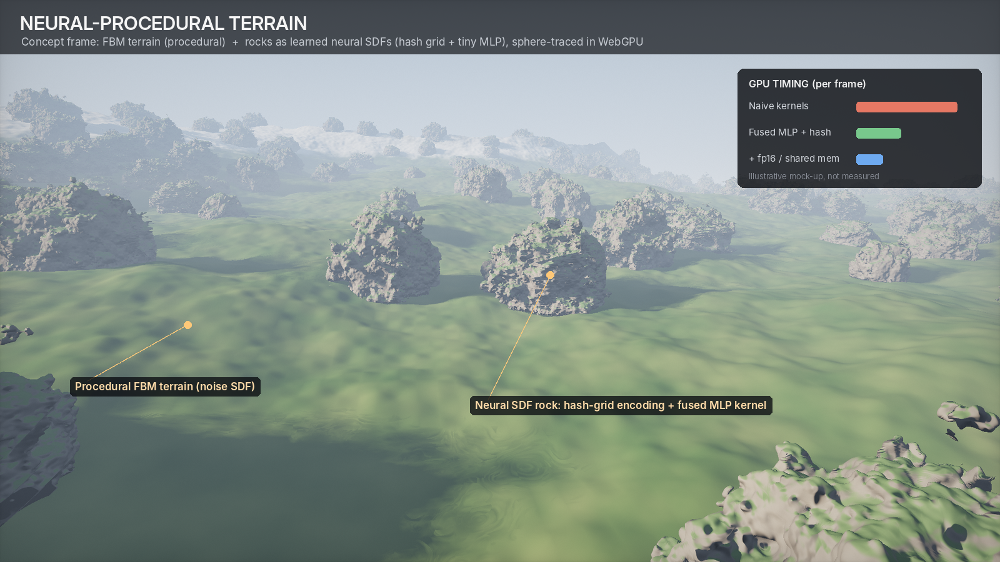
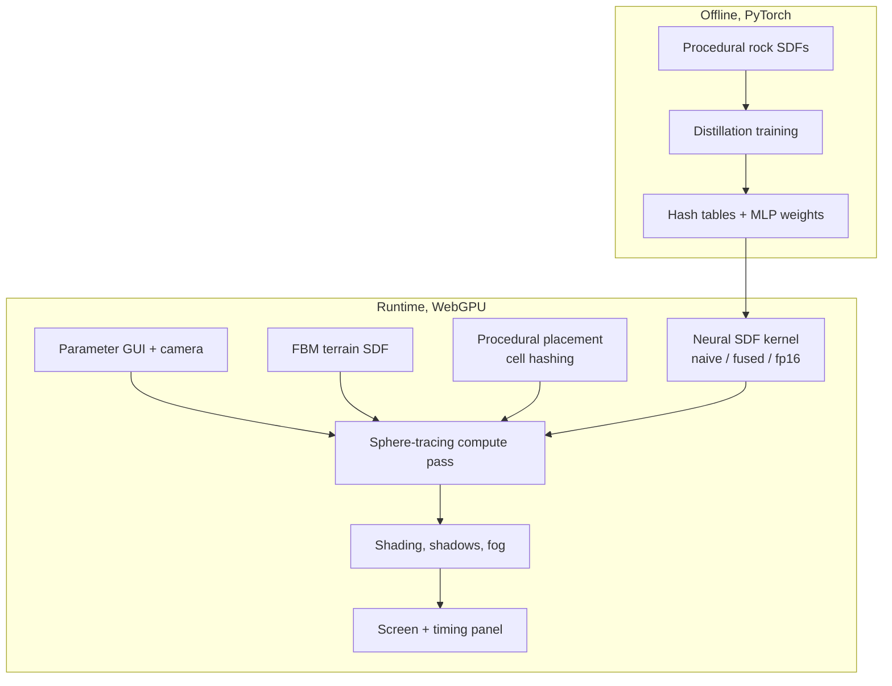

# Neural-Procedural Terrain in WebGPU

CIS 5660 Fall 2026 Final Project — Xuan Zhu

## Design Doc

### Introduction
Procedural terrain built from noise and signed distance functions (SDFs) can produce infinite, detailed worlds, but rich detail is expensive: every ray-marching step must evaluate many octaves of noise. Neural fields (e.g. Instant-NGP) take the opposite approach and store detail in a small neural network that can be queried quickly on the GPU.

This project combines the two. An infinite FBM terrain is generated procedurally, and procedurally placed rocks are represented as **neural SDFs**: their expensive multi-octave procedural shapes are distilled into tiny neural networks that are evaluated by **custom, hand-optimized WebGPU compute kernels**. The project sits at the meeting point of procedural graphics and GPU/ML systems, which is the area I want to grow in.

### Goal
- A real-time WebGPU fly-through of an **infinite procedural terrain** (FBM height-field SDF) populated with **procedurally placed neural-SDF rocks**.
- **Neural distillation:** train small networks (multi-resolution hash-grid encoding + tiny MLP) to reproduce expensive procedural rock SDFs.
- **Custom GPU kernels:** implement neural SDF evaluation from scratch in WGSL, then optimize it (kernel fusion, shared memory, fp16, early ray termination).
- **Measured results:** per-pass GPU timings and speed-ups for each optimization, plus quality comparisons against the original procedural SDF.
- An artist-facing **parameter panel** (terrain shape, rock density and variety, seed, quality vs. speed).

**Concept frame** (procedural GLSL prototype; the timing panel is an illustrative mock-up, not measured):

### Inspiration / Reference
- T. Müller, A. Evans, C. Schied, A. Keller, *Instant Neural Graphics Primitives with a Multiresolution Hash Encoding*, SIGGRAPH 2022. https://nvlabs.github.io/instant-ngp/
- T. Müller, *tiny-cuda-nn* (fully fused MLP kernels). https://github.com/NVlabs/tiny-cuda-nn
- T. Takikawa et al., *Neural Geometric Level of Detail: Real-time Rendering with Implicit 3D Shapes*, CVPR 2021.
- J. J. Park et al., *DeepSDF: Learning Continuous Signed Distance Functions for Shape Representation*, CVPR 2019.
- J. C. Hart, *Sphere Tracing: A Geometric Method for the Antialiased Ray Tracing of Implicit Surfaces*, The Visual Computer, 1996.
- I. Quilez, articles on FBM, terrain ray marching and SDFs. https://iquilezles.org/articles/

### Specification

**1. Procedural world**
- Infinite height-field terrain from FBM / ridged noise, ray-marched as an SDF.
- Slope- and height-based procedural materials (grass, rock, snow), sun light, soft shadows, aerial fog.
- Procedural rock placement by cell hashing (jittered grid): position, scale, rotation and rock type per cell.

**2. Neural SDF rocks**
- Several rock "species" defined by expensive procedural SDFs (displaced spheres with high-octave 3D noise).
- Each species is distilled offline (PyTorch) into a neural SDF: multi-resolution hash-grid encoding + 2-layer MLP (~10K parameters).
- Weights and hash tables are exported to GPU buffers and evaluated in WGSL during sphere tracing.

**3. GPU kernels and optimization**
- Baseline: separate passes for hash encoding and each MLP layer.
- Optimizations, each measured with WebGPU timestamp queries:
  - **Kernel fusion:** hash encoding + MLP in one kernel, with no intermediate buffers.
  - **Shared memory:** MLP weights loaded once per workgroup.
  - **fp16** weights and activations (where supported).
  - **Bounding-volume culling and early ray termination:** the network is only queried near rocks.
- Quality check: neural vs. procedural SDF error and image differences.

**4. Presentation**
- Live web demo with free camera, parameter panel and a kernel switch (naive / fused / fp16) showing timings.
- Fly-through video and a performance report (charts of speed-ups per optimization).

**Stretch goals:** neural level of detail (smaller networks at a distance), procedural caves carved with SDF operations, more rock and plant species.

### Planning

**Short list (ideas considered)**
1. **Neural-procedural terrain (chosen).** Procedural FBM/SDF world plus neural SDF assets evaluated by custom fused GPU kernels.
2. **Neural cellular automata texture synthesis.** Self-organizing procedural textures with WebGPU inference kernels; simpler, but 2D only.
3. **Multi-scale procedural universe** (planet → galaxy → black hole). Strong visuals but rendering-focused, with no neural component.

**Decision:** #1. It uses core course techniques (noise, FBM, SDFs, ray marching, procedural placement) and adds a neural/GPU-systems component that matches my interests. #2 remains the fallback if neural training proves too slow.

**1. Features, by priority (≈ 1.5 assignments of work)**
- **Must have:** procedural FBM terrain sphere tracing; procedural rock placement; one distilled neural SDF rock species with a naive WGSL evaluator; parameter GUI.
- **Should have:** fused kernel, shared-memory weights, fp16; several rock species; timing panel and performance report.
- **Nice to have:** neural LOD, caves, more species, offline high-quality video mode.

**2. Presentation / final product:** live demo (GitHub Pages), a fly-through video, and a performance report with before/after timings.

**3. Visual assets:** none imported. Terrain, materials and rock shapes are procedural; the neural rocks are trained from my own procedural SDFs, so no external meshes or textures are needed.

**4. Weekly targets:** see **Timeline** below.

**5. Resources:** see **Inspiration / Reference** above and **Techniques** below.

### Techniques
- **Sphere tracing** (Hart 1996): step along each ray by the SDF value until the surface is reached.
- **FBM terrain:** height field $h(x,z)=\sum_{i} a^{i}\,\mathrm{noise}(f^{i}\,(x,z))$ with rotated octaves and ridged variants; terrain SDF approximated as $d=\lambda\,(y-h(x,z))$ with $\lambda<1$ for safe stepping.
- **Scene SDF:** $d(\mathbf{p})=\min\big(d_{\text{terrain}}(\mathbf{p}),\, d_{\text{rock}}(\mathbf{p})\big)$, with rocks found by cell hashing around $\mathbf{p}$.
- **Neural SDF:** multi-resolution hash encoding (Müller et al. 2022). At level $l$ a point is mapped to grid vertices whose features are looked up by spatial hash $\big(\bigoplus_{k} x_k \pi_k\big) \bmod T$, trilinearly interpolated, concatenated over levels and fed to an MLP:

  $$\hat{d}(\mathbf{p}) = \mathrm{MLP}\big(\mathrm{enc}(\mathbf{p})\big)$$

- **Distillation loss:** sample points near the procedural rock surface and minimize

  $$\mathcal{L} = \mathbb{E}_{\mathbf{p}}\,\big\lvert \hat{d}(\mathbf{p}) - d_{\text{proc}}(\mathbf{p}) \big\rvert$$

- **GPU optimization:** fused kernels (Müller, *tiny-cuda-nn*), workgroup shared memory for weights, fp16, timestamp-query profiling.
- **Training:** PyTorch (Colab GPU); weights exported as binary buffers for WebGPU.

### Design

Stack: TypeScript + WebGPU + WGSL (Vite, lil-gui) for runtime; Python + PyTorch for training. Live demo hosted on GitHub Pages.

### Timeline
Solo project; all tasks by Xuan Zhu.

| Week | Dates | Milestone | Tasks |
|---|---|---|---|
| 1 | 11/8 – 11/11 | **Milestone 1** | WebGPU framework; FBM terrain sphere tracing; procedural rock placement (procedural SDF rocks); first neural SDF trained and evaluated by a naive WGSL kernel. |
| 2 | 11/12 – 11/17 | | Neural rocks integrated into the terrain; multiple species; timestamp-query profiling; fused hash-encoding + MLP kernel. |
| 3 | 11/18 – 11/23 | **Milestone 2** (feature complete) | Shared-memory weights, fp16, culling and early termination; kernel switch and timing panel; quality comparison. |
| 4 | 11/24 – 11/30 | **Final** | Visual polish (materials, lighting, fog), performance report, fly-through video, final README. Stretch goals if time allows. |

**Risk plan:** procedural rocks keep the scene complete even before the neural path works. If training or the WGSL hash encoding blocks progress by 11/15, I will fall back to a plain MLP SDF (no hash grid) and keep the optimization study on that kernel.

---

## Milestone 1
_TBD_

## Milestone 2
_TBD_

## Final Submission
_TBD_
