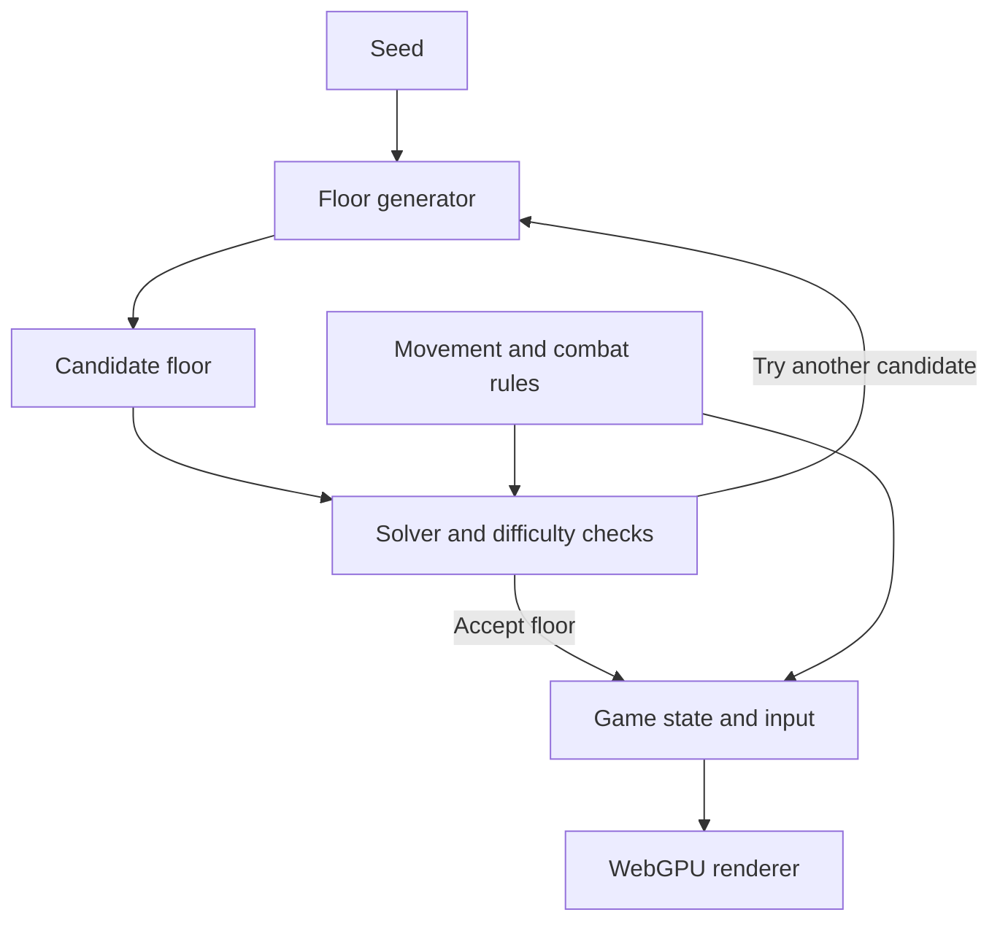

# Final Project - Ziqiu Wang

### Design Doc

#### Introduction & Goal

When I was young, I was obsessed with the puzzle game *Tower of the Sorcerer* (魔塔). In this game, players have to carefully plan their movement inside each level and manage limited resources like keys, HP, and gold to reach the topmost level of the tower, beat the final boss, and save the alleged "hostage princess".

Although the levels of 魔塔 are carefully designed to make the game challenging and intriguing, I've always wondered if a procedural level generator could produce floors compelling enough to serve as prototypes or inspiration for level designers. This project aims to make a browser game that procedurally generates playable dungeon floors. The player starts at the entrance and tries to reach the stairs alive by deciding which monsters to fight, which doors to open, and when to collect upgrades. Every generated floor should have at least one winning route and one decision that affects the outcome (e.g. whether I should drink an HP potion before or after fighting an enemy). For the final demo, I want to show at least three seeds with different routes or resource decisions as well as their possible solutions.

#### Inspiration & References

As mentioned above, *Tower of the Sorcerer* will be my gameplay reference. The monsters, doors, and resources are visible to the player so that they can think through a route before taking any action. *DungeonUp* is a related example that uses procedural levels; the player gets to solve random levels each time they respawn. See [original *Tower of the Sorcerer* project page](https://wwajp.com/mtower/), and [*DungeonUp*](https://store.steampowered.com/app/388620/DungeonUp/).

Below are some screenshots of *Tower of the Sorcerer* from [Thinky Games](https://thinkygames.com/games/tower-of-the-sorcerer/).

For the art, I plan to use the texture atlases from ckcz123's HTML5 魔塔 template. See [mota-js on GitHub](https://github.com/ckcz123/mota-js), and [texture atlases](https://github.com/ckcz123/mota-js/tree/master/project/materials).

#### Specification

- **Floors:** Each floor is a 11×11 grid containing walls, corridors, an entrance (where the player spawns), and exit stairs. The player can play a certain floor by entering a seed. They may also restart the current floor.
- **Movement and resources:** The player can use the arrow keys to move one tile at a time. Doors consume a key of the corresponding color. Potions restore HP, and a sword or shield pickup increases attack or defense respectively.
- **Deterministic combat:** At least two types of stationary monsters act as obstacles. Stepping into a monster resolves the fight based on the current stats. Ideally, the UI should show the predicted HP cost before the player fights an enemy. The player cannot step into an enemy if the HP cost is higher than their current HP (so a softlock means defeat).
- **Solution replay:** A winning action sequence should be stored for each accepted floor so that it can be replayed to verify that the floor is beatable and check the floor's difficulty.

#### Techniques & Methods

1. **Generate each floor around an intended decision.** Start with a small pattern, like two doors that compete for one key, or a detour that lets the player upgrade before a fight. Pick the room connections and resource values, then lay out the rooms, walls, and corridors on the grid. Vary the pattern, placement, and stats with the seed. For example, a player with 12 HP might choose between a potion that adds 4 HP before a 14-HP fight and a sword that reduces the fight cost to 6 HP. Both routes work, but with different amounts of HP left over. Separating the puzzle structure from the physical layout is inspired by Dormans's discussion about separating missions and spaces ([Dormans, *Adventures in Level Design*](https://pcgworkshop.com/archive/dormans2010adventures.pdf)).
2. **Check that the floor is beatable.** The solver uses flood fill to see where the player can walk and which doors, monsters, or items they can reach. It then tries one legal action, like spending a key to open a door. It repeats this step with the updated position, HP, stats, and keys. A bitmask keeps track of opened doors, defeated monsters, and collected items. When a choice leads to a dead end, the solver backs up and tries another one. This is basically depth-first search, and memoization lets the solver skip states it has already checked. A generated floor is kept only if the solver finds a way to reach the exit stairs alive. I may need to reference this paper, [Balyo and Froleyks, *AI Assisted Design of Sokoban Puzzles Using Automated Planning*](https://froleyks.de/assets/pdf/Balyo%20and%20Froleyks%20-%202021%20-%20AI%20assisted%20design%20of%20sokoban%20puzzles%20using%20automated%20planning.pdf), when implementing the solver.
3. **Check whether the puzzle is at least somewhat challenging.** For example, for a floor with two doors, I'll check that the player has to open at least one of the doors to beat the level. Then I'll use the solver to compare the most HP the player can finish with on each route. Both routes should be beatable, with one leaving noticeably more HP. This can then be used to control the difficulty level of the floor.
4. **Render the board with WebGPU.** Draw the tiles and sprites as instanced quads sampled from texture atlases with nearest-neighbor filtering. Floor generation, solution search, and gameplay will be done with TypeScript on the CPU.

#### Design

The generator creates a candidate floor from a seed. The solver checks the floor against the game rules. The game then loads an accepted floor and passes its current state to the renderer.

#### Timeline

| Days | Tasks |
| --- | --- |
| Nov 5–11 (Milestone 1) | Make one floor manually to test movement, combat, and pickups. Implement the solver and add the first puzzle pattern. Be able to show the basic generator output and a verified solution. |
| Nov 12–18 | Add the second puzzle pattern and difficulty checks. Test a beatable and unbeatable floors, as well as floors with shortcuts so I can check that the solver and filters behave as expected. |
| Nov 19–23 (Milestone 2) | Finish the WebGPU tile rendering, damage previews, seed controls, and solution playback. |
| Nov 24–30 (Final Submission) | Finish up anything I didn't get to complete, prepare the browser demo and presentation, and finish the README. |
