# Progress Checks

## Milestone #1 (at time of 11/11 midnight):

For this milestone, I focused on implementing the core procedural framework for my Howl's Moving Castle inspired generator.

So far, I have implemented:

A central castle body with placeholder architectural geometry.

Candidate attachment point generation based on surface orientation.

Weighted random house placement (a lottery system!) with adjustable count, rotation, clustering, height preference, and seed.

Collision detection using bounding boxes and Oriented Bounding Boxes (as opposed to AABB, just because the houses are rotated), with retries for invalid placements.

I'm not finished with the adaptive supports and exposed HDA parameters, but I will add those as the first thing I do for MS2.

Other than the weights and collision (which had the most work to be done), the main challenge has been balancing collision-free placement with the crowded, irregular look of Howl's Moving Castle. I plan to introduce more house variants and clustered structures to improve the overall silhouette. For example, longer (horizontally longer) houses, skinnier ones, etc. 

Next, I'll expand the system to include towers, pipes, mechanical details, and vegetation, which will hopefully help fill it out. My current idea is that these other systems will depend heavily on the House Placement system that I have in place, so at least right now I have the basis finished.

PROGRESS IMAGES BELOW: 
In order: Copy to Points, Showing Clustering, Textured Base, Collision (houses no longer overlap)
For video documentation of MS1: https://vimeo.com/1245700571/6d7ae986f6?share=copy&fl=sv&fe=ci

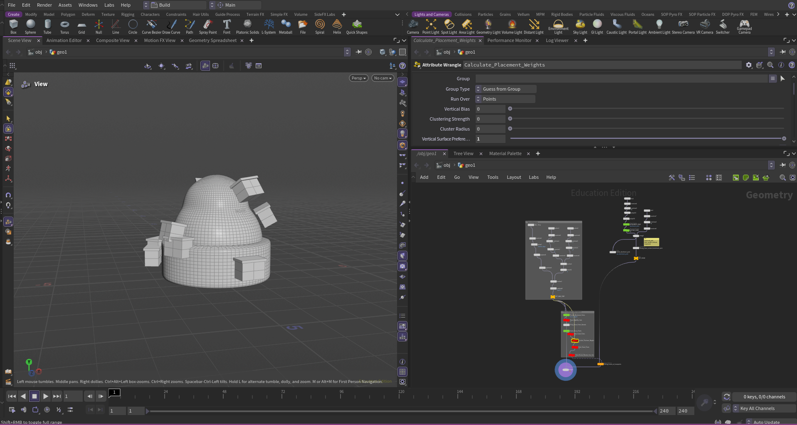

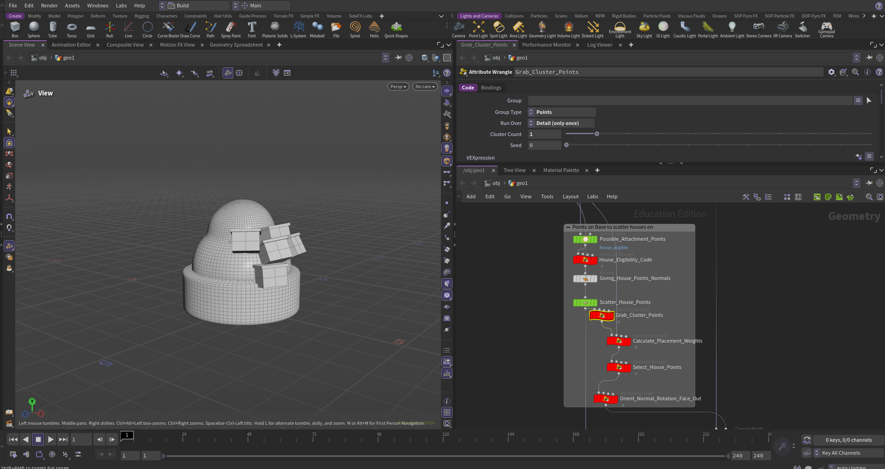

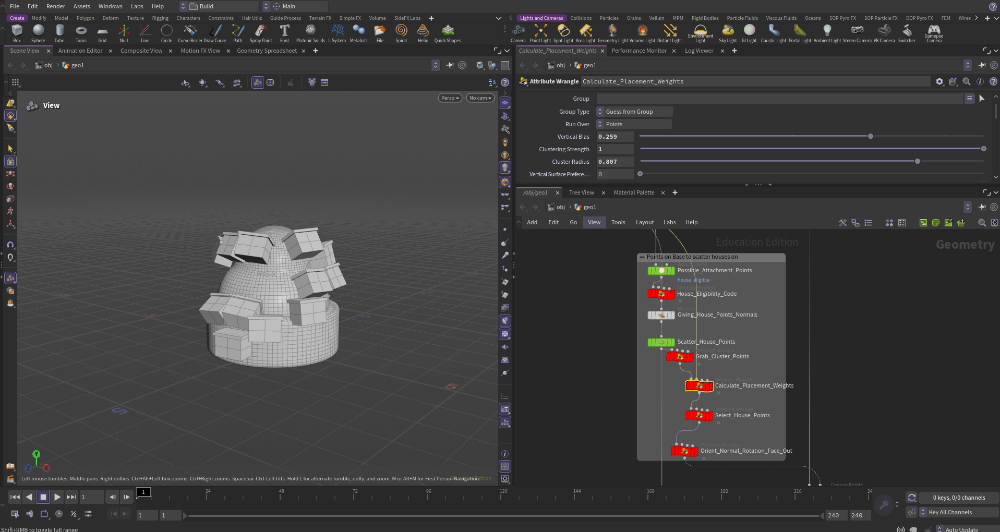

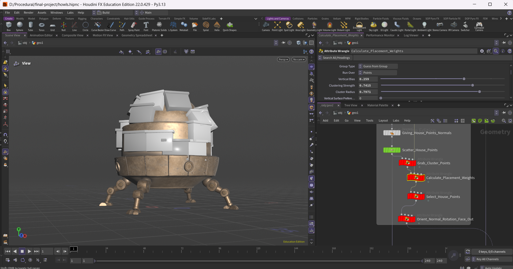

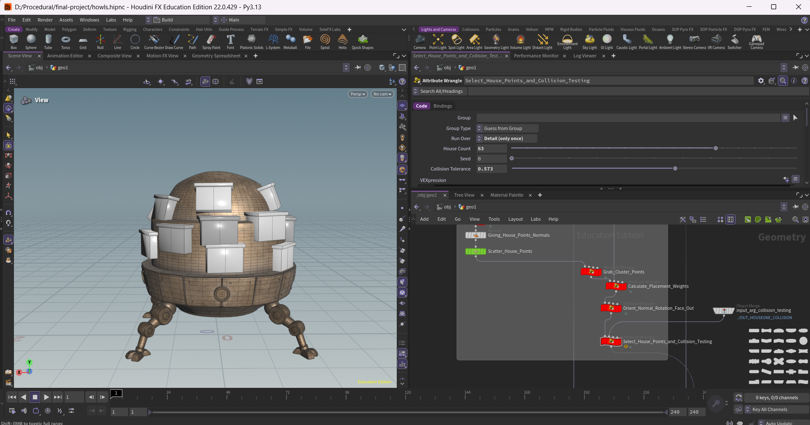

# Design Doc

### Project Blurb

I'm creating a Houdini procedural generator inspired by *Howl's Moving Castle* that assembles whimsical, chaotic-looking castles-house-creatures by attaching houses, towers, pipes, vegetation, and other wacky parts to a central mechanical body. The goal is to make these structures adapt to their surroundings through collision-aware placement, artist-controlled parameters, and automatically generated supports that connect them to nearby surfaces.

## Introduction

I was inspired by the whimsical, chaotic architecture of Studio Ghibli's *Howl's Moving Castle*, and always thought that the castle itself was the coolest part of the film. A while ago I also re-watched a video by Studson Studio on YouTube (he makes miniatures out of junk and other parts), which reignited my love for the crazy slap-together-but-somehow-still-cohesive chaos and charm of the castle.

So for this project, I'm interested in how irregular architectural structures can be assembled procedurally while maintaining a cohesive and visually appealing design. Key words are **wonk, charm, and complexity** that comes from the layering of assets and systems.

Art direction is important in this project – art direction in terms of how things will be placed and scattered.

## Goal

I want to develop a system that procedurally populates a central mechanical castle body with houses, towers, pipes, vegetation, and miscellaneous decorations. In the end, it should generate visually distinct castles using artist-controlled parameters and random seeds.

Something I want to do is to ensure components intelligently adapt to their surroundings (and have unique constraints) rather than being placed through purely random scattering. Large pieces should also self-support, which means they will automatically generate supporting structures connecting to nearby valid surfaces (for example, a house piece attaching to the side of the castle-creature with support structures below generating automatically).

The ultimate goal is to produce whimsical, abundant/full-looking, and asymmetrical silhouettes while maintaining believable architectural connections, all on this house-creature-thing.

## Inspiration / References

### Howl's Moving Castle — Studio Ghibli

Irregular architecture, mechanical structures, protruding houses, trees, towers, pipes, random objects, and whimsical silhouettes.

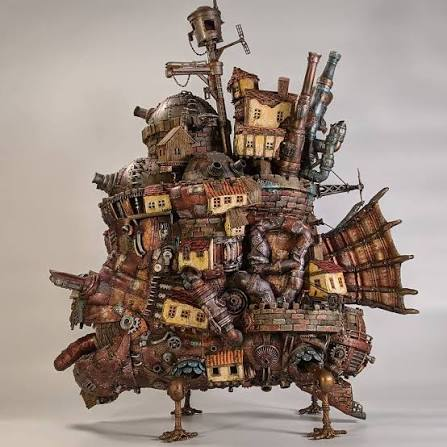

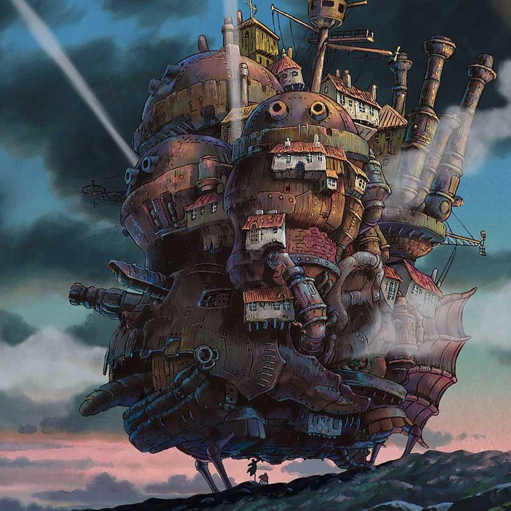

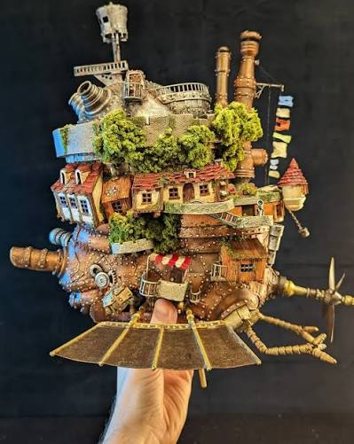

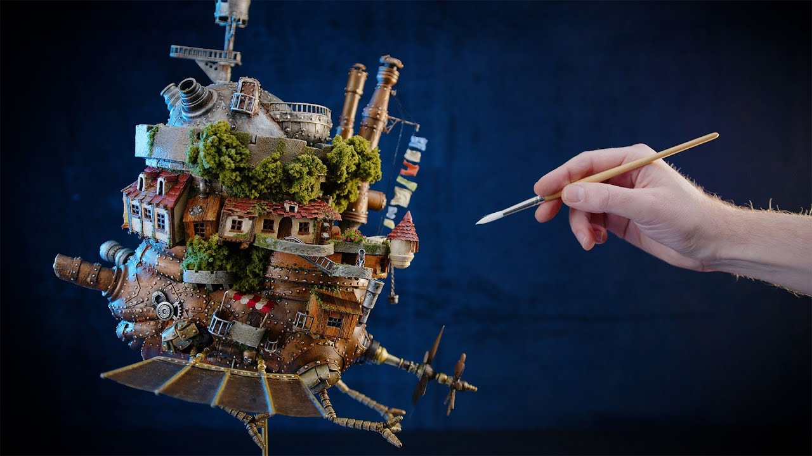

### Townscaper — Oskar Stålberg

Context-aware procedural architecture and geometry that adapts and responds to neighboring structures.

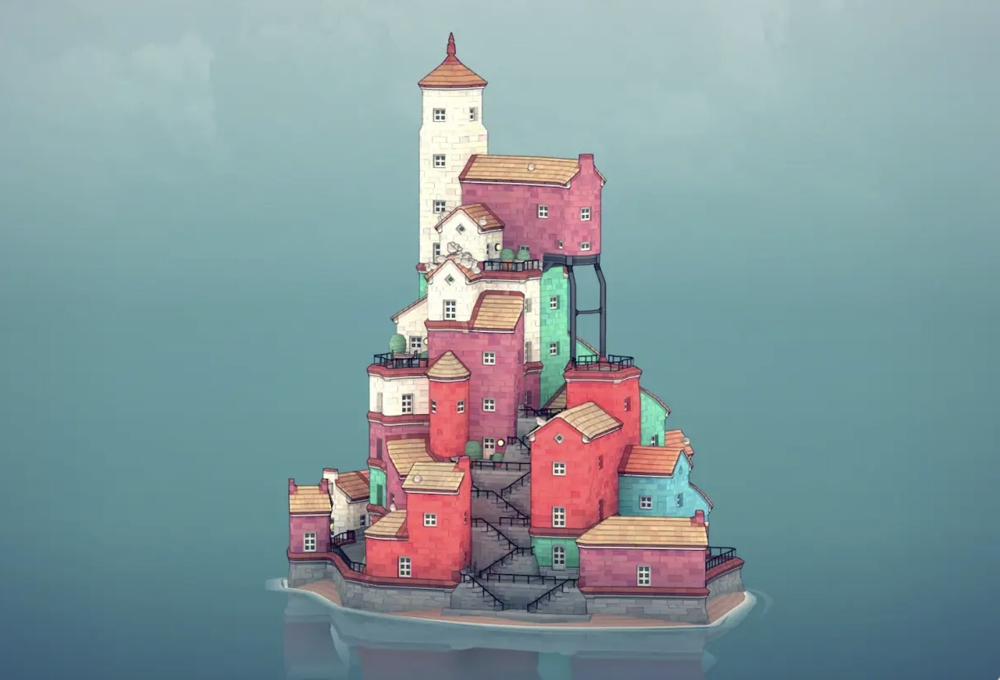

[Watch Townscaper Trailer](https://www.youtube.com/watch?v=hqq25n6cQqo)

### Inspiration Videos / Projects

- [Studson Studio — Making Howl's Moving Castle Out of Junk](https://www.youtube.com/watch?v=FDQ-sDDqWvk)
- [SideFX — Project Skylark Building Generator](https://www.sidefx.com/tutorials/project-skylark-building-generator/)

## Specification

### 1. Procedural House Population

- House-creature base (body).
- Artist-controlled number of attached houses (minimum of approximately 5), which serves as the base and "main" anchor for the rest of the assets that will form around them.
- Random selection from several premodeled house variants.
- Houses attach to eligible surfaces on the castle body, towers, and structural pipes. The definition of eligible will be art-directed.
- Adjustable placement distribution (like verticality, clustering, etc. that dictate where and how the houses are placed), orientation variation, scale variation, and random seed.
- Collision-aware placement to avoid bad intersections.
- Some constraint that makes sure each "side" of the creature-castle gets at least one house in most cases (just for art-direction purposes).

### 2. Adaptive Support Generation

- Each house contains predefined support attachment points (think about it like preset points on the house that attachments may shoot out from).
- Automatically find nearby valid support surfaces, without intersecting itself.
- Generate beams or braces connecting houses to the castle, and these supports adapt their length, orientation, and geometry as houses move or rotate. They will also adapt if there is another "better" structure to attach itself to that appears later.
- Evaluate support candidates based on distance, angle, and clearance.

### 3. Composition Controls

- **Verticality:** Controls whether attachments cluster toward the upper castle or spread across the body.
- **Clustering:** Controls how closely houses and other structures group together.
- **Rotation variation:** Controls the amount of irregularity in house orientations.
- **Random seed:** Generates different castle configurations with the same params.
- Adjusting parameters updates the generated arrangement and dependent geometry.

### 4. Secondary Procedural Population

- **Towers, pipes, ledges:** Independent population parameters and variations.
- **Vegetation:** Typically populates areas near houses, ledges, and other suitable surfaces.
- **Thingamajigs:** Artist-controlled density of thingamajig objects such as ladders, birdcages, signs, gears, house-attached railings, and lanterns, etc.
- Different object categories follow different placement and attachment rules.
- Premodeled decorative assets are instanced procedurally. Some assets are procedural (it'll depend on their need).
- Close assets (like houses close to each other, between a certain distance) may even be attached to each other, like with very simple pipes.

### 5. Possible Stretch Goals

- Actual textures.
- Slight animation.
- Castle age/personality presets:
  - **Baby:** Smaller, compact, upright components.
  - **Teenager:** Exaggerated proportions and jaunty angles.
  - **Adult:** Balanced default proportions.
  - **Elderly:** Slightly sagging or drooping structures.
- Composition scoring using some sort of heuristic to select visually appealing layouts.
- More advanced pipe routing and procedural connections.
- Additional house and decoration variations may be added.

## Techniques

- **Weighted random placement:** Distribute houses based on height, surface orientation, clustering, and artist-controlled parameters. Use weighted random sampling to select from eligible candidate points.

- **Collision detection and constraint checking:** Reject placements that intersect existing geo or violate attachment rules. Use bounding box intersection tests and rejection sampling, placing houses one at a time and retrying invalid placements.

- **Adaptive rotation and orientation:** Allow houses to tilt and rotate within specified angle limits to accommodate surrounding structures. Use surface normals for initial orientation, then test different rotations and score them based on collision clearance and attachment constraints.

- **Adaptive support generation:** Find suitable nearby anchor points and procedurally generate beams connecting houses to the castle, or "nearest valid structure" (like a thick tower). Use nearest-neighbor searches and heuristic scoring based on distance, angle, and intersection checks to select valid connections.

- **Context-aware asset placement:** Populate vegetation and decorations based on nearby geometry, available surfaces, and attachment rules. Use proximity-based scattering and surface normal checks, with different placement constraints for different asset types.

- **Procedural instancing:** Use Houdini VEX, Python, and SOPs to assemble premodeled assets with randomized variations. Use Copy to Points and point attributes to control asset selection, scale, and orientation.

### Time Savers

Most assets are pre-modeled (not procedural), but are rotate and slight-scale friendly. The base of the creature will only have maybe 1–2 variants of base-shapes, as the focus is on what's happening on top of it. Later on when the base shape is changed, the assets on top have to shuffle too, so it'll test the system.

### Technical References

- [SideFX — xyzdist()](https://www.sidefx.com/docs/houdini/vex/functions/xyzdist.html)
- [SideFX — intersect()](https://www.sidefx.com/docs/houdini/vex/functions/intersect.html)
- [Merrell et al. (2011) — Interactive Furniture Layout Using Interior Design Guidelines](https://graphics.eecs.berkeley.edu/papers/Merrell-IFL-2011-08/Merrell-IFL-2011-08.pdf)

## Design

### System Overview

The generator will consist of the following stages:

**1. Input Geometry**
- Central castle-house creature body and eligible structural surfaces.
- Premodeled house, tower, and decoration asset libraries.

**2. Candidate Surface Generation**
- Generate attachment points.
- Calculate surface normals, heights, and placement weights.

**3. House Placement Solver**
- Select house variants and candidate locations.
- Calculate transforms.
- Check collisions and attachment validity.
- Output accepted house placements. Repeat for each house.

**4. Adaptive Support Generator**
- Read house support preset locations.
- Search for valid support anchors (from preset to the anchor mesh).
- Generate connecting beams and brackets.

**5. Secondary Population Systems**
- Place towers and pipes with their own constraints and rules.
- Scatter vegetation near suitable architectural regions.
- Place miscellaneous decorations using attachment rules.

**6. Final Assembly**
- Merge generated geometry.
- Apply materials.
- Output the completed procedural castle.

### System Diagram

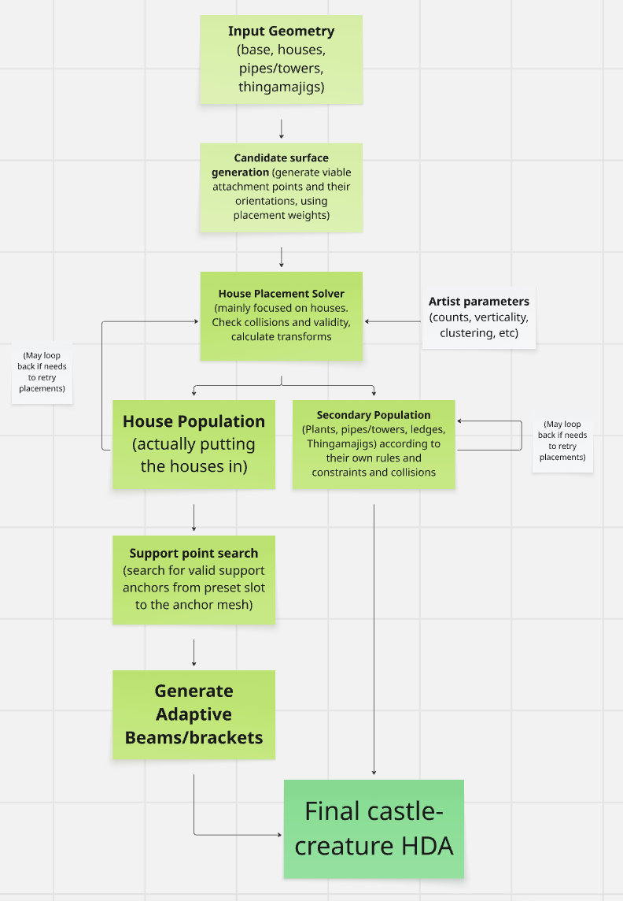

## Timeline

### Week 1: Nov 4 – Nov 11 (Milestone 1 Due Nov 11)

- Create the central castle body (actual model) and placeholder house/tower geometry.
- Implement candidate attachment point generation on the castle body and eligible structural surfaces.
- Implement weighted random placement using house count, verticality, rotation variation, and random seed.
- Implement collision-aware placement and retries.
- Implement an initial (can be crude) adaptive support system that connects houses to nearby valid surfaces.
- Set up basic HDA parameters and demonstrate procedural regeneration.
- Document progress and include screenshots of generated castle variations in the README.

### Week 2: Nov 11 – Nov 18

- House variants and pipes/towers model.
- Refine collision detection, attachment rules, and adaptive support generation.
- Integrate multiple house variants and structural tower/pipe assets.
- Implement secondary population systems for towers, pipes, vegetation, and miscellaneous decorations.

### Week 3: Nov 18 – Nov 25 (Milestone 2 Due Nov 23)

- Add context-aware placement rules, such as vegetation appearing near houses and decorations attaching to suitable surfaces.
- Finalize artist-facing parameters and test different combinations of house count, verticality, clustering, and random seeds.
- Fix bugs and ensure the generator works reliably across supported configurations.
- Document completed features, limitations, and any cuts in the README.

### Week 4-ish: Nov 25 – Nov 30 (Final Due Nov 30)

- Refine castle geometry, house variants, and decorative assets.
- Apply stylized materials, textures, and lighting, maybe.
- Tune procedural parameters to generate visually appealing castle variations.
- Improve the overall silhouette, composition, and whimsical aesthetic.
- Produce final renders, screenshots, and a demonstration of the HDA's procedural controls.
- Complete the final results and post-mortem sections of the README.
- Prepare the final class presentation.

### Stretch Goals

- Castle age/personality presets that influence proportions, angles, and structural posture.
- More advanced pipe routing and procedural connections.
- Heuristic composition scoring to select particularly appealing layouts.
- Additional architectural and decorative variations.

# Final Project!

This is it! The culmination of your procedural graphics experience this semester. For your final project, we'd like to give you the time and space to explore a topic of your choosing. You may choose any topic you please, so long as you vet the topic and scope with an instructor or TA. We've provided some suggestions below. The scope of your project should be roughly 1.5 homework assignments). To help structure your time, we're breaking down the project into 4 milestones:

## Project planning: Design Doc (due 11/4)
Before submitting your first milestone, _you must get your project idea and scope approved by Rachel, Adam or a TA._

### Design Doc
Start off by forking this repository. In your README, write a design doc to outline your project goals and implementation plan. It must include the following sections:

#### Introduction
- What motivates your project?

#### Goal
- What do you intend to achieve with this project?

#### Inspiration/reference:
- You must have some form of reference material for your final project. Your reference may be a research paper, a blog post, some artwork, a video, another class at Penn, etc.  
- Include in your design doc links to and images of your reference material.

#### Specification:
- Outline the main features of your project.

#### Techniques:
- What are the main technical/algorithmic tools you’ll be using? Give an overview, citing specific papers/articles.

#### Design:
- How will your program fit together? Make a simple free-body diagram illustrating the pieces.

#### Timeline:
- Create a week-by-week set of milestones for each person in your group. Make sure you explicitly outline what each group member's duties will be.

Submit your Design doc as usual via pull request against this repository.
## Milestone 1: Implementation part 1 (due 11/11)
Begin implementing your engine! Don't worry too much about polish or parameter tuning -- this week is about getting together the bulk of your generator implemented. By the end of the week, even if your visuals are crude, the majority of your generator's functionality should be done.

Put all your code in your forked repository.

Submission: Add a new section to your README titled: Milestone #1, which should include
- written description of progress on your project goals. If you haven't hit all your goals, what's giving you trouble?
- Examples of your generators output so far
We'll check your repository for updates. No need to create a new pull request.
## Milestone 2: Implementation part 2 (due 11/23)
We're over halfway there! This week should be about fixing bugs and extending the core of your generator. Make sure by the end of this week _your generator works and is feature complete._ Any core engine features that don't make it in this week should be cut! Don't worry if you haven't managed to exactly hit your goals. We're more interested in seeing proof of your development effort than knowing your planned everything perfectly. 

Put all your code in your forked repository.

Submission: Add a new section to your README titled: Milestone #3, which should include
- written description of progress on your project goals. If you haven't hit all your goals, what did you have to cut and why? 
- Detailed output from your generator, images, video, etc.
We'll check your repository for updates. No need to create a new pull request.

Come to class on the due date with a WORKING COPY of your project. We'll be spending time in class critiquing and reviewing your work so far.

## Final submission (due 11/30)
Time to polish! Spen this last week of your project using your generator to produce beautiful output. Add textures, tune parameters, play with colors, play with camera animation. Take the feedback from class critques and use it to take your project to the next level.

Submission:
- Push all your code / files to your repository
- Come to class ready to present your finished project
- Update your README with two sections 
  - final results with images and a live demo if possible
  - post mortem: how did your project go overall? Did you accomplish your goals? Did you have to pivot?

## Topic Suggestions

### Create a generator in Houdini

### A CLASSIC 4K DEMO
- In the spirit of the demo scene, create an animation that fits into a 4k executable that runs in real-time. Feel free to take inspiration from the many existing demos. Focus on efficiency and elegance in your implementation.
- Example: 
  - [cdak by Quite & orange](https://www.youtube.com/watch?v=RCh3Q08HMfs&list=PLA5E2FF8E143DA58C)

### A RE-IMPLEMENTATION
- Take an academic paper or other pre-existing project and implement it, or a portion of it.
- Examples:
  - [2D Wavefunction Collapse Pokémon Town](https://gurtd.github.io/566-final-project/)
  - [3D Wavefunction Collapse Dungeon Generator](https://github.com/whaoran0718/3dDungeonGeneration)
  - [Reaction Diffusion](https://github.com/charlesliwang/Reaction-Diffusion)
  - [WebGL Erosion](https://github.com/LanLou123/Webgl-Erosion)
  - [Particle Waterfall](https://github.com/chloele33/particle-waterfall)
  - [Voxelized Bread](https://github.com/ChiantiYZY/566-final)

### A FORGERY
Taking inspiration from a particular natural phenomenon or distinctive set of visuals, implement a detailed, procedural recreation of that aesthetic. This includes modeling, texturing and object placement within your scene. Does not need to be real-time. Focus on detail and visual accuracy in your implementation.
- Examples:
  - [The Shrines](https://github.com/byumjin/The-Shrines)
  - [Watercolor Shader](https://github.com/gracelgilbert/watercolor-stylization)
  - [Sunset Beach](https://github.com/HanmingZhang/homework-final)
  - [Sky Whales](https://github.com/WanruZhao/CIS566FinalProject)
  - [Snail](https://www.shadertoy.com/view/ld3Gz2)
  - [Journey](https://www.shadertoy.com/view/ldlcRf)
  - [Big Hero 6 Wormhole](https://2.bp.blogspot.com/-R-6AN2cWjwg/VTyIzIQSQfI/AAAAAAAABLA/GC0yzzz4wHw/s1600/big-hero-6-disneyscreencaps.com-10092.jpg)

### A GAME LEVEL
- Like generations of game makers before us, create a game which generates an navigable environment (eg. a roguelike dungeon, platforms) and some sort of goal or conflict (eg. enemy agents to avoid or items to collect). Aim to create an experience that will challenge players and vary noticeably in different playthroughs, whether that means procedural dungeon generation, careful resource management or an interesting AI model. Focus on designing a system that is capable of generating complex challenges and goals.
- Examples:
  - [Rhythm-based Mario Platformer](https://github.com/sgalban/platformer-gen-2D)
  - [Pokémon Ice Puzzle Generator](https://github.com/jwang5675/Ice-Puzzle-Generator)
  - [Abstract Exploratory Game](https://github.com/MauKMu/procedural-final-project)
  - [Tiny Wings](https://github.com/irovira/TinyWings)
  - Spore
  - Dwarf Fortress
  - Minecraft
  - Rogue

### AN ANIMATED ENVIRONMENT / MUSIC VISUALIZER
- Create an environment full of interactive procedural animation. The goal of this project is to create an environment that feels responsive and alive. Whether or not animations are musically-driven, sound should be an important component. Focus on user interactions, motion design and experimental interfaces.
- Examples:
  - [The Darkside](https://github.com/morganherrmann/thedarkside)
  - [Music Visualizer](https://yuruwang.github.io/MusicVisualizer/)
  - [Abstract Mesh Animation](https://github.com/mgriley/cis566_finalproj)
  - [Panoramical](https://www.youtube.com/watch?v=gBTTMNFXHTk)
  - [Bound](https://www.youtube.com/watch?v=aE37l6RvF-c)

### YOUR OWN PROPOSAL
- You are of course welcome to propose your own topic . Regardless of what you choose, you and your team must research your topic and relevant techniques and come up with a detailed plan of execution. You will meet with some subset of the procedural staff before starting implementation for approval.
