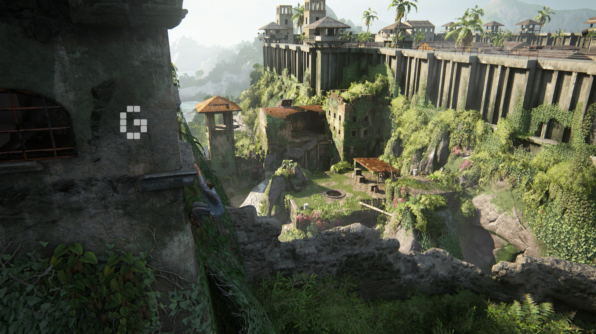
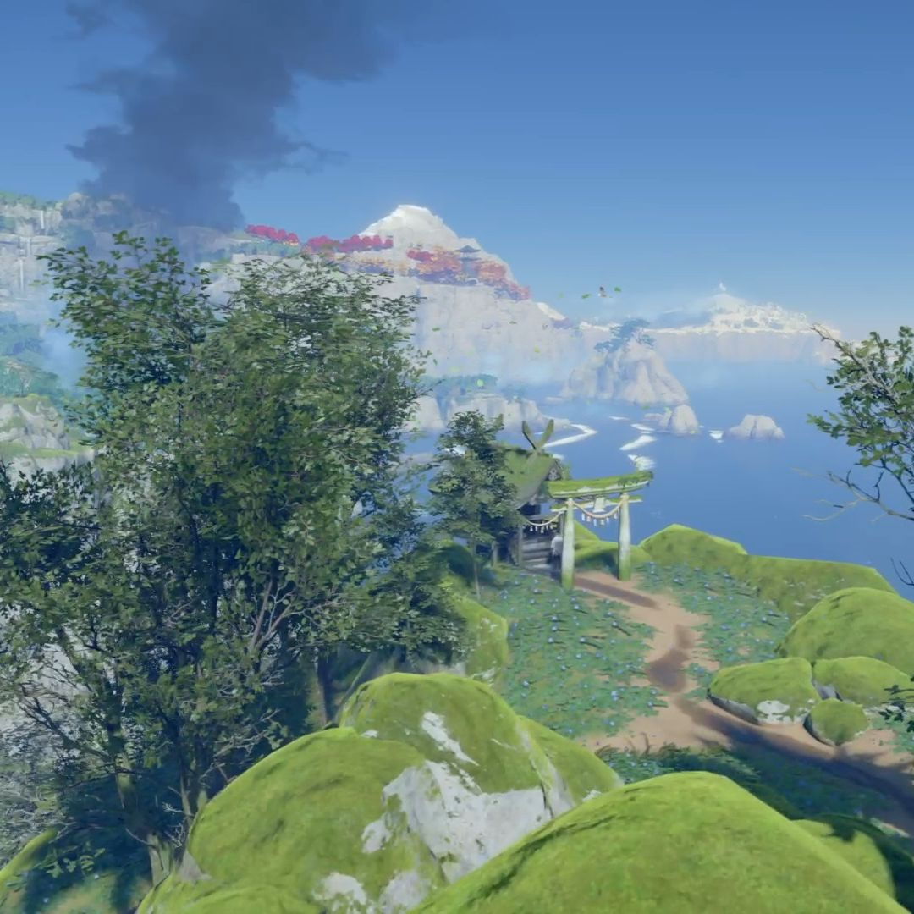
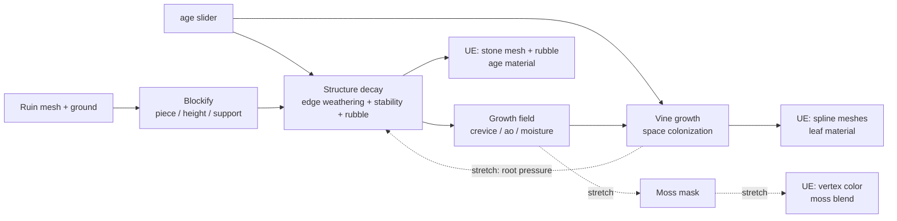

# Ruin Reclamation: a procedural environment-aging tool

CIS 5660 Final Project Design Doc

## Introduction

A tool that ages a stone ruin: given a clean structure and an `age` slider, edges weather, blocks fall, and vines grow into the gaps.

Decay comes first and plants follow it: the structure side outputs where the crevices and shaded, damp spots are, and the vegetation side grows there. Plants do not affect the structure in the core version.

## Goal

A Houdini Digital Asset, driven from Unreal Engine through Houdini Engine, that takes a block-based stone ruin and a single `age` parameter in \[0, 1\] and produces:

- a decayed version of the structure: weathered edges, blocks that fall out by a stability rule, rubble at the base
- a surface "growth field" (crevice, ambient occlusion, moisture) exported as point attributes
- vines grown from that field and rendered as spline meshes in UE
- (stretch) a moss mask derived from the same field, blended into the stone material

Dragging `age` in the UE editor regenerates the whole result. The deliverable is the HDA plus a short demo scene and video showing one ruin at five or six ages.

## Inspiration / reference

**Visual**

- Ta Prohm, Angkor (Cambodia): where vegetation settles on a ruin, in crevices and on shaded, lower courses.

  

  *Photo: Jerry Everard, [The Fog Watch](https://thefogwatch.com/cambodia-ta-prohm-angkor-treasure/).*

- Uncharted 4 and Shadow of the Tomb Raider overgrown ruin environments.

  

  *Image: [r/ACBFResynced on Reddit](https://www.reddit.com/r/ACBFResynced/comments/1x8rqly/shadow_of_the_tomb_raider_used_to_be_my_jungle/).*

- Ghost of Tsushima shrines: moss distribution by shade and moisture.

  

**Stone weathering and decay**

- Whiting, Ochsendorf, Durand, "Procedural Modeling of Structurally-Sound Masonry Buildings", SIGGRAPH Asia 2009. Block-level stability of unreinforced masonry; basis for our height / support stability heuristic.
- SideFX Houdini docs: RBD Material Fracture (brick mode), Labs Edge Damage, Occlusion SOP; Houdini Engine for Unreal.

**Plant growth**

- Runions, Lane, Prusinkiewicz, "Modeling Trees with a Space Colonization Algorithm", Eurographics NPH 2007.
- Hadrich, Benes, Deussen, Pirk, "Interactive Modeling and Authoring of Climbing Plants", Eurographics 2017. Climbing plants that attach to and follow surfaces, with gravity sag.
- SideFX ivy generator tutorials.

## Specification

**Input:** a stone ruin mesh made of individual blocks (each block its own piece, or an unsplit mesh that the tool voxel-splits into blocks on load), plus a ground plane.

**Core features**

1. Structure decay by `age`
   - Edge weathering: noise displacement weighted toward edges and upward faces
   - Block stability score from height and support from below; blocks below a threshold that rises with `age` are removed from the wall and placed on the ground as rubble (rule-based, no physics)
   - Stone material darkens with `age` in UE
   - Outputs per-point `crevice`, `ao`, `moisture` attributes for the vegetation step
2. Vine growth
   - Space colonization seeded from high-`crevice` / high-`moisture` points; branches follow the surface with a gravity sag; length and branching scale with `age`
   - Rendered in UE as spline meshes with a leaf material
3. UE integration
   - HDA exposed through Houdini Engine; `age` and a few style parameters on the actor; changing `age` recooks

**Plant / decay coupling.** One-way in the core: decay produces the growth field, plants read it, and plants have no effect on the structure. How the ruin collapses depends only on `age` and the stability rule. Feedback from plants to structure is listed under stretch.

**Stretch**

Stretch items are not ranked; in week 3 we pick whichever fits the remaining time, and only once all core features work.

- Moss mask = f(`ao`, `moisture`, distance to vine roots), grown with `age`, blended into the stone material
- Root-pressure feedback: vine root positions lower nearby block stability (`stability -= k * root_pressure`), so walls with vines fall first
- Block tilt / slide before falling
- Rain streaks and dirt accumulation on the stone
- Soil and leaf-litter burial of the lowest courses
- Leaf wind in UE
- Fly-through video with camera animation

**Cut list** (in order, if behind schedule): rubble fragments; real ruin asset (keep the procedural test asset); block tilt; root-pressure feedback; fixed vine branching instead of scaling with `age`.

## Techniques

### Test asset and blockifying (P1)

- Weeks 1-2: procedurally stacked test ruin (brick wall, a few columns, an arch) from grid-copied blocks
- Each block gets `piece` id, `height` (course index), `support` (blocks directly below), `edge` (end of wall)
- Week 3: swap in a real ruin asset; if it is one mesh, RBD Material Fracture (brick mode) splits it and the attributes are recomputed

### Edge weathering (P1)

- Noise displacement weighted by an edge mask (distance to sharp edges) and an exposure mask (upward-facing normals), scaled by `age`
- Same approach as Houdini Labs Edge Damage
- Stretch: rain streaks by accumulating "rain" downward along the surface; core only darkens the stone material with `age`

### Stability and collapse (P1)

- No physics solve; each block gets a stability score (Whiting et al. 2009 heuristic): lower for high courses, few supports, end-of-wall position
- Threshold rises with `age`; blocks below it leave the wall and are placed at the wall base as rubble with randomized rotation
- Deterministic and fast enough to recook interactively

### Growth field (P1, shared contract)

- `crevice` from curvature and edge distance
- `ao` from an Occlusion SOP
- `moisture` from height above ground, `ao` and facing
- Only interface between structure and vegetation; names agreed in week 1

### Vines (P2)

- Space colonization (Runions et al. 2007): attractors scattered on the surface weighted by `crevice` and `moisture`
- Growth nodes advance toward attractors, are projected back onto the surface each step, and sag with a gravity term (Hadrich et al. 2017)
- Growth budget scales with `age`; output polylines with a radius attribute

### UE integration (shared)

- HDA loaded through Houdini Engine for Unreal; `age` and style parameters on the actor
- Vines arrive as curves and are meshed with spline mesh components
- Weathering and moss arrive as vertex colors feeding a material layer blend

## Design

Everything left of UE runs inside one HDA. The growth field (`crevice`, `ao`, `moisture`) is the only contract between the structure side (P1) and the vegetation side (P2), so the two halves can be developed in parallel against a shared test asset.

## Timeline

P1 = structure (Anna), P2 = vegetation (Jacky).

*Revised 11/9: P1 is ahead of schedule, so the P1 column for weeks 2-3 is updated.*

| Week | Due | P1 (structure) | P2 (vegetation) | Shared |
| --- | --- | --- | --- | --- |
| 1 (11/4 - 11/11) | Milestone 1 | Blockify test asset; `height` / `support`; first stability score; edge weathering displacement (done early: rubble, HDA, growth field export) | Attractor scatter on surface; basic space colonization in Houdini; surface projection | Agree attribute contract (`crevice`, `ao`, `moisture`, `age`) |
| 2 (11/11 - 11/18) |  | Optional geometry input on the HDA; test asset gets a doorway, window and L-corner; stone darkening by `age` in UE (or render in Houdini if no license); first integration with P2 | Gravity sag, growth budget by `age`; vines exported as curves; spline mesh + leaf material in UE | UE round-trip with `age` exposed (pending license; fallback: render in Houdini); integrate both halves on the shared asset; all core features working end to end |
| 3 (11/18 - 11/23) | Milestone 2 | Block tilt before falling; rubble fragments (Voronoi-fracture some fallen blocks into 2-4 pieces); parameter cleanup; fix integration bugs; stretch: root-pressure feedback; real ruin asset only if all else is done | Vine density tuning; fix integration bugs; stretch only if core is done: moss mask | Feature freeze 11/23; working demo for class critique; anything not working by now is cut |
| 4 (11/23 - 11/30) | Final | Touch-ups from critique; tune decay parameters | Touch-ups from critique; tune vine look | Lighting, camera, video, README results and post mortem, presentation prep. No new features. |
